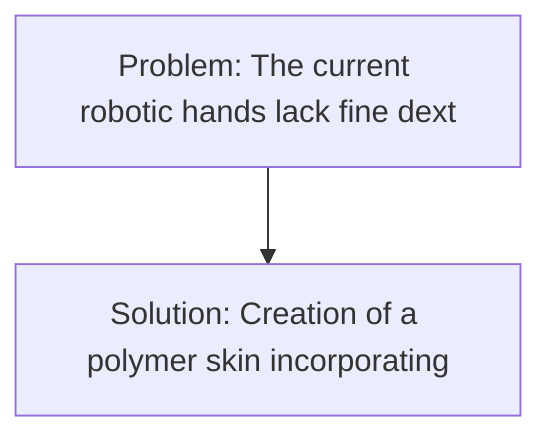
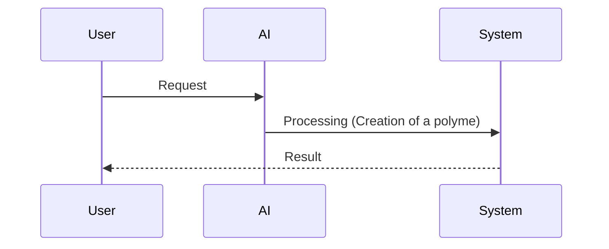

<!-- markdownlint-disable MD013 MD033 MD041 -->

[🇫🇷 Version Française](./README.fr.md)

# Neuromorphic Tactile Skin

> **Executive Summary:** A B2B solution targeting Manufacturers of humanoid robots (Tesla, Figure), automated logistics companies (Amazon), and advanced medical prosthetics designers. to solve the following problem: The current robotic hands lack fine dexterity because they rely mainly on computer vision, which suffers from occlusions. Existing tactile sensors generate volumes of continuous data that are too heavy to process in real time (latency) and are fragile. The approach relies on: Creation of a polymer "skin" incorporating thousands of micro-pressure and shear sensors, linked to a neuromorphic chip architecture (Spiking Neural Networks) that only transmits "events" of change (asynchronous), reducing latency to microsecond and energy consumption by 99%.

---

## 1. Visual Overview & Wow Effect

## 2. Contrarian Thesis (Peter Thiel Style)

- **Popular Belief:** A generic SaaS approach is sufficient.
- **Hidden Truth:** The bottlenecks lie in the classical von Neumann architecture and in the transmission of physical data. We need to invent new flexible materials, design dedicated neuromorphic ASICs, and write new learning paradigms (Spike Timing Dependent Plasticity) for motor control.

## 3. Problem & Target Market

- **Business Model:** B2B
- **Target Audience:** Manufacturers of humanoid robots (Tesla, Figure), automated logistics companies (Amazon), and advanced medical prosthetics designers.
- **Urgent Pain Point:** The current robotic hands lack fine dexterity because they rely mainly on computer vision, which suffers from occlusions. Existing tactile sensors generate volumes of continuous data that are too heavy to process in real time (latency) and are fragile.

## 4. Technical Architecture & Infrastructure

Creation of a polymer "skin" incorporating thousands of micro-pressure and shear sensors, linked to a neuromorphic chip architecture (Spiking Neural Networks) that only transmits "events" of change (asynchronous), reducing latency to microsecond and energy consumption by 99%.

## 5. Business Model & Financial Viability

| Metric                 | Value                              |
| ---------------------- | ---------------------------------- |
| Pricing Structure      | B2B Subscription / License         |
| 12-Month Target        | 100 clients (or equivalent volume) |
| Revenue Formula        | 100 \* 1000€ = 100k€               |
| Estimated Gross Margin | 80%                                |

## 6. Distribution Engine & Moat

- **Acquisition Strategy:** Direct sales and partnerships in the domain: Robotics & Embedded Systems
- **Moat (Defensibility):** The bottlenecks lie in the classical von Neumann architecture and in the transmission of physical data. We need to invent new flexible materials, design dedicated neuromorphic ASICs, and write new learning paradigms (Spike Timing Dependent Plasticity) for motor control. Risks include: Manufacturing complexity (integration of hard chips on stretchable substrates), material life under millions of deformation cycles, difficulty standardizing interface with existing robotic OS (ROS).

## 7. Detailed Evaluation Grid

| Criterion                   | VC Score (/100) | Market Score (/100) |
| --------------------------- | --------------- | ------------------- |
| Thesis & Monopoly / Urgency | -- / 25         | -- / 25             |
| Moat / LLM Immunity         | -- / 25         | -- / 25             |
| Scalability / UX Friction   | -- / 25         | -- / 25             |
| Unit Economics / ROI        | -- / 25         | -- / 25             |
| **TOTAL**                   | -- / 100        | -- / 100            |

> **VC Verdict:** Pending evaluation.
> **Market Verdict:** Pending evaluation.
