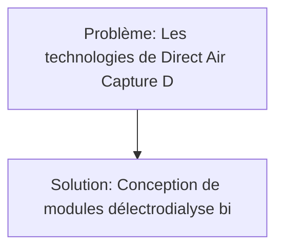
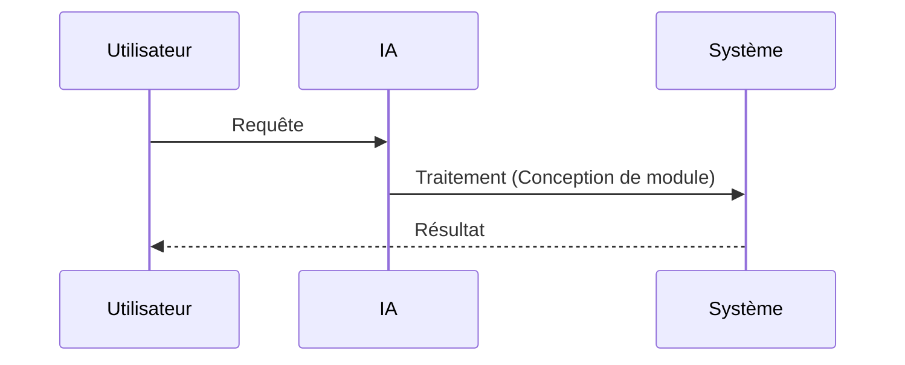

<!-- markdownlint-disable MD013 MD033 MD041 -->

[🇬🇧 English Version](./README.md)

# Ocean CO2 Electrodialysis

> **Résumé exécutif :** Une solution B2B (Marchés du carbone) / B2G ciblant Entreprises technologiques achetant des crédits carbone haute qualité (Microsoft, Stripe), gouvernements, et industries lourdes cherchant à compenser leurs émissions résiduelles. pour résoudre le problème suivant : Les technologies de Direct Air Capture (DAC) sont extrêmement énergivores en raison de la faible concentration de CO2 dans l'air (400 ppm). L'océan contient 150 fois plus de CO2 par volume que l'air, mais son extraction est historiquement coûteuse et complexe. L'approche repose sur : Conception de modules d'électrodialyse bipolaire à flux continu, intégrés aux infrastructures existantes (usines de dessalement, plateformes offshore), pour acidifier localement l'eau de mer, dégazer le CO2 de manière ultra-efficace avec des membranes sélectives avancées, puis relâcher une eau neutralisée (luttant contre l'acidification des océans).

---

## 1. Aperçu visuel & Effet Wahou

## 2. La thèse contrariante (Peter Thiel Style)

- **La croyance populaire :** Une approche générique SaaS classique est suffisante.
- **La vérité cachée :** C'est un défi de chimie des matériaux (membranes d'échange ionique) et d'ingénierie des procédés. La capture du carbone nécessite des infrastructures physiques lourdes, une optimisation électrochimique fine et une gestion de la corrosion marine, loin des capacités d'un logiciel.

## 3. Le problème & La cible

- **Modèle économique :** B2B (Marchés du carbone) / B2G
- **Cible précise :** Entreprises technologiques achetant des crédits carbone haute qualité (Microsoft, Stripe), gouvernements, et industries lourdes cherchant à compenser leurs émissions résiduelles.
- **La douleur urgente :** Les technologies de Direct Air Capture (DAC) sont extrêmement énergivores en raison de la faible concentration de CO2 dans l'air (400 ppm). L'océan contient 150 fois plus de CO2 par volume que l'air, mais son extraction est historiquement coûteuse et complexe.

## 4. Architecture technique & Plomberie

Conception de modules d'électrodialyse bipolaire à flux continu, intégrés aux infrastructures existantes (usines de dessalement, plateformes offshore), pour acidifier localement l'eau de mer, dégazer le CO2 de manière ultra-efficace avec des membranes sélectives avancées, puis relâcher une eau neutralisée (luttant contre l'acidification des océans).

## 5. Modèle économique & Viabilité financière

| Métrique                    | Valeur                                              |
| --------------------------- | --------------------------------------------------- |
| Structure de prix           | Abonnement / Licence B2B (Marchés du carbone) / B2G |
| Objectif 12 mois            | 100 clients (ou volume équivalent)                  |
| Calcul du CA (Target 100k€) | 100 \* 1000€ = 100k€                                |
| Marge brute estimée         | 80%                                                 |

## 6. Moteur de distribution & Fossé défensif (Moat)

- **Stratégie d'acquisition :** Ventes directes et partenariats dans le domaine : ClimateTech & Énergie
- **Moat (Barrière à l'entrée) :** C'est un défi de chimie des matériaux (membranes d'échange ionique) et d'ingénierie des procédés. La capture du carbone nécessite des infrastructures physiques lourdes, une optimisation électrochimique fine et une gestion de la corrosion marine, loin des capacités d'un logiciel. Les risques incluent : Durabilité et encrassement biologique (biofouling) des membranes, coût de l'énergie électrique requise (besoin d'énergies renouvelables dédiées), impact environnemental local des variations de pH sur les écosystèmes marins côtiers.

## 7. Grille d'évaluation détaillée

| Critère                           | Score VC (/100) | Score Terrain (/100) |
| --------------------------------- | --------------- | -------------------- |
| Thèse & Monopole / Urgence        | -- / 25         | -- / 25              |
| Moat / Résistance aux LLM natifs  | -- / 25         | -- / 25              |
| Scalabilité / Friction d'adoption | -- / 25         | -- / 25              |
| Unit Economics / ROI direct       | -- / 25         | -- / 25              |
| **TOTAL**                         | -- / 100        | -- / 100             |

> **Verdict VC :** En attente d'évaluation.
> **Verdict Terrain :** En attente d'évaluation.
