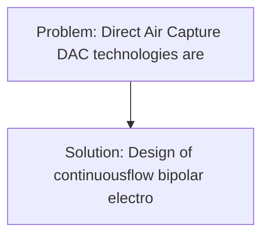
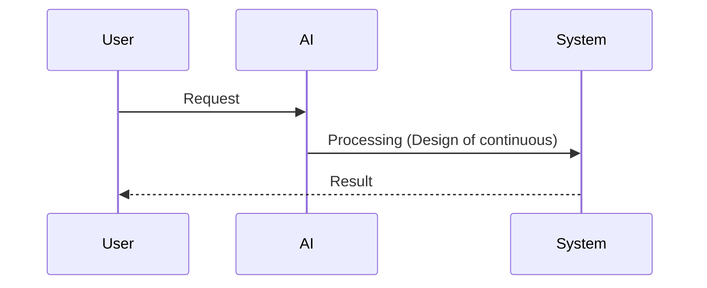

<!-- markdownlint-disable MD013 MD033 MD041 -->

[🇫🇷 Version Française](./README.fr.md)

# Ocean CO2 Electrodialysis

> **Executive Summary:** A B2B (Marchés du carbone) / B2G solution targeting Technology companies buying high quality carbon credits (Microsoft, Stripe), governments, and heavy industries seeking to offset their residual emissions. to solve the following problem: Direct Air Capture (DAC) technologies are extremely energy efficient because of the low CO2 concentration in the air (400 ppm). The ocean contains 150 times more CO2 per volume than air, but its extraction is historically expensive and complex. The approach relies on: Design of continuous-flow bipolar electrodialysis modules, integrated with existing infrastructures (desalination plants, offshore platforms), to acidify sea water locally, degass CO2 in an ultra-efficient way with advanced selective membranes, and then release neutralized water (combating ocean acidification).

---

## 1. Visual Overview & Wow Effect

## 2. Contrarian Thesis (Peter Thiel Style)

- **Popular Belief:** A generic SaaS approach is sufficient.
- **Hidden Truth:** It is a challenge of material chemistry (ion exchange membranes) and process engineering. Carbon capture requires heavy physical infrastructure, fine electrochemical optimization and marine corrosion management, far from software capabilities.

## 3. Problem & Target Market

- **Business Model:** B2B (Marchés du carbone) / B2G
- **Target Audience:** Technology companies buying high quality carbon credits (Microsoft, Stripe), governments, and heavy industries seeking to offset their residual emissions.
- **Urgent Pain Point:** Direct Air Capture (DAC) technologies are extremely energy efficient because of the low CO2 concentration in the air (400 ppm). The ocean contains 150 times more CO2 per volume than air, but its extraction is historically expensive and complex.

## 4. Technical Architecture & Infrastructure

Design of continuous-flow bipolar electrodialysis modules, integrated with existing infrastructures (desalination plants, offshore platforms), to acidify sea water locally, degass CO2 in an ultra-efficient way with advanced selective membranes, and then release neutralized water (combating ocean acidification).

## 5. Business Model & Financial Viability

| Metric                 | Value                                                 |
| ---------------------- | ----------------------------------------------------- |
| Pricing Structure      | B2B (Marchés du carbone) / B2G Subscription / License |
| 12-Month Target        | 100 clients (or equivalent volume)                    |
| Revenue Formula        | 100 \* 1000€ = 100k€                                  |
| Estimated Gross Margin | 80%                                                   |

## 6. Distribution Engine & Moat

- **Acquisition Strategy:** Direct sales and partnerships in the domain: ClimateTech & Energy
- **Moat (Defensibility):** It is a challenge of material chemistry (ion exchange membranes) and process engineering. Carbon capture requires heavy physical infrastructure, fine electrochemical optimization and marine corrosion management, far from software capabilities. Risks include: Sustainability and biological soiling (biofouling) of membranes, cost of electrical energy required (need for dedicated renewable energies), local environmental impact of pH variations on coastal marine ecosystems.

## 7. Detailed Evaluation Grid

| Criterion                   | VC Score (/100) | Market Score (/100) |
| --------------------------- | --------------- | ------------------- |
| Thesis & Monopoly / Urgency | -- / 25         | -- / 25             |
| Moat / LLM Immunity         | -- / 25         | -- / 25             |
| Scalability / UX Friction   | -- / 25         | -- / 25             |
| Unit Economics / ROI        | -- / 25         | -- / 25             |
| **TOTAL**                   | -- / 100        | -- / 100            |

> **VC Verdict:** Pending evaluation.
> **Market Verdict:** Pending evaluation.
