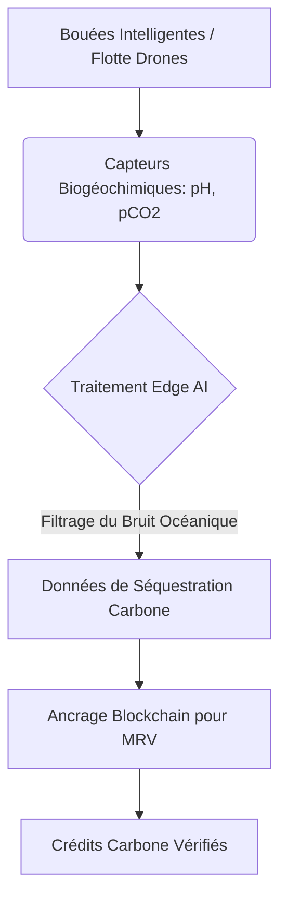
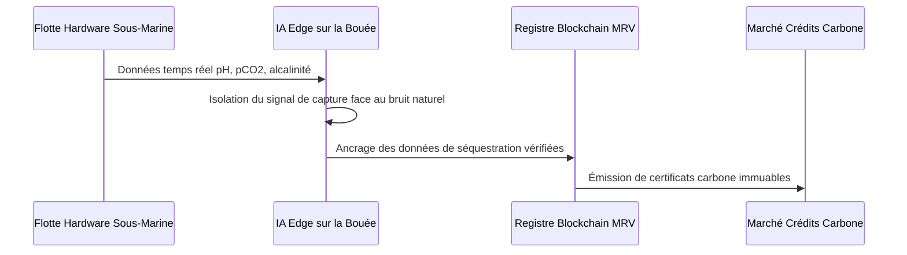

<!-- markdownlint-disable MD009 MD010 MD013 MD022 MD028 MD032 MD033 MD034 MD036 MD037 MD039 MD041 MD058 MD060 -->
[ 🇬🇧 English Version ](./README.md)

# Ocean MRV Sensor Network

> **Résumé exécutif :** Un réseau de capteurs sous-marins autonomes couplant capteurs biogéochimiques et Edge AI pour fournir des mesures vérifiables (MRV) de l'élimination du carbone marin (mCDR).

---

## 1. Aperçu visuel & Effet Wahou

## 2. La thèse contrariante (Peter Thiel Style)

**La croyance populaire :** Les crédits carbone peuvent être vérifiés avec de l'imagerie satellite et des modèles statistiques de croissance des arbres.

**La vérité cachée :** Le plus grand puits de carbone est l'océan, et la chimie des profondeurs ne se mesure pas depuis l'espace. Le véritable marché du retrait carbone exige du matériel robuste—des capteurs anti-corrosion en milieux extrêmes associés à une IA de dynamique des fluides—et non de simples plateformes SaaS.

## 3. Le problème & La cible

**Modèle économique :** B2B

**Cible précise :** Start-ups de l'élimination du dioxyde de carbone océanique (mCDR), marchés de crédits carbone, gouvernements, certificateurs environnementaux.

**La douleur urgente :** Sans processus MRV (Measurement, Reporting, and Verification) précis et auditable prouvant la séquestration permanente, les crédits carbone marins ne peuvent être vendus à grande échelle en raison des risques de greenwashing.

## 4. Architecture technique & Plomberie

## 5. Modèle économique & Viabilité financière

| Métrique | Valeur |
|---|---|
| Structure de prix | Location Hardware + Abonnement par hectare monitoré |
| Objectif 12 mois | 5 projets pilotes de start-ups mCDR |
| Calcul du CA (Target 100k€) | 5 projets × 20 000 €/an = 100 000 € ARR |
| Marge brute estimée | 60% (Forte intensité capitalistique hardware) |

## 6. Moteur de distribution & Fossé défensif (Moat)

**Stratégie d'acquisition :** Partenariats directs avec les startups mCDR émergentes pour agir comme leur couche de validation fondamentale, les aidant à sécuriser leurs premières ventes majeures de crédits carbone.

**Moat (Barrière à l'entrée) :** Intégration hardware profonde. Faire fonctionner des capteurs chimiques de haute précision dans un environnement marin corrosif à haute pression tout en gérant le biofouling (algues/coquillages) est extrêmement complexe. Les logiciels SaaS ne peuvent combler ce fossé physique.

## 7. Grille d'évaluation détaillée

| Critère | Score VC (/100) | Score Terrain (/100) |
|---|---|---|
| Thèse & Monopole / Urgence | -- / 25 | -- / 25 |
| Moat / Résistance aux LLM natifs | -- / 25 | -- / 25 |
| Scalabilité / Friction d'adoption | -- / 25 | -- / 25 |
| Unit Economics / ROI direct | -- / 25 | -- / 25 |
| **TOTAL** | **-- / 100** | **-- / 100** |

> **Verdict VC :** En attente d'évaluation.

> **Verdict Terrain :** En attente d'évaluation.
