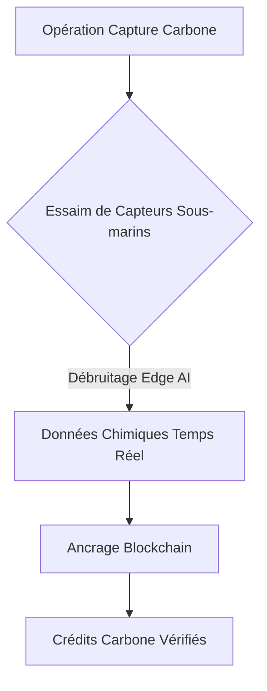
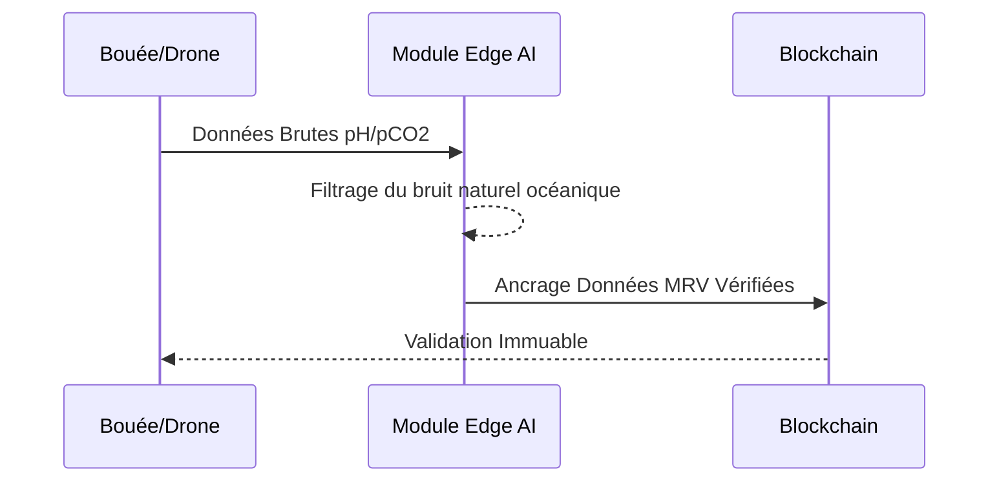

<!-- markdownlint-disable MD009 MD010 MD013 MD022 MD028 MD032 MD033 MD034 MD036 MD037 MD039 MD041 MD058 MD060 -->
[ 🇬🇧 English Version ](./README.md)

# Ocean MRV Sensor Network

> **Résumé exécutif :** Un réseau de capteurs sous-marins autonomes avec Edge AI fournissant un suivi MRV immuable pour l'élimination du carbone océanique.

---

## 1. Aperçu visuel & Effet Wahou

## 2. La thèse contrariante (Peter Thiel Style)

**La croyance populaire :** Les crédits carbone peuvent être vérifiés via des images satellites et des SaaS classiques.

**La vérité cachée :** L'océan est un environnement chimique 3D complexe. Le logiciel ne peut pas deviner la chimie ; un MRV océanique précis nécessite du matériel résistant à la corrosion déployé in situ.

## 3. Le problème & La cible

**Modèle économique :** B2B

**Cible précise :** Start-ups mCDR, marchés de crédits carbone, certificateurs (Verra).

**La douleur urgente :** Sans preuve (MRV) précise et auditable de la séquestration du CO2, les crédits marins sont invendables par peur du greenwashing.

## 4. Architecture technique & Plomberie

## 5. Modèle économique & Viabilité financière

| Métrique | Valeur |
| --- | --- |
| Structure de prix | Location matériel + Abonnement Data MRV |
| Objectif 12 mois | 10 déploiements mCDR |
| Calcul du CA (Target 100k€) | 10 flottes * 10k€/mois = 1.2M€ ARR |
| Marge brute estimée | 60% (Hardware CapEx lourd) |

## 6. Moteur de distribution & Fossé défensif (Moat)

**Stratégie d'acquisition :** Partenariat avec les startups mCDR (alcalinisation, algues) ayant besoin de certification.

**Moat (Barrière à l'entrée) :** Hardware complexe (pression, biofouling, corrosion) mêlé à de la data science océanographique. Les LLM ne peuvent résoudre ce défi matériel.

## 7. Grille d'évaluation détaillée

| Critère | Score VC (/100) | Score Terrain (/100) |
| :--- | :---: | :---: |
| Thèse & Monopole / Urgence | -- / 25 | -- / 25 |
| Moat / Résistance aux LLM natifs | -- / 25 | -- / 25 |
| Scalabilité / Friction d'adoption | -- / 25 | -- / 25 |
| Unit Economics / ROI direct | -- / 25 | -- / 25 |
| **TOTAL** | **-- / 100** | **-- / 100** |

> **Verdict VC :** En attente d'évaluation.
>
> **Verdict Terrain :** En attente d'évaluation.
