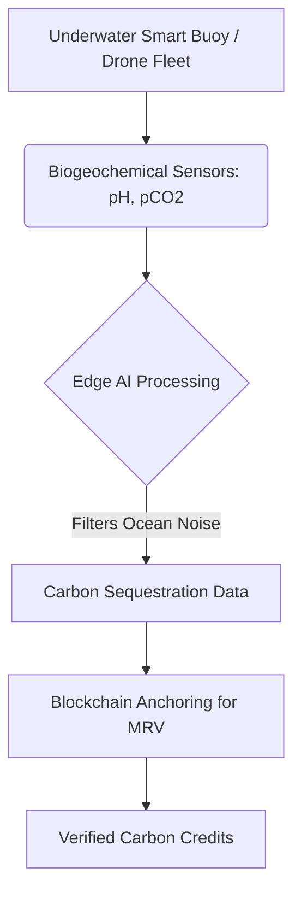
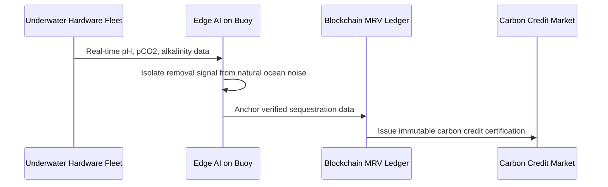

<!-- markdownlint-disable MD009 MD010 MD013 MD022 MD028 MD032 MD033 MD034 MD036 MD037 MD039 MD041 MD058 MD060 -->
[ 🇫🇷 Version Française ](./README.fr.md)

# Ocean MRV Sensor Network

> **Executive Summary:** An autonomous underwater sensor network combining biogeochemical sensors and Edge AI to provide auditable Measurement, Reporting, and Verification (MRV) for marine carbon dioxide removal (mCDR).

---

## 1. Visual Overview & Wow Effect

## 2. Contrarian Thesis (Peter Thiel Style)

**Popular Belief:** Carbon credits can be verified using satellite imagery and statistical models of tree growth.

**Hidden Truth:** The largest carbon sink is the ocean, and you can't measure deep ocean chemistry from space. True carbon removal markets require hard tech—corrosion-resistant sensors deployed in extreme underwater environments combined with advanced fluid dynamics AI—not just software platforms.

## 3. Problem & Target Market

**Business Model:** B2B

**Target Audience:** Marine Carbon Dioxide Removal (mCDR) startups, carbon credit markets, governments, environmental certifiers (Verra, Gold Standard).

**Urgent Pain Point:** Startups are developing methods to accelerate ocean carbon capture, but without precise, auditable Measurement, Reporting, and Verification (MRV) proving permanent sequestration, marine carbon credits cannot be sold at scale (due to greenwashing risks).

## 4. Technical Architecture & Infrastructure

## 5. Business Model & Financial Viability

| Metric | Value |
|---|---|
| Pricing Structure | Hardware Lease + Subscription per hectare monitored |
| 12-Month Target | 5 mCDR startup pilots monitoring distinct ocean zones |
| Revenue Formula | 5 pilots × €20,000/year = €100,000 ARR |
| Estimated Gross Margin | 60% (Hardware CapEx intensive) |

## 6. Distribution Engine & Moat

**Acquisition Strategy:** Partnering directly with early-stage mCDR startups to act as their foundational validation layer to help them secure their first major carbon credit sales.

**Moat (Defensibility):** Deep hardware integration. Operating high-precision chemical sensors in corrosive, high-pressure marine environments while managing biofouling is incredibly difficult. Pure software SaaS competitors cannot bridge the gap to physical reality.

## 7. Detailed Evaluation Grid

| Criterion | VC Score (/100) | Market Score (/100) |
|---|---|---|
| Thesis & Monopoly / Urgency | -- / 25 | -- / 25 |
| Moat / LLM Immunity | -- / 25 | -- / 25 |
| Scalability / UX Friction | -- / 25 | -- / 25 |
| Unit Economics / ROI | -- / 25 | -- / 25 |
| **TOTAL** | **-- / 100** | **-- / 100** |

> **VC Verdict:** Pending evaluation.

> **Market Verdict:** Pending evaluation.
