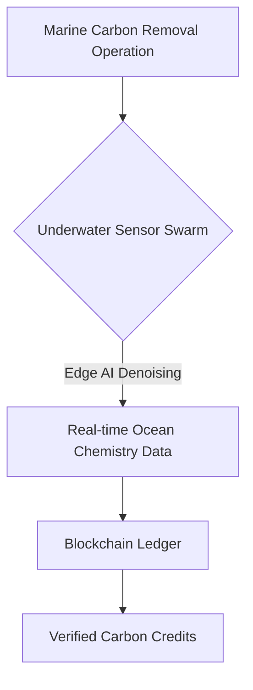
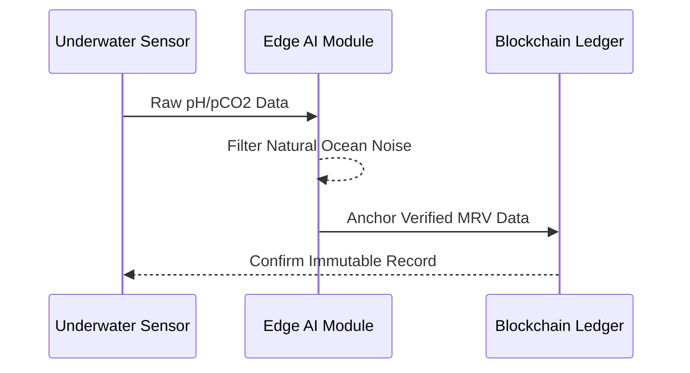

<!-- markdownlint-disable MD009 MD010 MD013 MD022 MD028 MD032 MD033 MD034 MD036 MD037 MD039 MD041 MD058 MD060 -->
[ 🇫🇷 Version Française ](./README.fr.md)

# Ocean MRV Sensor Network

> **Executive Summary:** An autonomous underwater sensor network with edge AI providing immutable Measurement, Reporting, and Verification (MRV) for marine carbon dioxide removal.

---

## 1. Visual Overview & Wow Effect

## 2. Contrarian Thesis (Peter Thiel Style)

**Popular Belief:** Carbon credits can be verified via satellite imagery and simple software models.

**Hidden Truth:** The ocean is a massive, dynamic 3D chemical environment. Software cannot guess ocean chemistry; accurate marine MRV requires heavily specialized, corrosion-resistant hardware deployed in-situ to prevent greenwashing.

## 3. Problem & Target Market

**Business Model:** B2B

**Target Audience:** Marine CDR (mCDR) startups, carbon credit markets, environmental certifiers (Verra).

**Urgent Pain Point:** It is nearly impossible to prove exactly how much CO2 has been permanently sequestered in the ocean. Without accurate MRV, marine carbon credits cannot be sold at scale.

## 4. Technical Architecture & Infrastructure

## 5. Business Model & Financial Viability

| Metric | Value |
| --- | --- |
| Pricing Structure | Hardware Leasing + MRV Data Subscription |
| 12-Month Target | 10 mCDR Deployments |
| Revenue Formula | 10 deployments * 10k€/month = 1.2M€ ARR |
| Estimated Gross Margin | 60% (Hardware-heavy) |

## 6. Distribution Engine & Moat

**Acquisition Strategy:** Direct partnerships with mCDR startups needing verification to unlock their own revenue.

**Moat (Defensibility):** Hard tech challenge involving deep ocean fluid dynamics, water chemistry, and edge computing in high-pressure, highly corrosive environments.

## 7. Detailed Evaluation Grid

| Criterion | VC Score (/100) | Market Score (/100) |
| :--- | :---: | :---: |
| Thesis & Monopoly / Urgency | -- / 25 | -- / 25 |
| Moat / LLM Immunity | -- / 25 | -- / 25 |
| Scalability / UX Friction | -- / 25 | -- / 25 |
| Unit Economics / ROI | -- / 25 | -- / 25 |
| **TOTAL** | **-- / 100** | **-- / 100** |

> **VC Verdict:** Pending evaluation.
>
> **Market Verdict:** Pending evaluation.
