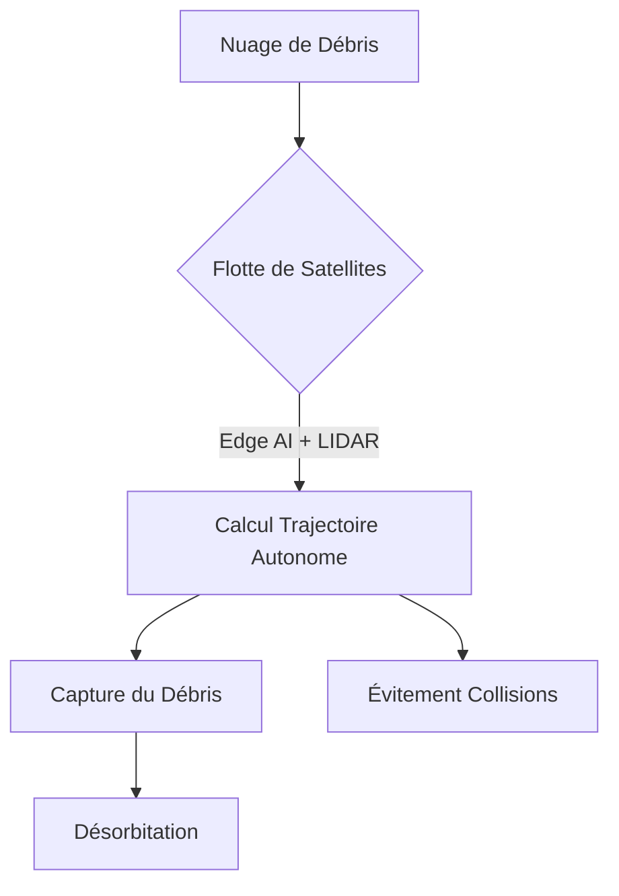
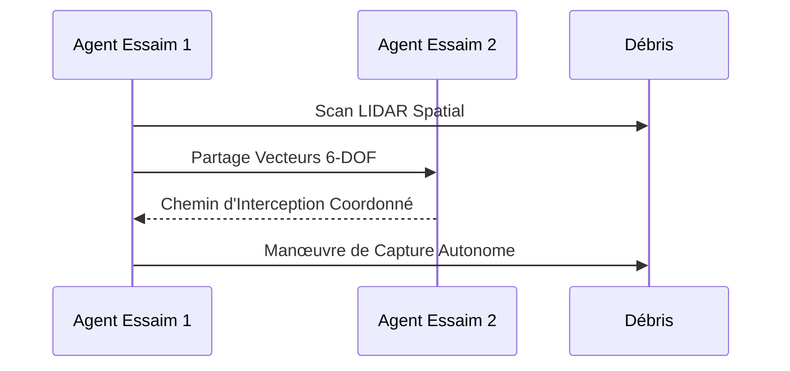

<!-- markdownlint-disable MD009 MD010 MD013 MD022 MD028 MD032 MD033 MD034 MD036 MD037 MD039 MD041 MD058 MD060 -->
[ 🇬🇧 English Version ](./README.md)

# Orbital Debris Swarm Nav

> **Résumé exécutif :** Un système de navigation décentralisé pour flottes de micro-satellites utilisant l'Edge AI pour capturer les débris spatiaux sans dépendre des commandes terrestres latentes.

---

## 1. Aperçu visuel & Effet Wahou

## 2. La thèse contrariante (Peter Thiel Style)

**La croyance populaire :** Le nettoyage spatial nécessite des robots unitaires coûteux télécommandés depuis la Terre.

**La vérité cachée :** La latence terrestre est mortelle ; le nettoyage doit être délégué à des essaims autonomes peu coûteux capables de calculs physiques multi-agents en temps réel en orbite.

## 3. Le problème & La cible

**Modèle économique :** B2B / B2G

**Cible précise :** Agences spatiales, opérateurs de méga-constellations, assurances spatiales.

**La douleur urgente :** Le Syndrome de Kessler menace l'orbite basse. Les missions de nettoyage actuelles sont trop lentes, chères et risquent d'aggraver le problème en cas de collision lors de la capture.

## 4. Architecture technique & Plomberie

## 5. Modèle économique & Viabilité financière

| Métrique | Valeur |
| --- | --- |
| Structure de prix | Contrat par capture + Licence Logicielle Essaim |
| Objectif 12 mois | 2 missions pilotes (Agences Spatiales) |
| Calcul du CA (Target 100k€) | 2 contrats * 600k€ = 1.2M€ ARR |
| Marge brute estimée | 70% |

## 6. Moteur de distribution & Fossé défensif (Moat)

**Stratégie d'acquisition :** Contrats B2G (ESA/NASA) et protection de flottes privées.

**Moat (Barrière à l'entrée) :** Calcul 6-DOF en microgravité à 28 000 km/h avec contraintes de carburant extrêmes. Inaccessible pour un IA/LLM classique. Coût de PoC en orbite très élevé.

## 7. Grille d'évaluation détaillée

| Critère | Score VC (/100) | Score Terrain (/100) |
| :--- | :---: | :---: |
| Thèse & Monopole / Urgence | -- / 25 | -- / 25 |
| Moat / Résistance aux LLM natifs | -- / 25 | -- / 25 |
| Scalabilité / Friction d'adoption | -- / 25 | -- / 25 |
| Unit Economics / ROI direct | -- / 25 | -- / 25 |
| **TOTAL** | **-- / 100** | **-- / 100** |

> **Verdict VC :** En attente d'évaluation.
>
> **Verdict Terrain :** En attente d'évaluation.
