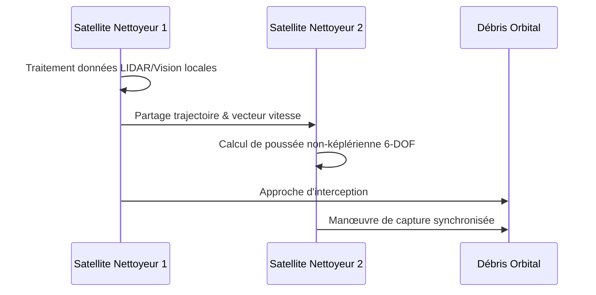

<!-- markdownlint-disable MD009 MD010 MD013 MD022 MD028 MD032 MD033 MD034 MD036 MD037 MD039 MD041 MD058 MD060 -->
[ 🇬🇧 English Version ](./README.md)

# Orbital Debris Swarm Nav

> **Résumé exécutif :** Un système de navigation décentralisée Edge AI pour essaims de micro-satellites, permettant l'évitement autonome de collisions et la capture coordonnée de débris sans commandes terrestres à haute latence.


---

## 1. Aperçu visuel & Effet Wahou

```mermaid
graph TD
    A[Contrôle Terrestre (Haute Latence)] -.-x B(Swarm Nav Edge AI)
    B --> C{Calcul Orbital 6-DOF Autonome}
    C --> D[Satellite Nettoyeur 1]
    C --> E[Satellite Nettoyeur 2]
    D & E --> F[Capture Coordonnée du Débris]
    D <-->|Comm. Inter-satellite| E
```

## 2. La thèse contrariante (Peter Thiel Style)

**La croyance populaire :** Le nettoyage des débris spatiaux requiert d'énormes robots spatiaux unitaires et coûteux, pilotés directement depuis la Terre.

**La vérité cachée :** Le Syndrome de Kessler ne peut être résolu que par des essaims décentralisés et peu coûteux agissant de manière autonome. La latence Terre-Orbite rend la capture cinétique en temps réel de cibles multiples mathématiquement impossible pour un opérateur humain ; l'intelligence doit résider directement en orbite.

## 3. Le problème & La cible

**Modèle économique :** B2B / B2G

**Cible précise :** Agences spatiales (ESA, NASA, JAXA), opérateurs de méga-constellations (Starlink, Kuiper), entreprises d'assurance spatiale.

**La douleur urgente :** L'orbite basse (LEO) est saturée. Un seul débris millimétrique peut détruire un satellite valant des millions. Les missions prévues impliquent des robots unitaires lents et limités par la latence. Une collision en chaîne lors du nettoyage aggraverait irrémédiablement le problème.

## 4. Architecture technique & Plomberie



## 5. Modèle économique & Viabilité financière

| Métrique | Valeur |
|---|---|
| Structure de prix | Licence OS Essaim par Mission + Frais de télémétrie |
| Objectif 12 mois | 1 PoC avec une agence spatiale ou 2 missions privées |
| Calcul du CA (Target 100k€) | 2 licences missions × 50 000 € = 100 000 € ARR |
| Marge brute estimée | 80% (Licence logicielle) |

## 6. Moteur de distribution & Fossé défensif (Moat)

**Stratégie d'acquisition :** Lobbying B2G et partenariats stratégiques avec les constructeurs aérospatiaux concevant le matériel des satellites nettoyeurs.

**Moat (Barrière à l'entrée) :** La mécanique orbitale nécessite des calculs de trajectoire 6-DOF en microgravité à 28 000 km/h avec des contraintes de carburant extrêmes. Un algorithme de routage de drones terrestres y échoue totalement. La complexité de l'intelligence en essaim dans l'espace est une barrière technique quasi-impénétrable.

## 7. Grille d'évaluation détaillée

| Critère | Score VC (/100) | Score Terrain (/100) |
|---|---|---|
| Thèse & Monopole / Urgence | -- / 25 | -- / 25 |
| Moat / Résistance aux LLM natifs | -- / 25 | -- / 25 |
| Scalabilité / Friction d'adoption | -- / 25 | -- / 25 |
| Unit Economics / ROI direct | -- / 25 | -- / 25 |
| **TOTAL** | **-- / 100** | **-- / 100** |

> **Verdict VC :** En attente d'évaluation.

> **Verdict Terrain :** En attente d'évaluation.
