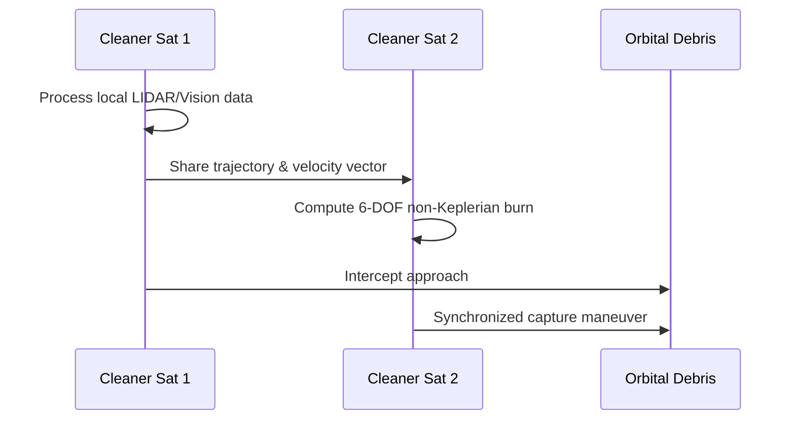

<!-- markdownlint-disable MD009 MD010 MD013 MD022 MD028 MD032 MD033 MD034 MD036 MD037 MD039 MD041 MD058 MD060 -->
[ 🇫🇷 Version Française ](./README.fr.md)

# Orbital Debris Swarm Nav

> **Executive Summary:** A decentralized Edge AI navigation system for swarms of micro-satellites, enabling autonomous collision avoidance and coordinated capture of orbital debris without high-latency ground commands.


---

## 1. Visual Overview & Wow Effect

```mermaid
graph TD
    A[Ground Control (High Latency)] -.-x B(Swarm Nav Edge AI)
    B --> C{Autonomous Orbital 6-DOF}
    C --> D[Cleaner Satellite 1]
    C --> E[Cleaner Satellite 2]
    D & E --> F[Coordinated Debris Capture]
    D <-->|Inter-satellite Comm| E
```

## 2. Contrarian Thesis (Peter Thiel Style)

**Popular Belief:** Space debris cleanup requires massive, expensive, single-unit robotic spacecraft directly piloted from Earth.

**Hidden Truth:** The Kessler Syndrome can only be solved by decentralized, low-cost swarms acting autonomously. Earth-to-orbit latency makes real-time kinetic capture of multiple targets mathematically impossible for human operators; the intelligence must live directly in the orbit.

## 3. Problem & Target Market

**Business Model:** B2B / B2G

**Target Audience:** Space agencies (ESA, NASA, JAXA), mega-constellation operators (Starlink, Kuiper), and space insurance companies.

**Urgent Pain Point:** Low Earth Orbit (LEO) is crowded. A single millimeter-sized debris piece can destroy a multi-million dollar satellite. Current cleaning missions rely on costly unitary robots with high latency. A chain collision during cleanup could permanently ruin orbit access.

## 4. Technical Architecture & Infrastructure



## 5. Business Model & Financial Viability

| Metric | Value |
|---|---|
| Pricing Structure | Swarm OS License per Mission + Data Telemetry Fee |
| 12-Month Target | 1 major space agency PoC or 2 private cleanup missions |
| Revenue Formula | 2 mission licenses × €50,000 = €100,000 ARR |
| Estimated Gross Margin | 80% (Software licensing) |

## 6. Distribution Engine & Moat

**Acquisition Strategy:** B2G lobbying and strategic partnerships with aerospace hardware manufacturers building the physical cleaner satellites.

**Moat (Defensibility):** Orbital mechanics require 6-DOF trajectory calculation in microgravity at 28,000 km/h under extreme fuel constraints. A terrestrial drone routing algorithm totally fails here. The mathematical complexity of swarm intelligence in space creates a near-impenetrable barrier to entry.

## 7. Detailed Evaluation Grid

| Criterion | VC Score (/100) | Market Score (/100) |
|---|---|---|
| Thesis & Monopoly / Urgency | -- / 25 | -- / 25 |
| Moat / LLM Immunity | -- / 25 | -- / 25 |
| Scalability / UX Friction | -- / 25 | -- / 25 |
| Unit Economics / ROI | -- / 25 | -- / 25 |
| **TOTAL** | **-- / 100** | **-- / 100** |

> **VC Verdict:** Pending evaluation.

> **Market Verdict:** Pending evaluation.
