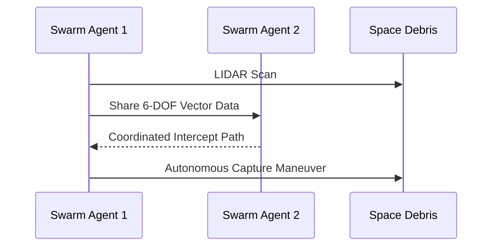

<!-- markdownlint-disable MD009 MD010 MD013 MD022 MD028 MD032 MD033 MD034 MD036 MD037 MD039 MD041 MD058 MD060 -->
[ 🇫🇷 Version Française ](./README.fr.md)

# Orbital Debris Swarm Nav

> **Executive Summary:** A decentralized swarm navigation system for micro-satellite fleets using Edge AI to autonomously capture orbital debris and avoid collisions without relying on high-latency Earth commands.


---

## 1. Visual Overview & Wow Effect

```mermaid
graph TD
    A[Debris Cloud (Kessler Syndrome)] --> B{Swarm Satellites}
    B -->|Edge AI + LIDAR| C[Autonomous Trajectory Calc]
    C --> D[Debris Capture]
    C --> E[Collision Avoidance]
    D --> F[De-orbit Burn]
```

## 2. Contrarian Thesis (Peter Thiel Style)

**Popular Belief:** Space debris cleanup requires massive, expensive, single-unit robotic arms remote-controlled from Earth.

**Hidden Truth:** Remote control from Earth suffers from deadly latency and limited comms windows; cleanup must be delegated to cheap, autonomous, decentralized swarms capable of real-time multi-agent physics calculations in orbit.

## 3. Problem & Target Market

**Business Model:** B2B / B2G

**Target Audience:** Space agencies (ESA, NASA), mega-constellation operators (Starlink), space insurance firms.

**Urgent Pain Point:** Low Earth Orbit is clogged. A single collision could wipe out billions in assets (Kessler Syndrome), but current cleanup missions are too slow, too expensive, and risk causing more debris.

## 4. Technical Architecture & Infrastructure



## 5. Business Model & Financial Viability

| Metric | Value |
| --- | --- |
| Pricing Structure | Per-debris capture contract + Swarm OS License |
| 12-Month Target | 2 Pilot Missions (Space Agencies) |
| Revenue Formula | 2 missions * 600k€ = 1.2M€ ARR |
| Estimated Gross Margin | 70% (Software + Sensors) |

## 6. Distribution Engine & Moat

**Acquisition Strategy:** B2G contracts and partnerships with satellite constellation operators desperate to protect their assets.

**Moat (Defensibility):** Classical drone routing fails in 6-DOF non-Keplerian orbital dynamics at 28,000 km/h with strict fuel constraints. LLMs cannot calculate complex orbital physics in real-time on edge processors.

## 7. Detailed Evaluation Grid

| Criterion | VC Score (/100) | Market Score (/100) |
| :--- | :---: | :---: |
| Thesis & Monopoly / Urgency | -- / 25 | -- / 25 |
| Moat / LLM Immunity | -- / 25 | -- / 25 |
| Scalability / UX Friction | -- / 25 | -- / 25 |
| Unit Economics / ROI | -- / 25 | -- / 25 |
| **TOTAL** | **-- / 100** | **-- / 100** |

> **VC Verdict:** Pending evaluation.
>
> **Market Verdict:** Pending evaluation.
