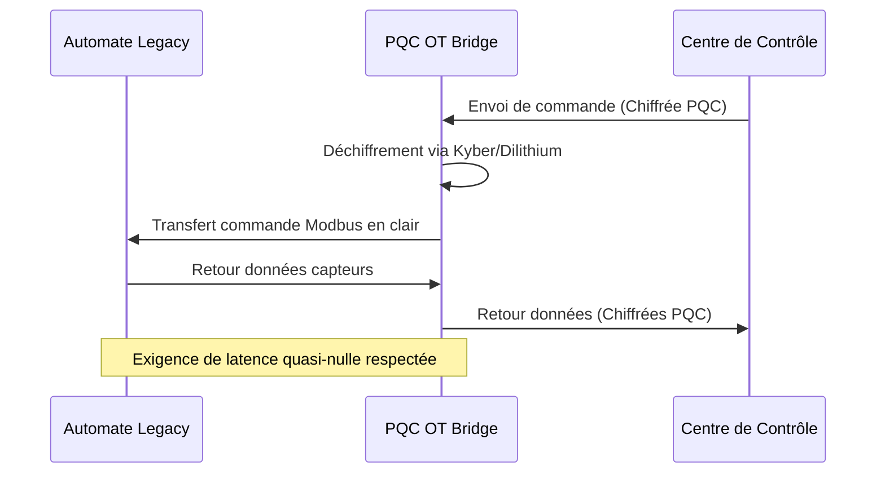

<!-- markdownlint-disable MD009 MD010 MD013 MD022 MD028 MD032 MD033 MD034 MD036 MD037 MD039 MD041 MD058 MD060 -->
[ 🇬🇧 English Version ](./README.md)

# PQC OT Bridge

> **Résumé exécutif :** Une passerelle matérielle légère encapsulant les systèmes industriels legacy (OT/ICS) dans des tunnels de cryptographie post-quantique pour protéger les infrastructures critiques contre la menace du "Q-Day".


---

## 1. Aperçu visuel & Effet Wahou

```mermaid
graph TD
    A[Automate Legacy Vulnérable (PLC)] --> B(Passerelle PQC OT Bridge)
    B -->|Tunnel Chiffré Post-Quantique| C{Réseau d'Entreprise}
    C --> D[Centre de Contrôle SCADA]
    C -.-x E[Attaquant Quantique (Q-Day)]
```

## 2. La thèse contrariante (Peter Thiel Style)

**La croyance populaire :** La sécurité des infrastructures critiques passe par la mise à jour des contrôleurs industriels vieux de 20 ans avec des agents logiciels modernes et des pare-feu IT standards.

**La vérité cachée :** Vous ne pouvez pas mettre à jour le logiciel d'une pompe à eau vieille de 20 ans sans la casser ou provoquer une coupure inacceptable. La seule façon de sécuriser l'OT contre la menace quantique est d'encapsuler les protocoles legacy à la source via un pont matériel passif à latence nulle.

## 3. Le problème & La cible

**Modèle économique :** B2B

**Cible précise :** Opérateurs d'Infrastructures d'Importance Vitale (OIV) : gestionnaires de réseaux électriques, traitement des eaux, industrie lourde, pipelines.

**La douleur urgente :** Les systèmes industriels (OT/ICS) opèrent souvent sur des protocoles legacy en clair (Modbus). Avec l'arrivée de la menace Q-Day, ces infrastructures deviendront vulnérables au contrôle à distance malveillant, menaçant la sécurité nationale. Remplacer le matériel existant est financièrement et opérationnellement impossible à court terme.

## 4. Architecture technique & Plomberie



## 5. Modèle économique & Viabilité financière

| Métrique | Valeur |
|---|---|
| Structure de prix | Boîtier Matériel + Abonnement Annuel Sécurité |
| Objectif 12 mois | 20 sous-stations ou déploiements usines |
| Calcul du CA (Target 100k€) | 20 déploiements × 5 000 €/an = 100 000 € ARR |
| Marge brute estimée | 70% (Mix Hardware/SaaS) |

## 6. Moteur de distribution & Fossé défensif (Moat)

**Stratégie d'acquisition :** Ventes B2B ciblant les RSSI (CISO) des infrastructures critiques, en s'appuyant sur les nouvelles directives gouvernementales exigeant la conformité PQC.

**Moat (Barrière à l'entrée) :** L'environnement industriel exige une latence nulle et une fiabilité extrême (normes CEI 62443). Faire tourner des algorithmes PQC lourds sur des équipements edge temps réel sans perturber les boucles industrielles est un défi d'ingénierie majeur que les entreprises IT classiques ne peuvent relever facilement.

## 7. Grille d'évaluation détaillée

| Critère | Score VC (/100) | Score Terrain (/100) |
|---|---|---|
| Thèse & Monopole / Urgence | -- / 25 | -- / 25 |
| Moat / Résistance aux LLM natifs | -- / 25 | -- / 25 |
| Scalabilité / Friction d'adoption | -- / 25 | -- / 25 |
| Unit Economics / ROI direct | -- / 25 | -- / 25 |
| **TOTAL** | **-- / 100** | **-- / 100** |

> **Verdict VC :** En attente d'évaluation.

> **Verdict Terrain :** En attente d'évaluation.
