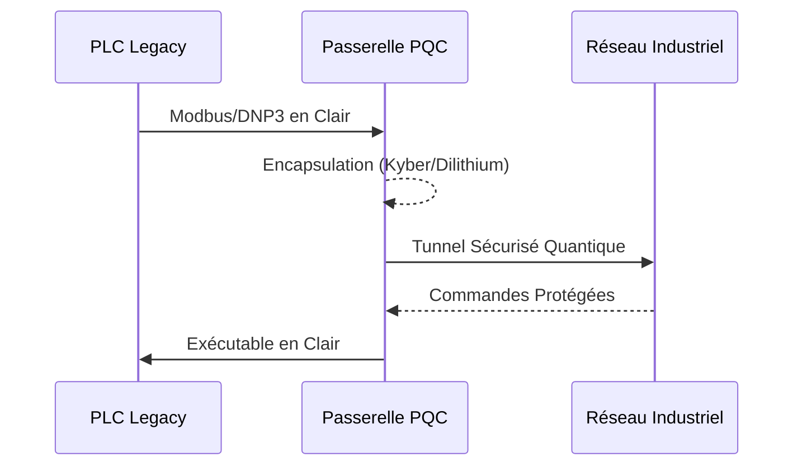

<!-- markdownlint-disable MD009 MD010 MD013 MD022 MD028 MD032 MD033 MD034 MD036 MD037 MD039 MD041 MD058 MD060 -->
[ 🇬🇧 English Version ](./README.md)

# PQC OT Bridge

> **Résumé exécutif :** Un pont matériel et passerelle ultra-légère encapsulant les systèmes industriels legacy (OT) vulnérables dans des tunnels de cryptographie post-quantique.


---

## 1. Aperçu visuel & Effet Wahou

```mermaid
graph TD
    A[Automates PLC Legacy] --> B{Pont PQC OT (Matériel/Passerelle)}
    B -->|Algorithmes Post-Quantiques NIST| C[Tunnel Chiffré]
    C --> D[Contrôle Industriel Central]
    E[Attaquants Quantiques] -.->|Échec Déchiffrement| C
```

## 2. La thèse contrariante (Peter Thiel Style)

**La croyance populaire :** L'infrastructure critique a juste besoin de meilleurs pare-feux et mises à jour VPN logicielles.

**La vérité cachée :** L'OT (Operational Technology) tourne sur du matériel vieux de 20 ans impossible à mettre à jour. La sécurité doit être implémentée physiquement avant que le Q-Day ne rende obsolète tout chiffrement classique.

## 3. Le problème & La cible

**Modèle économique :** B2B

**Cible précise :** Opérateurs d'Infrastructures d'Importance Vitale (OIV) : énergie, eau, pipelines.

**La douleur urgente :** Les automates opèrent en clair (Modbus). Une attaque "Harvest Now, Decrypt Later" pourrait paralyser les infrastructures nationales.

## 4. Architecture technique & Plomberie



## 5. Modèle économique & Viabilité financière

| Métrique | Valeur |
| --- | --- |
| Structure de prix | Boîtier Hardware + SaaS Gestion de Flotte |
| Objectif 12 mois | 20 usines/sous-stations industrielles |
| Calcul du CA (Target 100k€) | 20 sites * 5 000€/mois = 1.2M€ ARR |
| Marge brute estimée | 75% |

## 6. Moteur de distribution & Fossé défensif (Moat)

**Stratégie d'acquisition :** Ventes B2B aux OIV poussées par les nouvelles réglementations gouvernementales.

**Moat (Barrière à l'entrée) :** Contraintes de latence temps réel de l'OT et certifications industrielles strictes (CEI 62443). Le SaaS cloud générique est inopérant.

## 7. Grille d'évaluation détaillée

| Critère | Score VC (/100) | Score Terrain (/100) |
| :--- | :---: | :---: |
| Thèse & Monopole / Urgence | -- / 25 | -- / 25 |
| Moat / Résistance aux LLM natifs | -- / 25 | -- / 25 |
| Scalabilité / Friction d'adoption | -- / 25 | -- / 25 |
| Unit Economics / ROI direct | -- / 25 | -- / 25 |
| **TOTAL** | **-- / 100** | **-- / 100** |

> **Verdict VC :** En attente d'évaluation.
>
> **Verdict Terrain :** En attente d'évaluation.
