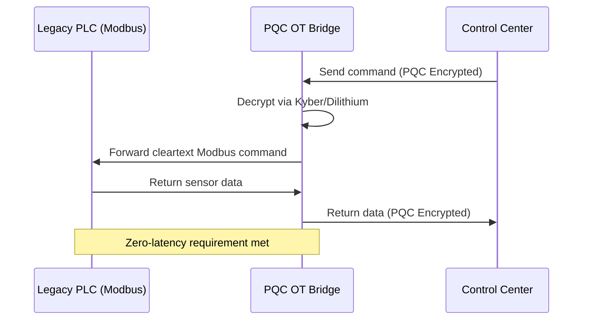

<!-- markdownlint-disable MD009 MD010 MD013 MD022 MD028 MD032 MD033 MD034 MD036 MD037 MD039 MD041 MD058 MD060 -->
[ 🇫🇷 Version Française ](./README.fr.md)

# PQC OT Bridge

> **Executive Summary:** A lightweight gateway device that wraps legacy industrial control systems (OT/ICS) in post-quantum cryptography tunnels, protecting critical national infrastructure from "Harvest Now, Decrypt Later" quantum attacks.


---

## 1. Visual Overview & Wow Effect

```mermaid
graph TD
    A[Vulnerable Legacy PLC/RTU] --> B(PQC OT Bridge)
    B -->|Post-Quantum Encryption Tunnel| C{Corporate Network}
    C --> D[SCADA Control Center]
    C -.-x E[Quantum Attacker (Q-Day)]
```

## 2. Contrarian Thesis (Peter Thiel Style)

**Popular Belief:** Critical infrastructure security means upgrading 20-year-old industrial controllers with modern software agents and standard IT firewalls.

**Hidden Truth:** You cannot update the software on a 20-year-old water pump PLC without breaking it or causing unacceptable downtime. The only way to secure OT against the quantum threat is to encapsulate legacy protocols at the edge via a passive, zero-latency physical bridge.

## 3. Problem & Target Market

**Business Model:** B2B

**Target Audience:** Operators of Critical National Infrastructure (CNI): power grid managers, water treatment facilities, heavy industry, oil/gas pipelines.

**Urgent Pain Point:** Industrial systems (OT/ICS, SCADA) run on unencrypted legacy protocols (Modbus, DNP3). With Q-Day approaching, these systems will become instantly vulnerable to remote takeover, threatening national security. Replacing the physical hardware is financially and operationally impossible in the short term.

## 4. Technical Architecture & Infrastructure



## 5. Business Model & Financial Viability

| Metric | Value |
|---|---|
| Pricing Structure | Hardware Appliance + Annual Security Subscription |
| 12-Month Target | 20 substations or factory node deployments |
| Revenue Formula | 20 deployments × €5,000/year = €100,000 ARR |
| Estimated Gross Margin | 70% (Blended Hardware/SaaS) |

## 6. Distribution Engine & Moat

**Acquisition Strategy:** B2B enterprise sales targeting CISOs of critical infrastructure, leveraging incoming government mandates for PQC compliance.

**Moat (Defensibility):** The industrial environment demands zero latency and extreme reliability (IEC 62443 standards). Running heavy PQC algorithms like CRYSTALS-Kyber on low-power, real-time edge devices without crashing industrial loops is a massive engineering hurdle that generic IT cybersecurity firms cannot easily cross.

## 7. Detailed Evaluation Grid

| Criterion | VC Score (/100) | Market Score (/100) |
|---|---|---|
| Thesis & Monopoly / Urgency | -- / 25 | -- / 25 |
| Moat / LLM Immunity | -- / 25 | -- / 25 |
| Scalability / UX Friction | -- / 25 | -- / 25 |
| Unit Economics / ROI | -- / 25 | -- / 25 |
| **TOTAL** | **-- / 100** | **-- / 100** |

> **VC Verdict:** Pending evaluation.

> **Market Verdict:** Pending evaluation.
