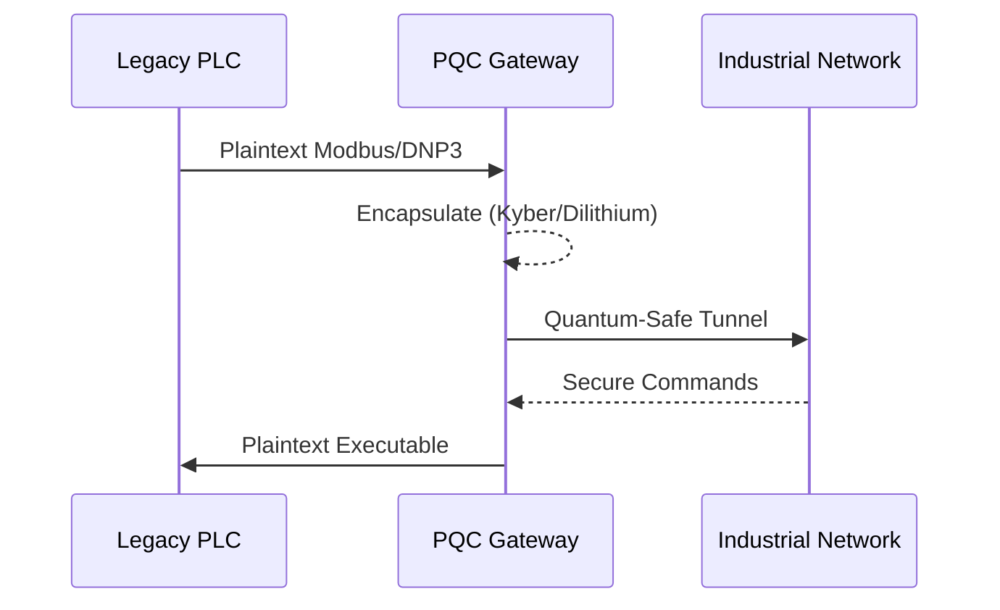

<!-- markdownlint-disable MD009 MD010 MD013 MD022 MD028 MD032 MD033 MD034 MD036 MD037 MD039 MD041 MD058 MD060 -->
[ 🇫🇷 Version Française ](./README.fr.md)

# PQC OT Bridge

> **Executive Summary:** A hardware bridge and ultra-light gateway wrapping vulnerable legacy industrial control systems (ICS/OT) in post-quantum cryptography tunnels.


---

## 1. Visual Overview & Wow Effect

```mermaid
graph TD
    A[Legacy PLC / SCADA] --> B{PQC OT Bridge (Hardware/Gateway)}
    B -->|NIST Post-Quantum Algorithms| C[Encrypted Tunnel]
    C --> D[Central Industrial Control]
    E[Quantum Attackers] -.->|Fail to Decrypt| C
```

## 2. Contrarian Thesis (Peter Thiel Style)

**Popular Belief:** Critical infrastructure security just needs better firewalls and standard VPN software updates.

**Hidden Truth:** Operational Technology (OT) runs on 20-year-old hardware that cannot be updated. Software agents fail here. Security must be retrofitted physically at the edge before Q-Day makes all standard encryption obsolete.

## 3. Problem & Target Market

**Business Model:** B2B

**Target Audience:** Critical Infrastructure Operators (OIV): power grids, water treatment plants, heavy industry, oil pipelines.

**Urgent Pain Point:** Industrial PLCs operate in plaintext or weak legacy encryption. A "Harvest Now, Decrypt Later" quantum attack could cripple national infrastructure via remote control.

## 4. Technical Architecture & Infrastructure



## 5. Business Model & Financial Viability

| Metric | Value |
| --- | --- |
| Pricing Structure | Hardware Gateway Unit + Fleet Management SaaS |
| 12-Month Target | 20 Industrial Substations/Plants |
| Revenue Formula | 20 plants * 5,000€/month = 1.2M€ ARR |
| Estimated Gross Margin | 75% |

## 6. Distribution Engine & Moat

**Acquisition Strategy:** B2B sales to critical infrastructure operators pushed by incoming government compliance mandates.

**Moat (Defensibility):** Industrial latency constraints (real-time encapsulation) and hardware certification (IEC 62443) create massive barriers. Standard cloud SaaS cannot touch isolated, physical OT networks.

## 7. Detailed Evaluation Grid

| Criterion | VC Score (/100) | Market Score (/100) |
| :--- | :---: | :---: |
| Thesis & Monopoly / Urgency | -- / 25 | -- / 25 |
| Moat / LLM Immunity | -- / 25 | -- / 25 |
| Scalability / UX Friction | -- / 25 | -- / 25 |
| Unit Economics / ROI | -- / 25 | -- / 25 |
| **TOTAL** | **-- / 100** | **-- / 100** |

> **VC Verdict:** Pending evaluation.
>
> **Market Verdict:** Pending evaluation.
