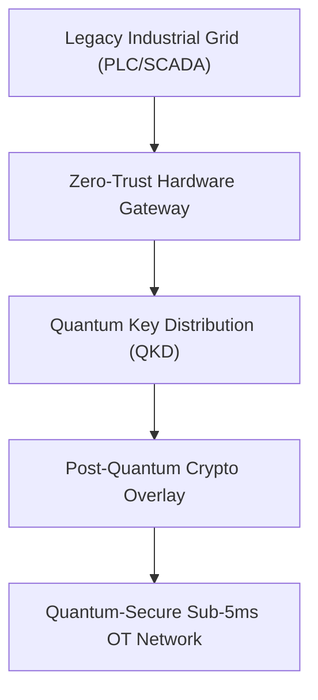
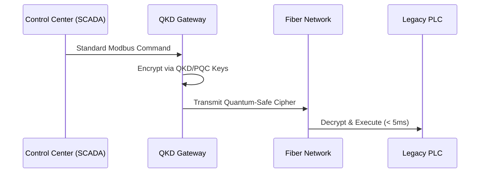

<!-- markdownlint-disable MD009 MD010 MD013 MD022 MD028 MD032 MD033 MD034 MD036 MD037 MD039 MD041 MD058 MD060 -->

[🇫🇷 Version Française](./README.fr.md)

# QKD OT Guardian

> **Executive Summary:** A hardware-based Quantum Key Distribution (QKD) and PQC gateway overlay that secures legacy critical infrastructure from quantum attacks without modifying endpoint PLCs.

---

## 1. Visual Overview & Wow Effect

## 2. Contrarian Thesis (Peter Thiel Style)

Popular Belief: To protect the power grid from quantum computers, we must replace every legacy PLC and SCADA system with new, quantum-safe hardware.
Hidden Truth: Replacing every PLC is physically and financially impossible. The only viable path is a low-latency, hardware-level QKD/PQC overlay network that acts as a secure tunnel for legacy systems.

## 3. Problem & Target Market

Business Model: B2B
Target Audience: Critical infrastructure operators (power grids, nuclear plants, water treatment), CISO, OT Security Managers.
Urgent Pain Point: Operational Technology (OT/ICS) networks use legacy protocols vulnerable to 'Store Now, Decrypt Later' quantum attacks. Upgrading legacy hardware is impossible at scale.

## 4. Technical Architecture & Infrastructure

## 5. Business Model & Financial Viability

| Metric                 | Value                                                     |
| ---------------------- | --------------------------------------------------------- |
| Pricing Structure      | Hardware gateway cluster sale + recurring management SaaS |
| 12-Month Target        | 10 major utility substations protected                    |
| Revenue Formula        | 10 substations \* $200k hardware + $50k/year SaaS         |
| Estimated Gross Margin | 70%                                                       |

## 6. Distribution Engine & Moat

Acquisition Strategy: Direct infrastructure sales, partnerships with national energy regulators.
Moat (Defensibility): Traditional VPNs add too much latency for real-time OT (needs < 5ms) and use obsolete RSA/ECC crypto. The moat is the integration of physical quantum optics (QKD) with ultra-low-latency industrial network packet processing.

## 7. Detailed Evaluation Grid

| Criterion                   | VC Score (/100) | Market Score (/100) |
| --------------------------- | --------------- | ------------------- |
| Thesis & Monopoly / Urgency | -- / 25         | 17 / 25             |
| Moat / LLM Immunity         | -- / 25         | 25 / 25             |
| Scalability / UX Friction   | -- / 25         | 11 / 25             |
| Unit Economics / ROI        | -- / 25         | 16 / 25             |
| **TOTAL**                   | **-- / 100**    | **69 / 100**        |

> **VC Verdict:** Pending evaluation.
> **Market Verdict:** Ultimate protection for critical infrastructures, meeting maximum security needs. Quantum key distribution is physically impossible for a LLM to emulate. However, adoption is extremely hindered by the cost of dedicated hardware and dark fiber deployment, making profitability slow to emerge.
