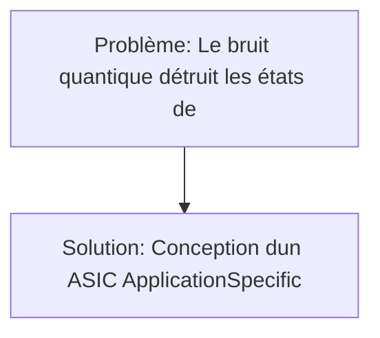
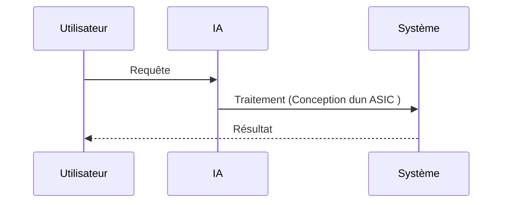

<!-- markdownlint-disable MD013 MD033 MD041 -->

[🇬🇧 English Version](./README.md)

# Quantum Error Correction ASIC

> **Résumé exécutif :** Une solution B2B (Hardware & IP Licensing) ciblant Constructeurs d'ordinateurs quantiques (IBM, Google, startups full-stack), centres de recherche nationaux pour résoudre le problème suivant : Le bruit quantique détruit les états de superposition avant qu'un calcul utile ne soit terminé. La correction d'erreurs (QEC - Quantum Error Correction) logicielle classique est trop lente ; si le décodage du syndrome d'erreur prend plus de temps que le temps de cohérence du qubit, l'ordinateur quantique universel (FTQC) est impossible. L'approche repose sur : Conception d'un ASIC (Application-Specific Integrated Circuit) ultra-basse latence fonctionnant à des températures cryogéniques (4 Kelvin), dédié uniquement au décodage matériel en temps réel des codes de surface quantiques. L'ASIC s'interface directement entre le contrôleur classique et les qubits physiques.

---

## 1. Aperçu visuel & Effet Wahou

## 2. La thèse contrariante (Peter Thiel Style)

- **La croyance populaire :** Une approche générique SaaS classique est suffisante.
- **La vérité cachée :** L'approche logicielle CPU/GPU classique est beaucoup trop lente (latence de millisecondes) pour rattraper la décohérence des qubits (microsecondes). Le hardware dédié cryogénique est l'unique solution physique.

## 3. Le problème & La cible

- **Modèle économique :** B2B (Hardware & IP Licensing)
- **Cible précise :** Constructeurs d'ordinateurs quantiques (IBM, Google, startups full-stack), centres de recherche nationaux
- **La douleur urgente :** Le bruit quantique détruit les états de superposition avant qu'un calcul utile ne soit terminé. La correction d'erreurs (QEC - Quantum Error Correction) logicielle classique est trop lente ; si le décodage du syndrome d'erreur prend plus de temps que le temps de cohérence du qubit, l'ordinateur quantique universel (FTQC) est impossible.

## 4. Architecture technique & Plomberie

Conception d'un ASIC (Application-Specific Integrated Circuit) ultra-basse latence fonctionnant à des températures cryogéniques (4 Kelvin), dédié uniquement au décodage matériel en temps réel des codes de surface quantiques. L'ASIC s'interface directement entre le contrôleur classique et les qubits physiques.

## 5. Modèle économique & Viabilité financière

| Métrique                    | Valeur                                             |
| --------------------------- | -------------------------------------------------- |
| Structure de prix           | Abonnement / Licence B2B (Hardware & IP Licensing) |
| Objectif 12 mois            | 100 clients (ou volume équivalent)                 |
| Calcul du CA (Target 100k€) | 100 \* 1000€ = 100k€                               |
| Marge brute estimée         | 80%                                                |

## 6. Moteur de distribution & Fossé défensif (Moat)

- **Stratégie d'acquisition :** Ventes directes et partenariats dans le domaine : Quantique
- **Moat (Barrière à l'entrée) :** L'approche logicielle CPU/GPU classique est beaucoup trop lente (latence de millisecondes) pour rattraper la décohérence des qubits (microsecondes). Le hardware dédié cryogénique est l'unique solution physique. Les risques incluent : Coûts massifs de tape-out (fabrication des puces), incertitude sur le type de qubits dominant le marché à long terme (supraconducteurs vs ions piégés vs photons), dépendance stricte aux fonderies spécialisées.

## 7. Grille d'évaluation détaillée

| Critère                           | Score VC (/100) | Score Terrain (/100) |
| --------------------------------- | --------------- | -------------------- |
| Thèse & Monopole / Urgence        | -- / 25         | -- / 25              |
| Moat / Résistance aux LLM natifs  | -- / 25         | -- / 25              |
| Scalabilité / Friction d'adoption | -- / 25         | -- / 25              |
| Unit Economics / ROI direct       | -- / 25         | -- / 25              |
| **TOTAL**                         | -- / 100        | -- / 100             |

> **Verdict VC :** En attente d'évaluation.
> **Verdict Terrain :** En attente d'évaluation.
