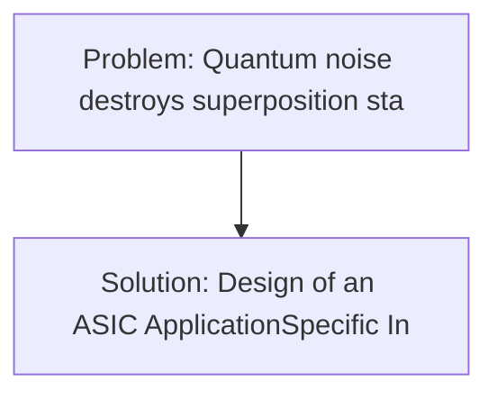
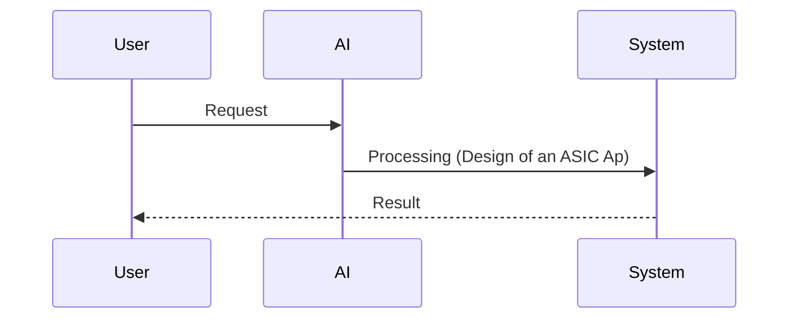

<!-- markdownlint-disable MD013 MD033 MD041 -->

[🇫🇷 Version Française](./README.fr.md)

# Quantum Error Correction ASIC

> **Executive Summary:** A B2B (Hardware & IP Licensing) solution targeting Quantum computer builders (IBM, Google, full-stack startups), national research centres to solve the following problem: Quantum noise destroys superposition states before a useful calculation is completed. Error correction (QEC - Quantum Error Correction) is too slow; If the decoding of error syndrome takes longer than the consistency time of the qubit, the universal quantum computer (FTQC) is impossible. The approach relies on: Design of an ASIC (Application-Specific Integrated Circuit) ultra-low latency operating at cryogenic temperatures (4 Kelvin), dedicated only to real-time hardware decoding of quantum surface codes. ASIC interfaces directly between the conventional controller and the physical quadits.

---

## 1. Visual Overview & Wow Effect

## 2. Contrarian Thesis (Peter Thiel Style)

- **Popular Belief:** A generic SaaS approach is sufficient.
- **Hidden Truth:** The classic CPU/GPU software approach is much too slow (millisecond latency) to catch up with the decoherence of qubits (microseconds). Cryogenic dedicated hardware is the only physical solution.

## 3. Problem & Target Market

- **Business Model:** B2B (Hardware & IP Licensing)
- **Target Audience:** Quantum computer builders (IBM, Google, full-stack startups), national research centres
- **Urgent Pain Point:** Quantum noise destroys superposition states before a useful calculation is completed. Error correction (QEC - Quantum Error Correction) is too slow; If the decoding of error syndrome takes longer than the consistency time of the qubit, the universal quantum computer (FTQC) is impossible.

## 4. Technical Architecture & Infrastructure

Design of an ASIC (Application-Specific Integrated Circuit) ultra-low latency operating at cryogenic temperatures (4 Kelvin), dedicated only to real-time hardware decoding of quantum surface codes. ASIC interfaces directly between the conventional controller and the physical quadits.

## 5. Business Model & Financial Viability

| Metric                 | Value                                                |
| ---------------------- | ---------------------------------------------------- |
| Pricing Structure      | B2B (Hardware & IP Licensing) Subscription / License |
| 12-Month Target        | 100 clients (or equivalent volume)                   |
| Revenue Formula        | 100 \* 1000€ = 100k€                                 |
| Estimated Gross Margin | 80%                                                  |

## 6. Distribution Engine & Moat

- **Acquisition Strategy:** Direct sales and partnerships in the domain: Quantum
- **Moat (Defensibility):** The classic CPU/GPU software approach is much too slow (millisecond latency) to catch up with the decoherence of qubits (microseconds). Cryogenic dedicated hardware is the only physical solution. Risks include: Massive costs of tap-out (flea manufacturing), uncertainty about the type of qubits that dominate the long-term market (superconductors vs ions trapped vs photons), strict dependence on specialized foundries.

## 7. Detailed Evaluation Grid

| Criterion                   | VC Score (/100) | Market Score (/100) |
| --------------------------- | --------------- | ------------------- |
| Thesis & Monopoly / Urgency | -- / 25         | -- / 25             |
| Moat / LLM Immunity         | -- / 25         | -- / 25             |
| Scalability / UX Friction   | -- / 25         | -- / 25             |
| Unit Economics / ROI        | -- / 25         | -- / 25             |
| **TOTAL**                   | -- / 100        | -- / 100            |

> **VC Verdict:** Pending evaluation.
> **Market Verdict:** Pending evaluation.
