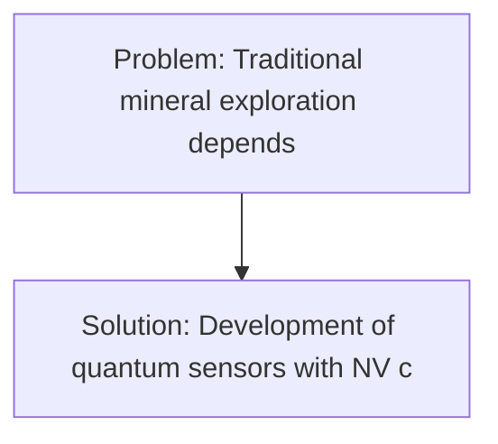
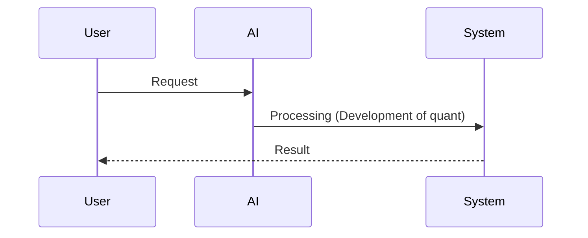

<!-- markdownlint-disable MD013 MD033 MD041 -->

[🇫🇷 Version Française](./README.fr.md)

# Quantum Magnetometer Exploration

> **Executive Summary:** A B2B solution targeting Critical resource mining companies (rare lands, lithium, cobalt), national geological institutes, and underwater exploration companies. to solve the following problem: Traditional mineral exploration depends on costly, environmentally destructive drilling and low resolution geophysical surveys. Discovering deep or hidden deposits under thick overburdens becomes exponentially more difficult and expensive, slowing the energy transition. The approach relies on: Development of quantum sensors with NV centres (Nitrogen-Vacancy) in diamond or alkaline vapours, mounted on drone fleets, capable of detecting tiny magnetic anomalies in the basement with unprecedented sensitivity and spatial resolution, coupled with geophysical reversal algorithms based on AI.

---

## 1. Visual Overview & Wow Effect

## 2. Contrarian Thesis (Peter Thiel Style)

- **Popular Belief:** A generic SaaS approach is sufficient.
- **Hidden Truth:** This is a fundamental problem of measurement physics. No software algorithm can recover a signal drowned in the noise if it was not physically captured initially. This requires mastering experimental quantum physics, precision hardware and cryogenic/miniaturization.

## 3. Problem & Target Market

- **Business Model:** B2B
- **Target Audience:** Critical resource mining companies (rare lands, lithium, cobalt), national geological institutes, and underwater exploration companies.
- **Urgent Pain Point:** Traditional mineral exploration depends on costly, environmentally destructive drilling and low resolution geophysical surveys. Discovering deep or hidden deposits under thick overburdens becomes exponentially more difficult and expensive, slowing the energy transition.

## 4. Technical Architecture & Infrastructure

Development of quantum sensors with NV centres (Nitrogen-Vacancy) in diamond or alkaline vapours, mounted on drone fleets, capable of detecting tiny magnetic anomalies in the basement with unprecedented sensitivity and spatial resolution, coupled with geophysical reversal algorithms based on AI.

## 5. Business Model & Financial Viability

| Metric                 | Value                              |
| ---------------------- | ---------------------------------- |
| Pricing Structure      | B2B Subscription / License         |
| 12-Month Target        | 100 clients (or equivalent volume) |
| Revenue Formula        | 100 \* 1000€ = 100k€               |
| Estimated Gross Margin | 80%                                |

## 6. Distribution Engine & Moat

- **Acquisition Strategy:** Direct sales and partnerships in the domain: Quantum & Deep Tech Infra
- **Moat (Defensibility):** This is a fundamental problem of measurement physics. No software algorithm can recover a signal drowned in the noise if it was not physically captured initially. This requires mastering experimental quantum physics, precision hardware and cryogenic/miniaturization. Risks include: Miniaturization of lasers and control electronics for the shipboard (SWaP - Size, Weight, and Power), extreme sensitivity to environmental noises (drone vibrations, ambient terrestrial magnetic fields), long certification cycle for the mining industry.

## 7. Detailed Evaluation Grid

| Criterion                   | VC Score (/100) | Market Score (/100) |
| --------------------------- | --------------- | ------------------- |
| Thesis & Monopoly / Urgency | -- / 25         | -- / 25             |
| Moat / LLM Immunity         | -- / 25         | -- / 25             |
| Scalability / UX Friction   | -- / 25         | -- / 25             |
| Unit Economics / ROI        | -- / 25         | -- / 25             |
| **TOTAL**                   | -- / 100        | -- / 100            |

> **VC Verdict:** Pending evaluation.
> **Market Verdict:** Pending evaluation.
