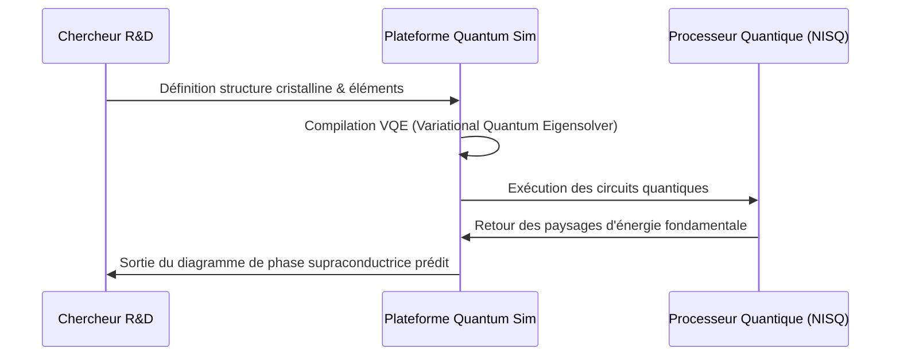

<!-- markdownlint-disable MD009 MD010 MD013 MD022 MD028 MD032 MD033 MD034 MD036 MD037 MD039 MD041 MD058 MD060 -->
[ 🇬🇧 English Version ](./README.md)

# Quantum Superconductor Sim

> **Résumé exécutif :** Une plateforme d'algorithmie quantique spécialisée pour simuler des matériaux fortement corrélés, permettant la découverte virtuelle de supraconducteurs à haute température avant leur synthèse en laboratoire.


---

## 1. Aperçu visuel & Effet Wahou

```mermaid
graph TD
    A[Propriétés Matérielles Cibles] --> B(Algorithme Quantique VQE)
    B --> C{Ordinateur Quantique NISQ}
    C -->|Simulation État Fondamental| D[Interactions Électroniques à N-Corps]
    D --> E[Température Critique Prédite (Tc)]
    E --> F[Validation par Synthèse en Laboratoire]
```

## 2. La thèse contrariante (Peter Thiel Style)

**La croyance populaire :** Les avancées en science des matériaux reposent sur la construction de supercalculateurs classiques toujours plus gros pour accélérer les calculs de Théorie de la Fonctionnelle de la Densité (DFT).

**La vérité cachée :** Les ordinateurs classiques font face à une explosion combinatoire pour simuler des électrons fortement corrélés. On ne peut pas utiliser les mathématiques de la physique classique pour résoudre des problèmes de matériaux quantiques. La percée viendra d'une simulation quantique native calquant directement la nature quantique du matériau.

## 3. Le problème & La cible

**Modèle économique :** B2B

**Cible précise :** Laboratoires R&D en matériaux (électronique, énergie), entreprises de semi-conducteurs, constructeurs de réseaux électriques.

**La douleur urgente :** La découverte de supraconducteurs à haute température révolutionnerait le transport d'énergie. Mais modéliser ces comportements électroniques est exponentiellement trop complexe pour le calcul classique. La R&D fonctionne par essais et erreurs en laboratoire, coûtant des milliards et des années de perdus.

## 4. Architecture technique & Plomberie



## 5. Modèle économique & Viabilité financière

| Métrique | Valeur |
|---|---|
| Structure de prix | Licence SaaS Enterprise + Crédits de calcul quantique |
| Objectif 12 mois | 2 contrats majeurs de R&D avec des géants de l'énergie |
| Calcul du CA (Target 100k€) | 2 contrats × 50 000 €/an = 100 000 € ARR |
| Marge brute estimée | 75% (Coûts d'accès au hardware quantique) |

## 6. Moteur de distribution & Fossé défensif (Moat)

**Stratégie d'acquisition :** Ventes B2B directes ciblant les directeurs R&D des entreprises du Fortune 500 cherchant à sécuriser la propriété intellectuelle fondatrice des matériaux de demain.

**Moat (Barrière à l'entrée) :** Dépendance totale à une double expertise extrêmement rare : physique de la matière condensée et algorithmie quantique. Les éditeurs SaaS classiques ne peuvent pas écrire d'Hamiltoniens pour des cuprates. L'atténuation des erreurs quantiques (error mitigation) affinée spécifiquement pour la supraconductivité crée un moat structurel.

## 7. Grille d'évaluation détaillée

| Critère | Score VC (/100) | Score Terrain (/100) |
|---|---|---|
| Thèse & Monopole / Urgence | -- / 25 | -- / 25 |
| Moat / Résistance aux LLM natifs | -- / 25 | -- / 25 |
| Scalabilité / Friction d'adoption | -- / 25 | -- / 25 |
| Unit Economics / ROI direct | -- / 25 | -- / 25 |
| **TOTAL** | **-- / 100** | **-- / 100** |

> **Verdict VC :** En attente d'évaluation.

> **Verdict Terrain :** En attente d'évaluation.
