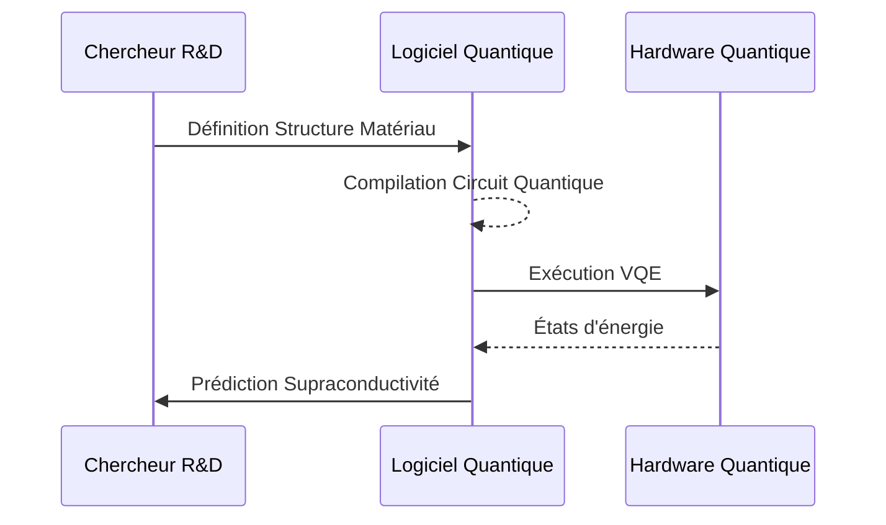

<!-- markdownlint-disable MD009 MD010 MD013 MD022 MD028 MD032 MD033 MD034 MD036 MD037 MD039 MD041 MD058 MD060 -->
[ 🇬🇧 English Version ](./README.md)

# Quantum Superconductor Sim

> **Résumé exécutif :** Une plateforme algorithmique quantique optimisée pour simuler les systèmes d'électrons fortement corrélés afin de prédire informatiquement de nouveaux supraconducteurs à haute température.


---

## 1. Aperçu visuel & Effet Wahou

```mermaid
graph TD
    A[Spécifications Matériau] --> B{Simulateur Hamiltonien Quantique}
    B -->|Algorithme VQE| C[Processeur Quantique NISQ]
    C --> D[Prédiction Énergie Fondamentale]
    D --> E[Température Critique (Tc)]
```

## 2. La thèse contrariante (Peter Thiel Style)

**La croyance populaire :** La science des matériaux nécessite des labos physiques infinis car les supercalculateurs classiques maîtrisent déjà la théorie de la fonctionnelle de la densité (DFT).

**La vérité cachée :** Les méthodes classiques échouent sur le problème à N-corps pour les matériaux fortement corrélés ; seuls des processeurs simulant nativement la mécanique quantique peuvent éviter des décennies d'itérations physiques.

## 3. Le problème & La cible

**Modèle économique :** B2B

**Cible précise :** Labos R&D matériaux (électronique, énergie), entreprises semi-conducteurs.

**La douleur urgente :** La découverte de supraconducteurs à température ambiante révolutionnerait l'énergie, mais la modélisation classique est bloquée par "l'explosion combinatoire".

## 4. Architecture technique & Plomberie



## 5. Modèle économique & Viabilité financière

| Métrique | Valeur |
| --- | --- |
| Structure de prix | Licence de plateforme logicielle SaaS |
| Objectif 12 mois | 10 laboratoires R&D de pointe |
| Calcul du CA (Target 100k€) | 10 labos * 10 000€/mois = 1.2M€ ARR |
| Marge brute estimée | 85% |

## 6. Moteur de distribution & Fossé défensif (Moat)

**Stratégie d'acquisition :** Ventes B2B directes aux grands instituts de recherche et industriels de l'énergie.

**Moat (Barrière à l'entrée) :** Requiert une double expertise rarissime : physique de la matière condensée et algorithmique quantique. Dépendance totale à l'évolution réelle du hardware quantique.

## 7. Grille d'évaluation détaillée

| Critère | Score VC (/100) | Score Terrain (/100) |
| :--- | :---: | :---: |
| Thèse & Monopole / Urgence | -- / 25 | -- / 25 |
| Moat / Résistance aux LLM natifs | -- / 25 | -- / 25 |
| Scalabilité / Friction d'adoption | -- / 25 | -- / 25 |
| Unit Economics / ROI direct | -- / 25 | -- / 25 |
| **TOTAL** | **-- / 100** | **-- / 100** |

> **Verdict VC :** En attente d'évaluation.
>
> **Verdict Terrain :** En attente d'évaluation.
