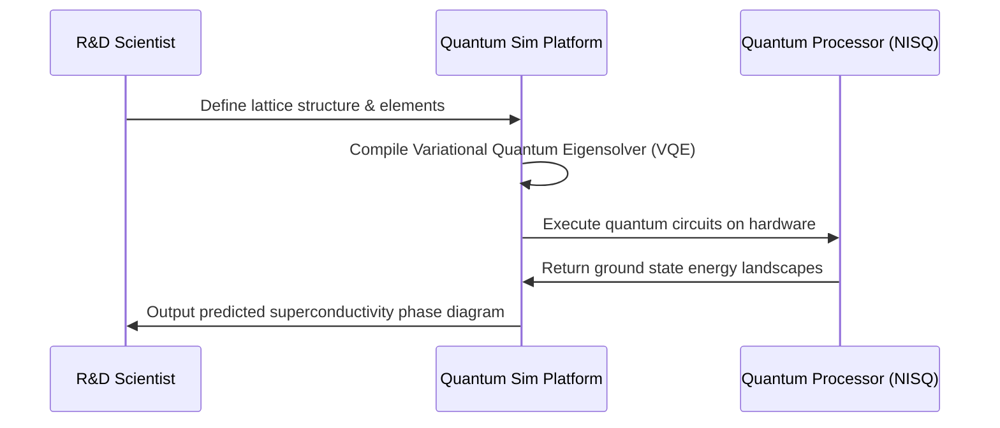

<!-- markdownlint-disable MD009 MD010 MD013 MD022 MD028 MD032 MD033 MD034 MD036 MD037 MD039 MD041 MD058 MD060 -->
[ 🇫🇷 Version Française ](./README.fr.md)

# Quantum Superconductor Sim

> **Executive Summary:** A specialized quantum algorithmic platform designed to simulate strongly correlated materials, enabling the virtual discovery of high-temperature superconductors before physical lab synthesis.


---

## 1. Visual Overview & Wow Effect

```mermaid
graph TD
    A[Material Properties Target] --> B(Quantum VQE Algorithm)
    B --> C{NISQ Quantum Computer}
    C -->|Ground State Simulation| D[N-Body Electron Interactions]
    D --> E[Predicted Critical Temperature (Tc)]
    E --> F[Lab Synthesis Validation]
```

## 2. Contrarian Thesis (Peter Thiel Style)

**Popular Belief:** Material science advancements rely on building bigger classical supercomputers to crunch Density Functional Theory (DFT) calculations faster.

**Hidden Truth:** Classical computers face a combinatorial explosion when simulating strongly correlated electrons. You cannot use classical physics math to solve quantum material problems. The breakthrough in high-temperature superconductors will only come from native quantum simulation mapping directly to the quantum nature of the material.

## 3. Problem & Target Market

**Business Model:** B2B

**Target Audience:** R&D labs in materials (electronics, energy), semiconductor companies, grid infrastructure builders, and advanced electric motor manufacturers.

**Urgent Pain Point:** Discovering room-temperature superconductors would revolutionize energy transport (zero loss). However, modeling electron behavior in these novel materials is exponentially complex for classical supercomputers. R&D currently relies on expensive, decade-long "trial and error" lab experiments.

## 4. Technical Architecture & Infrastructure



## 5. Business Model & Financial Viability

| Metric | Value |
|---|---|
| Pricing Structure | Enterprise SaaS License + Quantum Compute Credits |
| 12-Month Target | 2 massive R&D contracts with energy/tech giants |
| Revenue Formula | 2 contracts × €50,000/year = €100,000 ARR |
| Estimated Gross Margin | 75% (Quantum hardware costs) |

## 6. Distribution Engine & Moat

**Acquisition Strategy:** Direct B2B sales targeting Heads of R&D at Fortune 500 energy and tech companies looking to secure the foundational IP for next-gen materials.

**Moat (Defensibility):** Total reliance on deep, dual-domain expertise (condensed matter physics and quantum algorithmic compilation). Generic SaaS companies cannot write Hamiltonians for cuprates. The software creates a structural moat as it fine-tunes its error mitigation specific to superconducting simulations over time.

## 7. Detailed Evaluation Grid

| Criterion | VC Score (/100) | Market Score (/100) |
|---|---|---|
| Thesis & Monopoly / Urgency | -- / 25 | -- / 25 |
| Moat / LLM Immunity | -- / 25 | -- / 25 |
| Scalability / UX Friction | -- / 25 | -- / 25 |
| Unit Economics / ROI | -- / 25 | -- / 25 |
| **TOTAL** | **-- / 100** | **-- / 100** |

> **VC Verdict:** Pending evaluation.

> **Market Verdict:** Pending evaluation.
