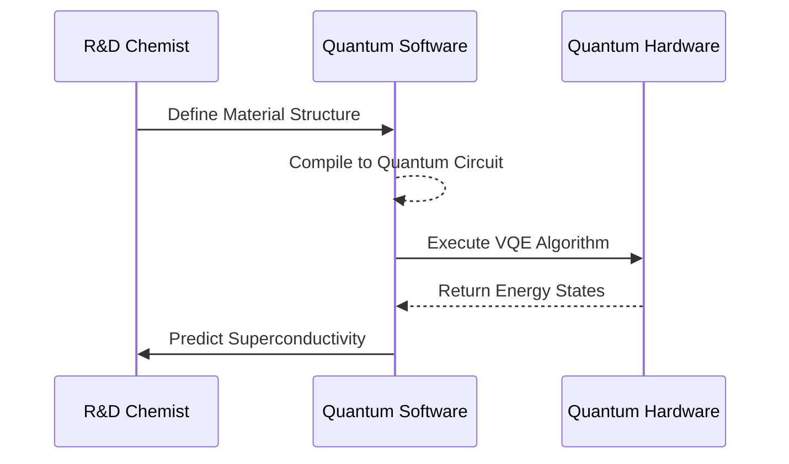

<!-- markdownlint-disable MD009 MD010 MD013 MD022 MD028 MD032 MD033 MD034 MD036 MD037 MD039 MD041 MD058 MD060 -->
[ 🇫🇷 Version Française ](./README.fr.md)

# Quantum Superconductor Sim

> **Executive Summary:** A quantum algorithm platform optimized for simulating strongly correlated electron systems to computationally predict high-temperature superconductors.


---

## 1. Visual Overview & Wow Effect

```mermaid
graph TD
    A[Material Specifications] --> B{Quantum Hamiltonian Simulator}
    B -->|VQE Algorithm| C[NISQ Quantum Processor]
    C --> D[Ground State Energy Prediction]
    D --> E[Superconducting Critical Temp (Tc)]
```

## 2. Contrarian Thesis (Peter Thiel Style)

**Popular Belief:** Material science requires infinite "trial and error" in physical wet labs because classic supercomputers can handle standard Density Functional Theory (DFT).

**Hidden Truth:** Classical methods fundamentally fail at the N-body problem for strongly correlated materials (like cuprates); only quantum processors natively simulating quantum mechanics can bypass decades of physical lab iterations.

## 3. Problem & Target Market

**Business Model:** B2B

**Target Audience:** R&D material labs, semiconductor foundries, advanced electrical engine and power grid manufacturers.

**Urgent Pain Point:** Room-temperature superconductors would revolutionize global energy, but finding them via physical trial and error is a multi-billion dollar shot in the dark.

## 4. Technical Architecture & Infrastructure



## 5. Business Model & Financial Viability

| Metric | Value |
| --- | --- |
| Pricing Structure | Enterprise Software Platform License |
| 12-Month Target | 10 Advanced Material R&D Labs |
| Revenue Formula | 10 labs * 10,000€/month = 1.2M€ ARR |
| Estimated Gross Margin | 85% |

## 6. Distribution Engine & Moat

**Acquisition Strategy:** Direct B2B sales to cutting-edge research institutes and global energy hardware manufacturers.

**Moat (Defensibility):** Requires an incredibly rare dual expertise in condensed matter physics and quantum algorithms. Traditional AI/LLMs cannot solve the combinatorial explosion of quantum mechanics.

## 7. Detailed Evaluation Grid

| Criterion | VC Score (/100) | Market Score (/100) |
| :--- | :---: | :---: |
| Thesis & Monopoly / Urgency | -- / 25 | -- / 25 |
| Moat / LLM Immunity | -- / 25 | -- / 25 |
| Scalability / UX Friction | -- / 25 | -- / 25 |
| Unit Economics / ROI | -- / 25 | -- / 25 |
| **TOTAL** | **-- / 100** | **-- / 100** |

> **VC Verdict:** Pending evaluation.
>
> **Market Verdict:** Pending evaluation.
