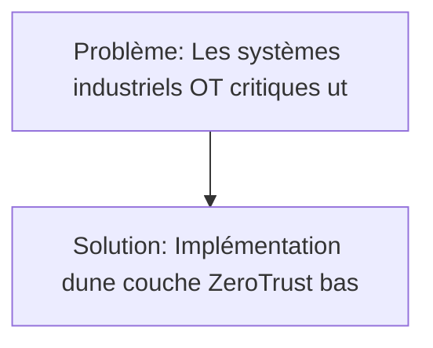
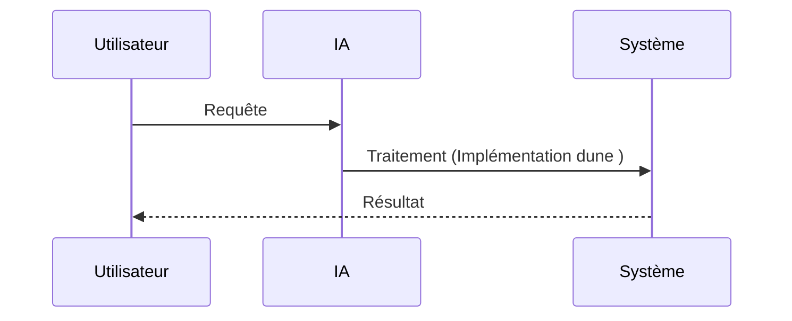

<!-- markdownlint-disable MD013 MD033 MD041 -->

[🇬🇧 English Version](./README.md)

# RF Fingerprint Zero Trust

> **Résumé exécutif :** Une solution B2B ciblant Opérateurs d'Infrastructures d'Importance Vitale (OIV), usines manufacturières, gestionnaires de centrales électriques et réseaux de distribution d'eau. pour résoudre le problème suivant : Les systèmes industriels (OT) critiques utilisent souvent des capteurs sans fil ou des liaisons radio obsolètes vulnérables aux attaques de type "spoofing" ou "replay". Les attaquants peuvent injecter de fausses données de capteurs (ex: température d'une turbine) sans alerter les systèmes de sécurité IT/OT classiques. L'approche repose sur : Implémentation d'une couche Zero-Trust bas niveau analysant les micro-imperfections matérielles des transmissions radio (Radio Frequency Fingerprinting) via des modèles de machine learning embarqués sur des FPGA en périphérie (edge), authentifiant ainsi le composant physique émetteur de manière incontestable.

---

## 1. Aperçu visuel & Effet Wahou

## 2. La thèse contrariante (Peter Thiel Style)

- **La croyance populaire :** Une approche générique SaaS classique est suffisante.
- **La vérité cachée :** Les solutions de sécurité réseau classiques se basent sur des adresses IP, des MAC adresses ou des certificats cryptographiques qui peuvent être usurpés ou volés. L'analyse des signaux analogiques au niveau physique (Layer 1) nécessite une expertise en traitement du signal et du hardware spécifique (SDR, FPGA) impossible à fournir via un simple logiciel.

## 3. Le problème & La cible

- **Modèle économique :** B2B
- **Cible précise :** Opérateurs d'Infrastructures d'Importance Vitale (OIV), usines manufacturières, gestionnaires de centrales électriques et réseaux de distribution d'eau.
- **La douleur urgente :** Les systèmes industriels (OT) critiques utilisent souvent des capteurs sans fil ou des liaisons radio obsolètes vulnérables aux attaques de type "spoofing" ou "replay". Les attaquants peuvent injecter de fausses données de capteurs (ex: température d'une turbine) sans alerter les systèmes de sécurité IT/OT classiques.

## 4. Architecture technique & Plomberie

Implémentation d'une couche Zero-Trust bas niveau analysant les micro-imperfections matérielles des transmissions radio (Radio Frequency Fingerprinting) via des modèles de machine learning embarqués sur des FPGA en périphérie (edge), authentifiant ainsi le composant physique émetteur de manière incontestable.

## 5. Modèle économique & Viabilité financière

| Métrique                    | Valeur                             |
| --------------------------- | ---------------------------------- |
| Structure de prix           | Abonnement / Licence B2B           |
| Objectif 12 mois            | 100 clients (ou volume équivalent) |
| Calcul du CA (Target 100k€) | 100 \* 1000€ = 100k€               |
| Marge brute estimée         | 80%                                |

## 6. Moteur de distribution & Fossé défensif (Moat)

- **Stratégie d'acquisition :** Ventes directes et partenariats dans le domaine : Cybersécurité & Résilience (OT/ICS)
- **Moat (Barrière à l'entrée) :** Les solutions de sécurité réseau classiques se basent sur des adresses IP, des MAC adresses ou des certificats cryptographiques qui peuvent être usurpés ou volés. L'analyse des signaux analogiques au niveau physique (Layer 1) nécessite une expertise en traitement du signal et du hardware spécifique (SDR, FPGA) impossible à fournir via un simple logiciel. Les risques incluent : Variabilité des empreintes RF due aux changements de température ou au vieillissement des composants, intégration matérielle intrusive requise sur les infrastructures existantes (brownfield), fausses alertes pouvant paralyser des processus industriels continus.

## 7. Grille d'évaluation détaillée

| Critère                           | Score VC (/100) | Score Terrain (/100) |
| --------------------------------- | --------------- | -------------------- |
| Thèse & Monopole / Urgence        | -- / 25         | -- / 25              |
| Moat / Résistance aux LLM natifs  | -- / 25         | -- / 25              |
| Scalabilité / Friction d'adoption | -- / 25         | -- / 25              |
| Unit Economics / ROI direct       | -- / 25         | -- / 25              |
| **TOTAL**                         | -- / 100        | -- / 100             |

> **Verdict VC :** En attente d'évaluation.
> **Verdict Terrain :** En attente d'évaluation.
