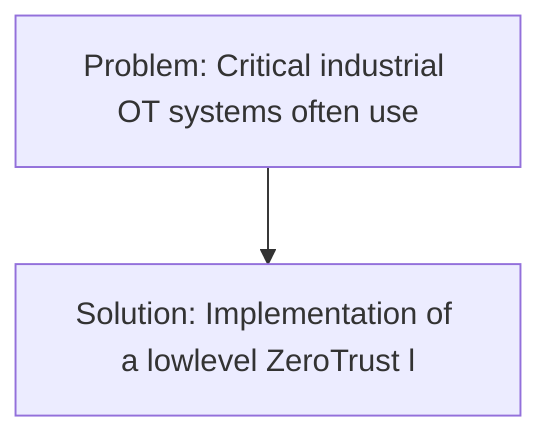
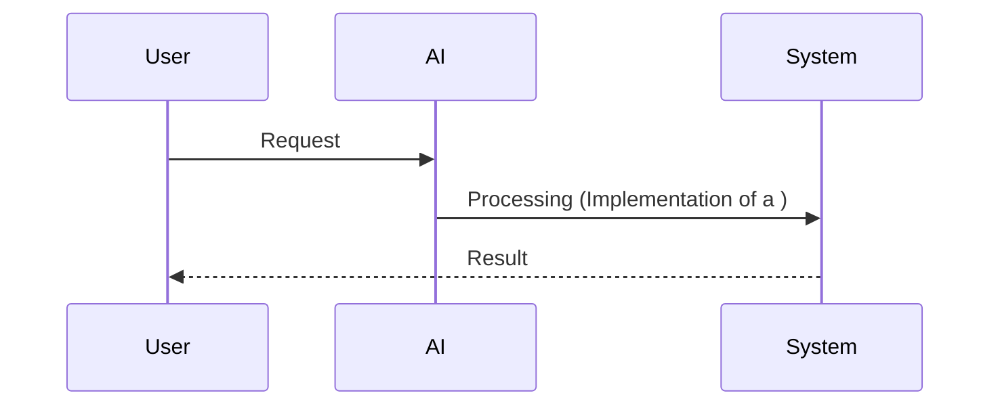

<!-- markdownlint-disable MD013 MD033 MD041 -->

[🇫🇷 Version Française](./README.fr.md)

# RF Fingerprint Zero Trust

> **Executive Summary:** A B2B solution targeting Vital Import Infrastructure (VIO) operators, manufacturing plants, power plant managers and water distribution systems. to solve the following problem: Critical industrial (OT) systems often use wireless sensors or obsolete radio links that are vulnerable to "spoofing" or "replay" attacks. Attackers can inject false sensor data (e.g. turbine temperature) without warning conventional IT/OT safety systems. The approach relies on: Implementation of a low-level Zero-Trust layer analyzing the physical micro-imperfections of radio transmissions (Radio Frequency Fingerprinting) via machine learning models embedded on FPGAs in the periphery (edge), thus authenticating the emitting physical component in an indisputable way.

---

## 1. Visual Overview & Wow Effect

## 2. Contrarian Thesis (Peter Thiel Style)

- **Popular Belief:** A generic SaaS approach is sufficient.
- **Hidden Truth:** Conventional network security solutions are based on IP addresses, MAC addresses or cryptographic certificates that can be usurped or stolen. Analogue signal analysis at the physical level (Layer 1) requires expertise in signal processing and specific hardware (SDR, FPGA) that cannot be provided via simple software.

## 3. Problem & Target Market

- **Business Model:** B2B
- **Target Audience:** Vital Import Infrastructure (VIO) operators, manufacturing plants, power plant managers and water distribution systems.
- **Urgent Pain Point:** Critical industrial (OT) systems often use wireless sensors or obsolete radio links that are vulnerable to "spoofing" or "replay" attacks. Attackers can inject false sensor data (e.g. turbine temperature) without warning conventional IT/OT safety systems.

## 4. Technical Architecture & Infrastructure

Implementation of a low-level Zero-Trust layer analyzing the physical micro-imperfections of radio transmissions (Radio Frequency Fingerprinting) via machine learning models embedded on FPGAs in the periphery (edge), thus authenticating the emitting physical component in an indisputable way.

## 5. Business Model & Financial Viability

| Metric                 | Value                              |
| ---------------------- | ---------------------------------- |
| Pricing Structure      | B2B Subscription / License         |
| 12-Month Target        | 100 clients (or equivalent volume) |
| Revenue Formula        | 100 \* 1000€ = 100k€               |
| Estimated Gross Margin | 80%                                |

## 6. Distribution Engine & Moat

- **Acquisition Strategy:** Direct sales and partnerships in the domain: Cybersecurity & Resilience (OT/ICS)
- **Moat (Defensibility):** Conventional network security solutions are based on IP addresses, MAC addresses or cryptographic certificates that can be usurped or stolen. Analogue signal analysis at the physical level (Layer 1) requires expertise in signal processing and specific hardware (SDR, FPGA) that cannot be provided via simple software. Risks include: Variability of RF fingerprints due to temperature changes or component aging, intrusive hardware integration required on existing infrastructure (brownfield), false alerts that can paralyze continuous industrial processes.

## 7. Detailed Evaluation Grid

| Criterion                   | VC Score (/100) | Market Score (/100) |
| --------------------------- | --------------- | ------------------- |
| Thesis & Monopoly / Urgency | -- / 25         | -- / 25             |
| Moat / LLM Immunity         | -- / 25         | -- / 25             |
| Scalability / UX Friction   | -- / 25         | -- / 25             |
| Unit Economics / ROI        | -- / 25         | -- / 25             |
| **TOTAL**                   | -- / 100        | -- / 100            |

> **VC Verdict:** Pending evaluation.
> **Market Verdict:** Pending evaluation.
