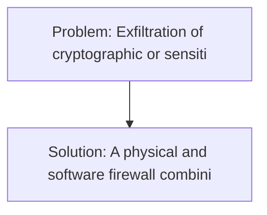
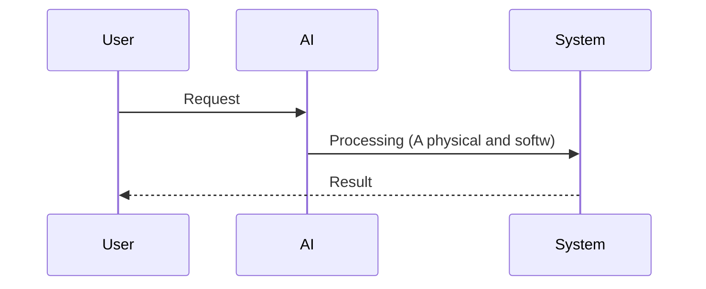

<!-- markdownlint-disable MD013 MD033 MD041 -->

[🇫🇷 Version Française](./README.fr.md)

# RF Side-Channel Firewall

> **Executive Summary:** A B2B solution targeting Critical Industries, Sovereign Data Centres, Defence, Vital Infrastructure Operators (VIO) to solve the following problem: Exfiltration of cryptographic or sensitive data via auxiliary channel attacks (Side-Channel) using the electromagnetic (RF) or acoustic emissions of the processors. The so-called air-gapped environments are no longer safe against the advanced sensors of industrial spying. The approach relies on: A physical and software firewall combining metamaterial coverage specifically absorbing CPU leakage frequencies, and a software orchestrator (hypervisor) that dynamically injects algorithmic noise (entropy injection) into CPU cycles to mask the execution signature of cryptographic processes.

---

## 1. Visual Overview & Wow Effect

## 2. Contrarian Thesis (Peter Thiel Style)

- **Popular Belief:** A generic SaaS approach is sufficient.
- **Hidden Truth:** It is a fundamental problem of material physics. Network software firewalls or BDUs are blind to radio frequency emissions generated by CPU transistors running an AES key.

## 3. Problem & Target Market

- **Business Model:** B2B
- **Target Audience:** Critical Industries, Sovereign Data Centres, Defence, Vital Infrastructure Operators (VIO)
- **Urgent Pain Point:** Exfiltration of cryptographic or sensitive data via auxiliary channel attacks (Side-Channel) using the electromagnetic (RF) or acoustic emissions of the processors. The so-called air-gapped environments are no longer safe against the advanced sensors of industrial spying.

## 4. Technical Architecture & Infrastructure

A physical and software firewall combining metamaterial coverage specifically absorbing CPU leakage frequencies, and a software orchestrator (hypervisor) that dynamically injects algorithmic noise (entropy injection) into CPU cycles to mask the execution signature of cryptographic processes.

## 5. Business Model & Financial Viability

| Metric                 | Value                              |
| ---------------------- | ---------------------------------- |
| Pricing Structure      | B2B Subscription / License         |
| 12-Month Target        | 100 clients (or equivalent volume) |
| Revenue Formula        | 100 \* 1000€ = 100k€               |
| Estimated Gross Margin | 80%                                |

## 6. Distribution Engine & Moat

- **Acquisition Strategy:** Direct sales and partnerships in the domain: Cybersecurity & Resilience
- **Moat (Defensibility):** It is a fundamental problem of material physics. Network software firewalls or BDUs are blind to radio frequency emissions generated by CPU transistors running an AES key. Risks include: Difficulty in calibrating algorithmic noise without destroying performance (overhead CPU), need to deploy complex physical components in existing data centers, long sale and complex B2G cycle.

## 7. Detailed Evaluation Grid

| Criterion                   | VC Score (/100) | Market Score (/100) |
| --------------------------- | --------------- | ------------------- |
| Thesis & Monopoly / Urgency | -- / 25         | -- / 25             |
| Moat / LLM Immunity         | -- / 25         | -- / 25             |
| Scalability / UX Friction   | -- / 25         | -- / 25             |
| Unit Economics / ROI        | -- / 25         | -- / 25             |
| **TOTAL**                   | -- / 100        | -- / 100            |

> **VC Verdict:** Pending evaluation.
> **Market Verdict:** Pending evaluation.
