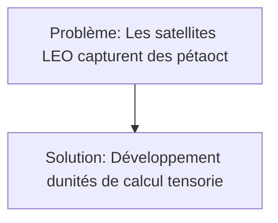
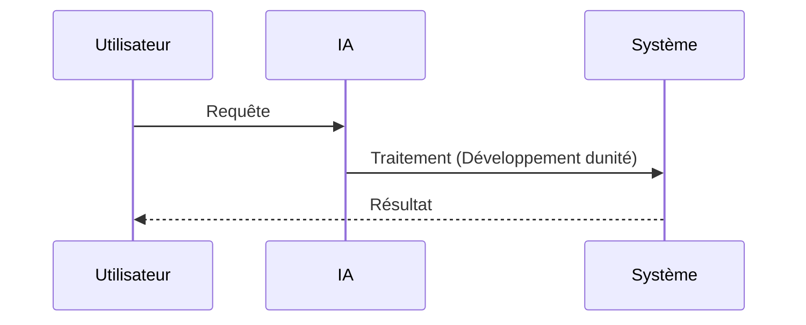

<!-- markdownlint-disable MD013 MD033 MD041 -->

[🇬🇧 English Version](./README.md)

# Satellite Photonic Tensor

> **Résumé exécutif :** Une solution B2B ciblant Opérateurs de constellations LEO (Starlink, Kuiper), agences de renseignement géospatial, et fournisseurs de données d'observation de la Terre. pour résoudre le problème suivant : Les satellites LEO capturent des pétaoctets de données brutes (images hyperspectrales, SAR) mais sont limités par la bande passante descendante (downlink) pour les renvoyer sur Terre. Traiter ces données à bord avec des GPU classiques nécessite trop de puissance (Watts) et génère une chaleur impossible à dissiper dans le vide spatial. L'approche repose sur : Développement d'unités de calcul tensoriel photoniques (Photonic Tensor Cores) spatialisées. Ces puces calculent les multiplications de matrices pour les réseaux de neurones (ex: détection d'anomalies, compression intelligente) à la vitesse de la lumière, avec une consommation énergétique et thermique quasi nulle par rapport au silicium traditionnel.

---

## 1. Aperçu visuel & Effet Wahou

## 2. La thèse contrariante (Peter Thiel Style)

- **La croyance populaire :** Une approche générique SaaS classique est suffisante.
- **La vérité cachée :** L'optimisation logicielle des modèles (quantization, pruning) a atteint ses limites physiques. Seule une rupture au niveau de l'architecture matérielle (utiliser des photons au lieu d'électrons) permet de franchir le mur de l'énergie et de la dissipation thermique dans les environnements spatiaux extrêmes (SWaP-C).

## 3. Le problème & La cible

- **Modèle économique :** B2B
- **Cible précise :** Opérateurs de constellations LEO (Starlink, Kuiper), agences de renseignement géospatial, et fournisseurs de données d'observation de la Terre.
- **La douleur urgente :** Les satellites LEO capturent des pétaoctets de données brutes (images hyperspectrales, SAR) mais sont limités par la bande passante descendante (downlink) pour les renvoyer sur Terre. Traiter ces données à bord avec des GPU classiques nécessite trop de puissance (Watts) et génère une chaleur impossible à dissiper dans le vide spatial.

## 4. Architecture technique & Plomberie

Développement d'unités de calcul tensoriel photoniques (Photonic Tensor Cores) spatialisées. Ces puces calculent les multiplications de matrices pour les réseaux de neurones (ex: détection d'anomalies, compression intelligente) à la vitesse de la lumière, avec une consommation énergétique et thermique quasi nulle par rapport au silicium traditionnel.

## 5. Modèle économique & Viabilité financière

| Métrique                    | Valeur                             |
| --------------------------- | ---------------------------------- |
| Structure de prix           | Abonnement / Licence B2B           |
| Objectif 12 mois            | 100 clients (ou volume équivalent) |
| Calcul du CA (Target 100k€) | 100 \* 1000€ = 100k€               |
| Marge brute estimée         | 80%                                |

## 6. Moteur de distribution & Fossé défensif (Moat)

- **Stratégie d'acquisition :** Ventes directes et partenariats dans le domaine : Deep Tech & Infra (Spatial)
- **Moat (Barrière à l'entrée) :** L'optimisation logicielle des modèles (quantization, pruning) a atteint ses limites physiques. Seule une rupture au niveau de l'architecture matérielle (utiliser des photons au lieu d'électrons) permet de franchir le mur de l'énergie et de la dissipation thermique dans les environnements spatiaux extrêmes (SWaP-C). Les risques incluent : Tolérance aux radiations spatiales des composants photoniques (Single Event Effects), alignement sub-nanométrique des fibres et guides d'ondes soumis aux vibrations de lancement, maturité des fonderies photoniques (silicon photonics).

## 7. Grille d'évaluation détaillée

| Critère                           | Score VC (/100) | Score Terrain (/100) |
| --------------------------------- | --------------- | -------------------- |
| Thèse & Monopole / Urgence        | -- / 25         | -- / 25              |
| Moat / Résistance aux LLM natifs  | -- / 25         | -- / 25              |
| Scalabilité / Friction d'adoption | -- / 25         | -- / 25              |
| Unit Economics / ROI direct       | -- / 25         | -- / 25              |
| **TOTAL**                         | -- / 100        | -- / 100             |

> **Verdict VC :** En attente d'évaluation.
> **Verdict Terrain :** En attente d'évaluation.
