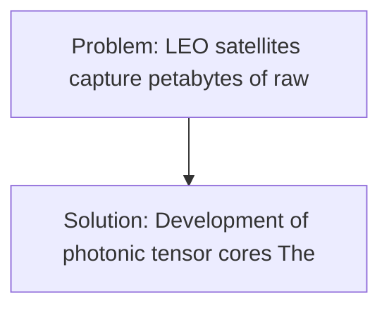
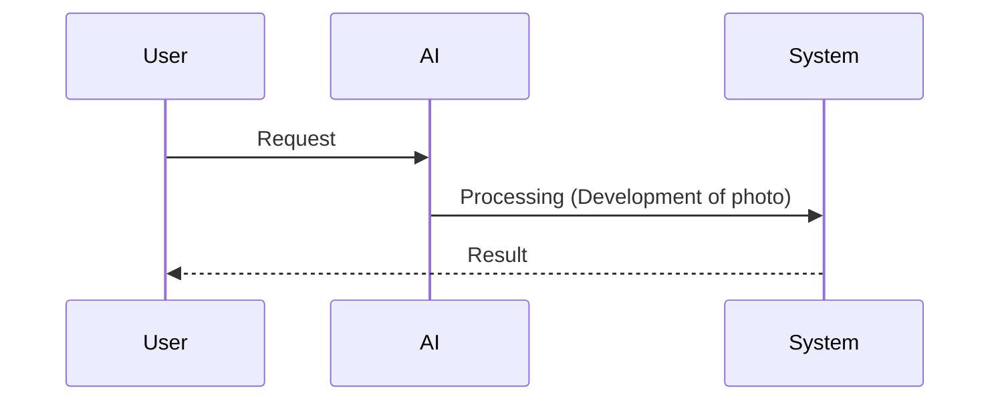

<!-- markdownlint-disable MD013 MD033 MD041 -->

[🇫🇷 Version Française](./README.fr.md)

# Photonic Tensor Satellite

> **Executive Summary:** A B2B solution targeting LEO constellation operators (Starlink, Kuiper), geospatial intelligence agencies, and Earth observation data providers. to solve the following problem: LEO satellites capture petabytes of raw data (hyperspectral images, SAR) but are limited by downlink to return them to Earth. Treating this data on board with conventional GPUs requires too much power (Watts) and generates heat that is impossible to dissipate in space vacuum. The approach relies on: Development of photonic tensor cores. These chips calculate matrice multiplications for neuron networks (e.g. detection of anomalies, intelligent compression) at the speed of light, with almost zero energy and thermal consumption compared to traditional silicon.

---

## 1. Visual Overview & Wow Effect

## 2. Contrarian Thesis (Peter Thiel Style)

- **Popular Belief:** A generic SaaS approach is sufficient.
- **Hidden Truth:** The software optimization of models (quantization, pruning) has reached its physical limits. Only a break in the physical architecture (use photons instead of electrons) allows to cross the wall of energy and thermal dissipation in extreme space environments (SWaP-C).

## 3. Problem & Target Market

- **Business Model:** B2B
- **Target Audience:** LEO constellation operators (Starlink, Kuiper), geospatial intelligence agencies, and Earth observation data providers.
- **Urgent Pain Point:** LEO satellites capture petabytes of raw data (hyperspectral images, SAR) but are limited by downlink to return them to Earth. Treating this data on board with conventional GPUs requires too much power (Watts) and generates heat that is impossible to dissipate in space vacuum.

## 4. Technical Architecture & Infrastructure

Development of photonic tensor cores. These chips calculate matrice multiplications for neuron networks (e.g. detection of anomalies, intelligent compression) at the speed of light, with almost zero energy and thermal consumption compared to traditional silicon.

## 5. Business Model & Financial Viability

| Metric                 | Value                              |
| ---------------------- | ---------------------------------- |
| Pricing Structure      | B2B Subscription / License         |
| 12-Month Target        | 100 clients (or equivalent volume) |
| Revenue Formula        | 100 \* 1000€ = 100k€               |
| Estimated Gross Margin | 80%                                |

## 6. Distribution Engine & Moat

- **Acquisition Strategy:** Direct sales and partnerships in the domain: Deep Tech & Infra (Spatial)
- **Moat (Defensibility):** The software optimization of models (quantization, pruning) has reached its physical limits. Only a break in the physical architecture (use photons instead of electrons) allows to cross the wall of energy and thermal dissipation in extreme space environments (SWaP-C). Risks include: Tolerance to spatial radiations of photonic components (Single Event Effects), sub-nanometric alignment of fibers and wave guides subjected to launch vibrations, maturity of photonic smelters (silicon photonics).

## 7. Detailed Evaluation Grid

| Criterion                   | VC Score (/100) | Market Score (/100) |
| --------------------------- | --------------- | ------------------- |
| Thesis & Monopoly / Urgency | -- / 25         | -- / 25             |
| Moat / LLM Immunity         | -- / 25         | -- / 25             |
| Scalability / UX Friction   | -- / 25         | -- / 25             |
| Unit Economics / ROI        | -- / 25         | -- / 25             |
| **TOTAL**                   | -- / 100        | -- / 100            |

> **VC Verdict:** Pending evaluation.
> **Market Verdict:** Pending evaluation.
