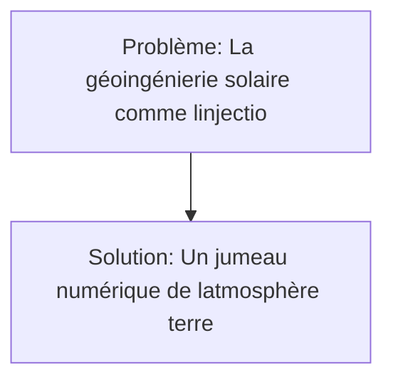
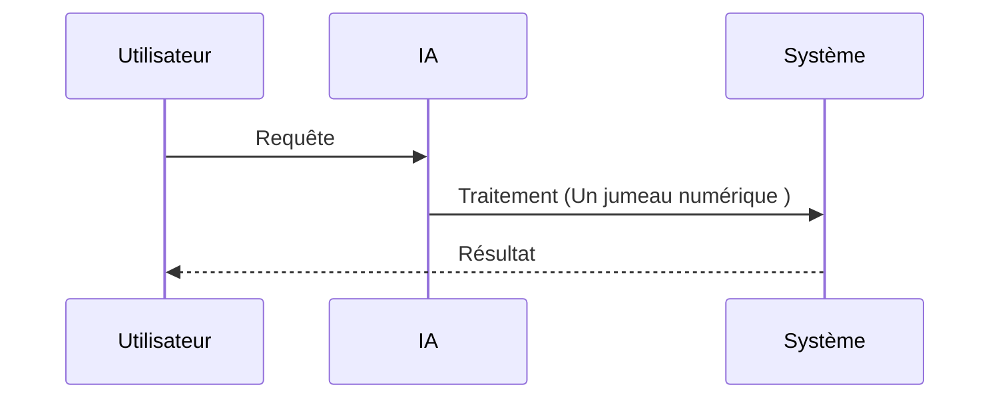

<!-- markdownlint-disable MD013 MD033 MD041 -->

[🇬🇧 English Version](./README.md)

# Stratospheric Aerosol Sim

> **Résumé exécutif :** Une solution B2G / B2B ciblant Gouvernements, agences environnementales de l'ONU, consortiums de réassurance climatique pour résoudre le problème suivant : La géo-ingénierie solaire (comme l'injection d'aérosols stratosphériques pour refroidir la Terre) est envisagée par certains états, mais les effets secondaires (perturbation des moussons, destruction de la couche d'ozone) sont inconnus à l'échelle locale. Agir à l'aveugle risque de provoquer des guerres climatiques. L'approche repose sur : Un jumeau numérique de l'atmosphère terrestre à ultra-haute résolution (Exascale Earth Model). Il combine la thermodynamique des fluides et des modèles d'IA prédictive pour simuler avec précision (maille kilométrique) comment des injections d'aérosols locales impacteraient les régimes de précipitations régionaux sur 10 ans.

---

## 1. Aperçu visuel & Effet Wahou

## 2. La thèse contrariante (Peter Thiel Style)

- **La croyance populaire :** Une approche générique SaaS classique est suffisante.
- **La vérité cachée :** Les modèles climatiques globaux (GCM) actuels ont une résolution trop faible (centaines de km) et demandent des mois de calcul. Un simple modèle de machine learning n'a pas les contraintes physiques (conservation de la masse et de l'énergie) nécessaires pour ne pas délirer sur des projections à long terme.

## 3. Le problème & La cible

- **Modèle économique :** B2G / B2B
- **Cible précise :** Gouvernements, agences environnementales de l'ONU, consortiums de réassurance climatique
- **La douleur urgente :** La géo-ingénierie solaire (comme l'injection d'aérosols stratosphériques pour refroidir la Terre) est envisagée par certains états, mais les effets secondaires (perturbation des moussons, destruction de la couche d'ozone) sont inconnus à l'échelle locale. Agir à l'aveugle risque de provoquer des guerres climatiques.

## 4. Architecture technique & Plomberie

Un jumeau numérique de l'atmosphère terrestre à ultra-haute résolution (Exascale Earth Model). Il combine la thermodynamique des fluides et des modèles d'IA prédictive pour simuler avec précision (maille kilométrique) comment des injections d'aérosols locales impacteraient les régimes de précipitations régionaux sur 10 ans.

## 5. Modèle économique & Viabilité financière

| Métrique                    | Valeur                             |
| --------------------------- | ---------------------------------- |
| Structure de prix           | Abonnement / Licence B2G / B2B     |
| Objectif 12 mois            | 100 clients (ou volume équivalent) |
| Calcul du CA (Target 100k€) | 100 \* 1000€ = 100k€               |
| Marge brute estimée         | 80%                                |

## 6. Moteur de distribution & Fossé défensif (Moat)

- **Stratégie d'acquisition :** Ventes directes et partenariats dans le domaine : ClimateTech & Énergie
- **Moat (Barrière à l'entrée) :** Les modèles climatiques globaux (GCM) actuels ont une résolution trop faible (centaines de km) et demandent des mois de calcul. Un simple modèle de machine learning n'a pas les contraintes physiques (conservation de la masse et de l'énergie) nécessaires pour ne pas délirer sur des projections à long terme. Les risques incluent : Besoin de supercalculateurs de classe Exascale. Fort risque éthique et politique (technologie potentiellement duale ou interdite par des traités internationaux), monétisation complexe reposant uniquement sur du financement public ou para-public.

## 7. Grille d'évaluation détaillée

| Critère                           | Score VC (/100) | Score Terrain (/100) |
| --------------------------------- | --------------- | -------------------- |
| Thèse & Monopole / Urgence        | -- / 25         | -- / 25              |
| Moat / Résistance aux LLM natifs  | -- / 25         | -- / 25              |
| Scalabilité / Friction d'adoption | -- / 25         | -- / 25              |
| Unit Economics / ROI direct       | -- / 25         | -- / 25              |
| **TOTAL**                         | -- / 100        | -- / 100             |

> **Verdict VC :** En attente d'évaluation.
> **Verdict Terrain :** En attente d'évaluation.
