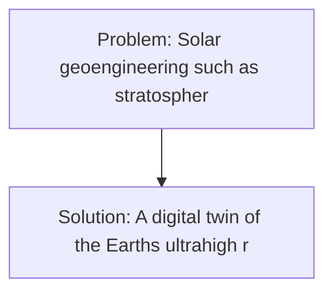
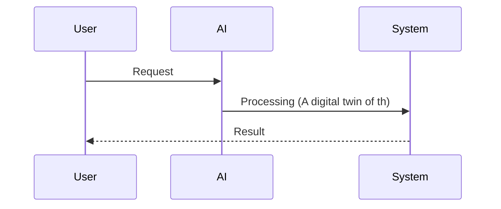

<!-- markdownlint-disable MD013 MD033 MD041 -->

[🇫🇷 Version Française](./README.fr.md)

# Stratospheric Aerosol Sim

> **Executive Summary:** A B2G / B2B solution targeting Governments, UN environmental agencies, climate reinsurance consortia to solve the following problem: Solar geo-engineering (such as stratospheric aerosol injection to cool the Earth) is considered by some states, but side effects (mould disturbance, destruction of the ozone layer) are unknown locally. Blinding risks causing climate wars. The approach relies on: A digital twin of the Earth's ultra-high resolution atmosphere (Exascale Earth Model). It combines fluid thermodynamics with predictive AI models to accurately simulate (kilometre mesh) how local aerosol injections would impact regional precipitation regimes over 10 years.

---

## 1. Visual Overview & Wow Effect

## 2. Contrarian Thesis (Peter Thiel Style)

- **Popular Belief:** A generic SaaS approach is sufficient.
- **Hidden Truth:** Current global climate models (GCMs) have too low resolution (100 km) and require months of calculation. A simple machine learning model does not have the physical constraints (conservation of mass and energy) necessary to avoid delusion on long-term projections.

## 3. Problem & Target Market

- **Business Model:** B2G / B2B
- **Target Audience:** Governments, UN environmental agencies, climate reinsurance consortia
- **Urgent Pain Point:** Solar geo-engineering (such as stratospheric aerosol injection to cool the Earth) is considered by some states, but side effects (mould disturbance, destruction of the ozone layer) are unknown locally. Blinding risks causing climate wars.

## 4. Technical Architecture & Infrastructure

A digital twin of the Earth's ultra-high resolution atmosphere (Exascale Earth Model). It combines fluid thermodynamics with predictive AI models to accurately simulate (kilometre mesh) how local aerosol injections would impact regional precipitation regimes over 10 years.

## 5. Business Model & Financial Viability

| Metric                 | Value                              |
| ---------------------- | ---------------------------------- |
| Pricing Structure      | B2G / B2B Subscription / License   |
| 12-Month Target        | 100 clients (or equivalent volume) |
| Revenue Formula        | 100 \* 1000€ = 100k€               |
| Estimated Gross Margin | 80%                                |

## 6. Distribution Engine & Moat

- **Acquisition Strategy:** Direct sales and partnerships in the domain: ClimateTech & Energy
- **Moat (Defensibility):** Current global climate models (GCMs) have too low resolution (100 km) and require months of calculation. A simple machine learning model does not have the physical constraints (conservation of mass and energy) necessary to avoid delusion on long-term projections. Risks include: Need Exascale class supercomputers. High ethical and political risk (potentially dual technology or prohibited by international treaties), complex monetization based solely on public or para-public funding.

## 7. Detailed Evaluation Grid

| Criterion                   | VC Score (/100) | Market Score (/100) |
| --------------------------- | --------------- | ------------------- |
| Thesis & Monopoly / Urgency | -- / 25         | -- / 25             |
| Moat / LLM Immunity         | -- / 25         | -- / 25             |
| Scalability / UX Friction   | -- / 25         | -- / 25             |
| Unit Economics / ROI        | -- / 25         | -- / 25             |
| **TOTAL**                   | -- / 100        | -- / 100            |

> **VC Verdict:** Pending evaluation.
> **Market Verdict:** Pending evaluation.
