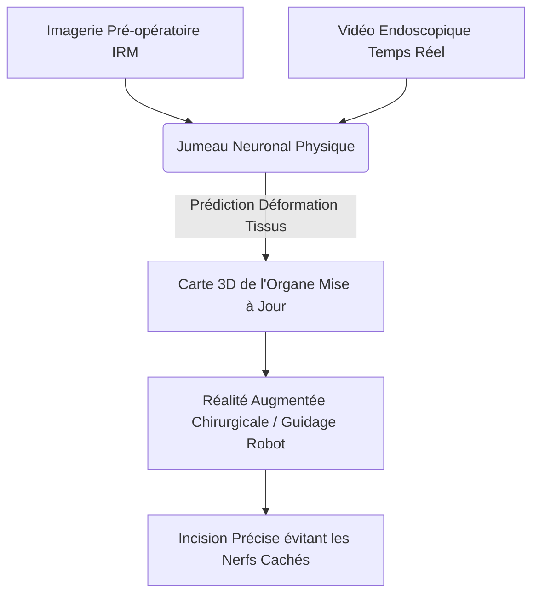
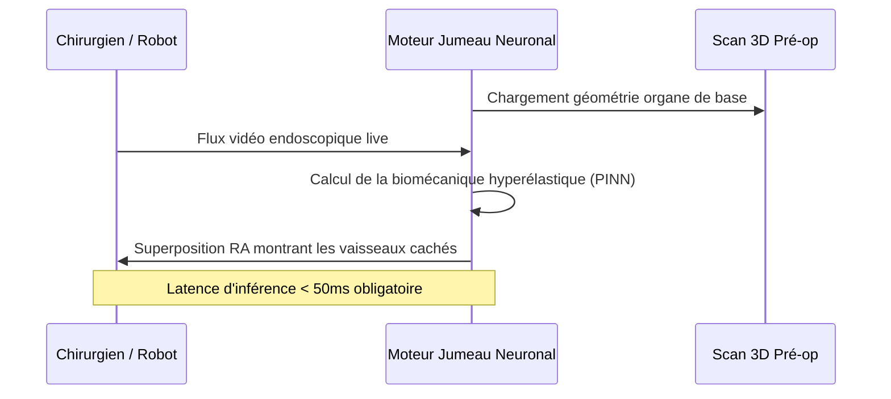

<!-- markdownlint-disable MD009 MD010 MD013 MD022 MD028 MD032 MD033 MD034 MD036 MD037 MD039 MD041 MD058 MD060 -->
[ 🇬🇧 English Version ](./README.md)

# Surgical Neural Twin

> **Résumé exécutif :** Un jumeau numérique biomécanique temps réel alimenté par des réseaux de neurones informés par la physique, qui recalcule instantanément la déformation des tissus mous pour guider les robots chirurgicaux via une réalité augmentée ultra-précise.

---

## 1. Aperçu visuel & Effet Wahou

## 2. La thèse contrariante (Peter Thiel Style)

**La croyance populaire :** De meilleurs résultats chirurgicaux passent par des IRM préopératoires de plus haute résolution et de meilleures caméras optiques sur les robots chirurgicaux.

**La vérité cachée :** L'imagerie pré-opératoire devient totalement obsolète à la seconde où le chirurgien fait la première incision, car les tissus mous se déforment et saignent. La véritable précision exige une simulation physique en temps réel pendant l'opération, calculant comment la chair se comporte réellement, et non pas à quoi elle ressemblait hier.

## 3. Le problème & La cible

**Modèle économique :** B2B (Licence hospitalière / Fabricants robots)

**Cible précise :** Fabricants de robots chirurgicaux (Intuitive Surgical, Medtronic), chirurgiens de pointe, systèmes de santé nationaux.

**La douleur urgente :** Lors de chirurgies complexes (neurochirurgie, hépatique), les chirurgiens naviguent "à l'aveugle" par rapport à l'imagerie 3D initiale car les organes bougent. Le risque de sectionner un vaisseau critique ou un nerf caché qui n'est plus à sa place théorique est immense.

## 4. Architecture technique & Plomberie

## 5. Modèle économique & Viabilité financière

| Métrique | Valeur |
|---|---|
| Structure de prix | Licence d'intégration OS par robot + Frais par chirurgie |
| Objectif 12 mois | 2 partenariats fabricants ou 5 installations hospitalières pilotes |
| Calcul du CA (Target 100k€) | 5 hôpitaux × 20 000 €/an = 100 000 € ARR |
| Marge brute estimée | 85% (Licence Logicielle) |

## 6. Moteur de distribution & Fossé défensif (Moat)

**Stratégie d'acquisition :** Partenariats d'intégration B2B avec les grandes entreprises de robotique chirurgicale, en intégrant le Neural Twin comme option logicielle premium dans leurs consoles matérielles existantes.

**Moat (Barrière à l'entrée) :** La simulation biomécanique standard (éléments finis) prend des heures. Atteindre une inférence en millisecondes nécessite une IA informée par la physique (PINN) entraînée sur des données médicales multimodales rares. De plus, la certification FDA/CE pour un logiciel de classe III crée une barrière réglementaire colossale de plusieurs années.

## 7. Grille d'évaluation détaillée

| Critère | Score VC (/100) | Score Terrain (/100) |
|---|---|---|
| Thèse & Monopole / Urgence | -- / 25 | -- / 25 |
| Moat / Résistance aux LLM natifs | -- / 25 | -- / 25 |
| Scalabilité / Friction d'adoption | -- / 25 | -- / 25 |
| Unit Economics / ROI direct | -- / 25 | -- / 25 |
| **TOTAL** | **-- / 100** | **-- / 100** |

> **Verdict VC :** En attente d'évaluation.

> **Verdict Terrain :** En attente d'évaluation.
