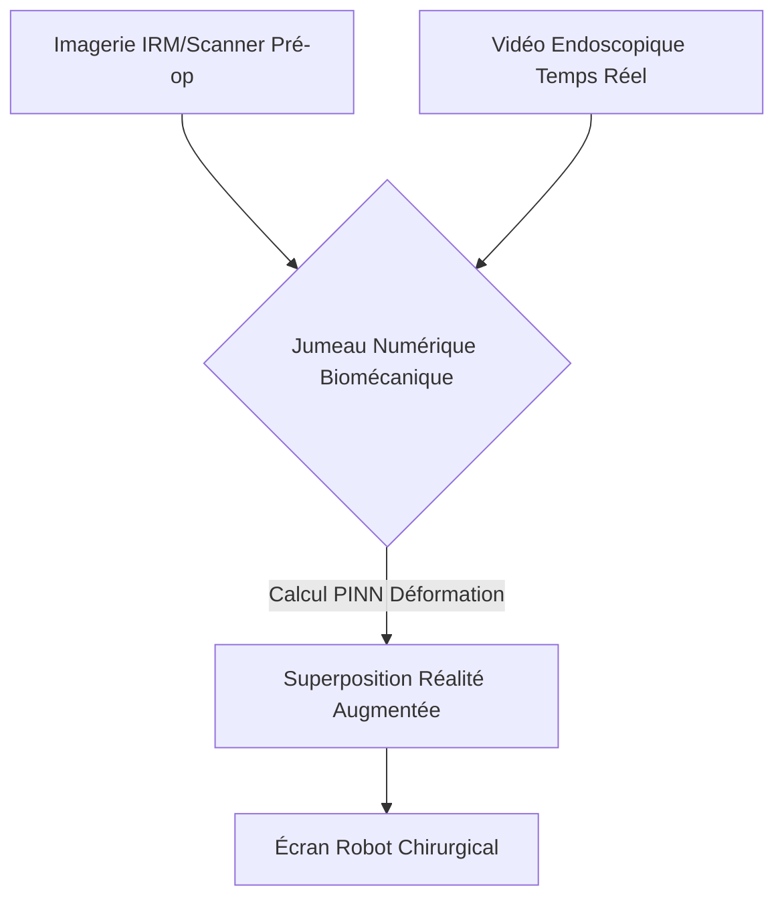
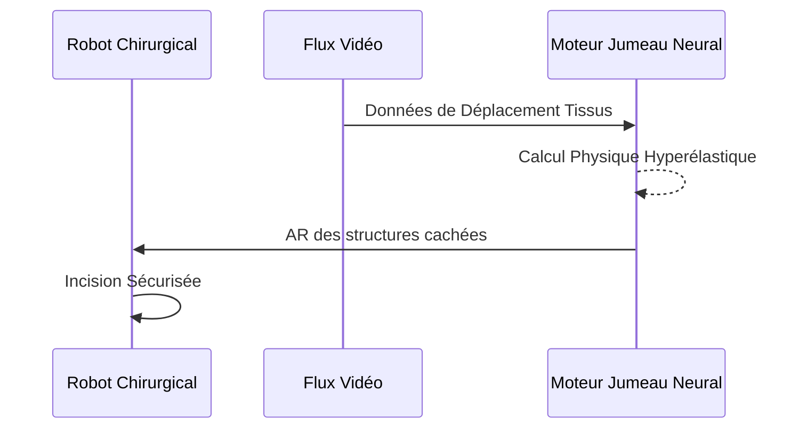

<!-- markdownlint-disable MD009 MD010 MD013 MD022 MD028 MD032 MD033 MD034 MD036 MD037 MD039 MD041 MD058 MD060 -->
[ 🇬🇧 English Version ](./README.md)

# Surgical Neural Twin

> **Résumé exécutif :** Un moteur de jumeau numérique biomécanique propulsé par des réseaux de neurones informés par la physique pour recalculer la déformation 3D des tissus mous en temps réel pendant la chirurgie.

---

## 1. Aperçu visuel & Effet Wahou

## 2. La thèse contrariante (Peter Thiel Style)

**La croyance populaire :** La navigation chirurgicale a juste besoin d'imagerie 3D préopératoire et de vision par ordinateur standard.

**La vérité cachée :** L'imagerie pré-opératoire devient obsolète à la première incision car les tissus se déforment. Les IA de vision standards ne comprennent pas la physique hyperélastique ; il faut des réseaux de neurones contraints par la physique (PINN) opérant en millisecondes.

## 3. Le problème & La cible

**Modèle économique :** B2B (Licence hospitalière / Robots chirurgicaux)

**Cible précise :** Fabricants de robots chirurgicaux, chirurgiens de pointe.

**La douleur urgente :** Lors de chirurgies complexes (ex: foie), les organes se déforment instantanément. Le chirurgien navigue "à l'aveugle", risquant de sectionner des vaisseaux critiques cachés.

## 4. Architecture technique & Plomberie

## 5. Modèle économique & Viabilité financière

| Métrique | Valeur |
| --- | --- |
| Structure de prix | Licence logicielle par système robotique |
| Objectif 12 mois | 10 intégrations sur robots chirurgicaux |
| Calcul du CA (Target 100k€) | 10 systèmes * 10 000€/mois = 1.2M€ ARR |
| Marge brute estimée | 90% (Logiciel) |

## 6. Moteur de distribution & Fossé défensif (Moat)

**Stratégie d'acquisition :** Partenariats d'intégration avec le petit oligopole des fabricants de robots.

**Moat (Barrière à l'entrée) :** La simulation d'éléments finis prend des heures. Réussir l'inférence en millisecondes sans latence est un défi énorme. Certification FDA/CE Classe III très lourde.

## 7. Grille d'évaluation détaillée

| Critère | Score VC (/100) | Score Terrain (/100) |
| :--- | :---: | :---: |
| Thèse & Monopole / Urgence | -- / 25 | -- / 25 |
| Moat / Résistance aux LLM natifs | -- / 25 | -- / 25 |
| Scalabilité / Friction d'adoption | -- / 25 | -- / 25 |
| Unit Economics / ROI direct | -- / 25 | -- / 25 |
| **TOTAL** | **-- / 100** | **-- / 100** |

> **Verdict VC :** En attente d'évaluation.
>
> **Verdict Terrain :** En attente d'évaluation.
