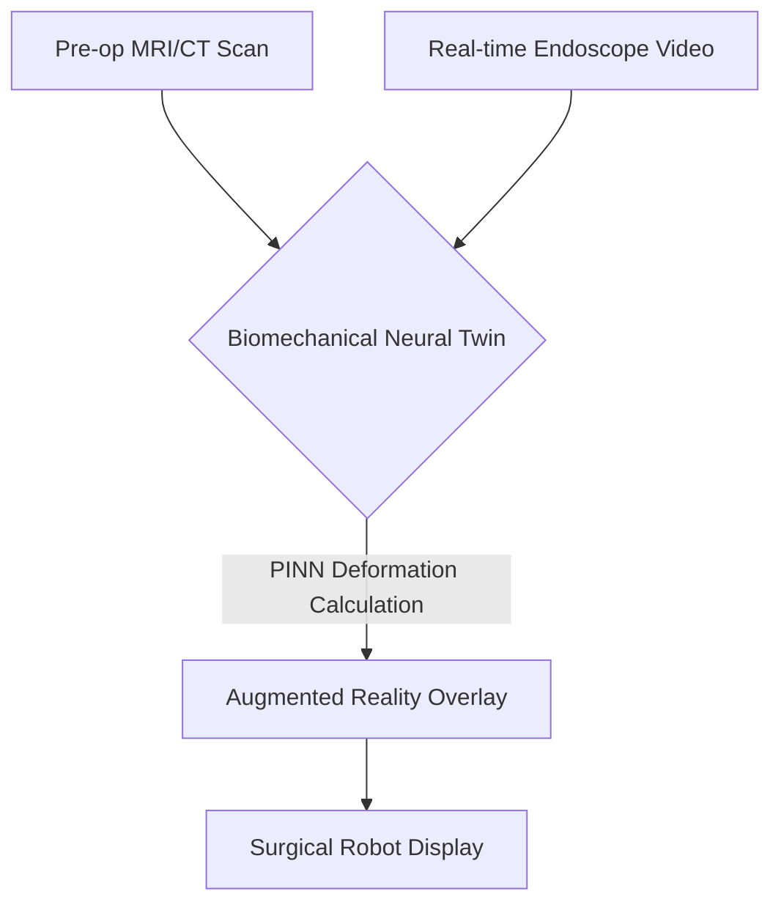
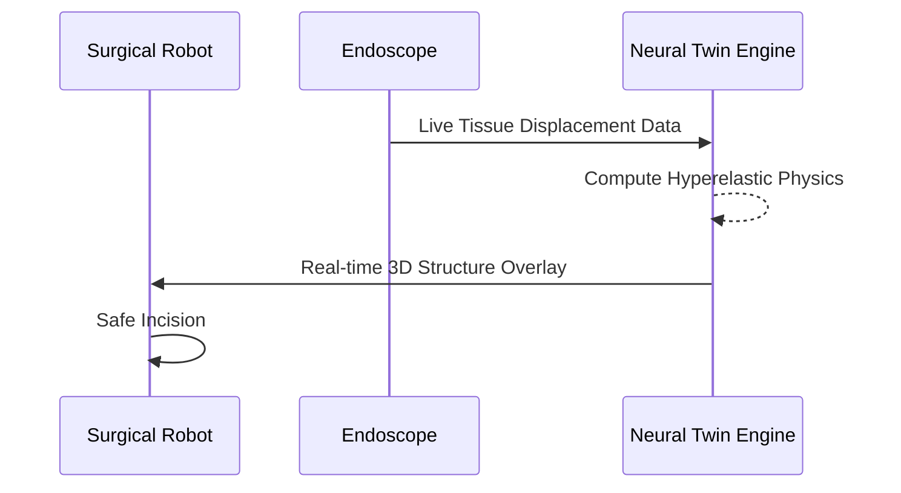

<!-- markdownlint-disable MD009 MD010 MD013 MD022 MD028 MD032 MD033 MD034 MD036 MD037 MD039 MD041 MD058 MD060 -->
[ 🇫🇷 Version Française ](./README.fr.md)

# Surgical Neural Twin

> **Executive Summary:** A biomechanical digital twin engine powered by Physics-Informed Neural Networks that recalculates 3D soft tissue deformation in real-time during complex surgery.

---

## 1. Visual Overview & Wow Effect

## 2. Contrarian Thesis (Peter Thiel Style)

**Popular Belief:** Surgical navigation just needs better pre-operative 3D imaging and standard computer vision.

**Hidden Truth:** Pre-op imagery becomes obsolete the second the surgeon makes an incision because soft tissues deform and bleed. Standard computer vision doesn't understand the hyperelastic physics of human flesh; we need physics-informed networks computing in milliseconds.

## 3. Problem & Target Market

**Business Model:** B2B (Hospital License / Surgical Robot OEMs)

**Target Audience:** Surgical robot manufacturers (Intuitive Surgical, Medtronic), advanced surgeons, national health systems.

**Urgent Pain Point:** Surgeons operate "blind" to underlying structures (blood vessels, nerves) once soft organs deform, leading to fatal mistakes or excessively cautious, slow surgeries.

## 4. Technical Architecture & Infrastructure

## 5. Business Model & Financial Viability

| Metric | Value |
| --- | --- |
| Pricing Structure | Per-system Software License |
| 12-Month Target | 10 Surgical Robot Integrations |
| Revenue Formula | 10 systems * 10,000€/month = 1.2M€ ARR |
| Estimated Gross Margin | 90% (Software) |

## 6. Distribution Engine & Moat

**Acquisition Strategy:** OEM integration partnerships with the small oligopoly of surgical robot manufacturers.

**Moat (Defensibility):** Traditional Finite Element Analysis takes hours; doing it in milliseconds requires deep PINN innovation. Extremely high FDA/CE Class III certification barriers prevent any quick startup copies.

## 7. Detailed Evaluation Grid

| Criterion | VC Score (/100) | Market Score (/100) |
| :--- | :---: | :---: |
| Thesis & Monopoly / Urgency | -- / 25 | -- / 25 |
| Moat / LLM Immunity | -- / 25 | -- / 25 |
| Scalability / UX Friction | -- / 25 | -- / 25 |
| Unit Economics / ROI | -- / 25 | -- / 25 |
| **TOTAL** | **-- / 100** | **-- / 100** |

> **VC Verdict:** Pending evaluation.
>
> **Market Verdict:** Pending evaluation.
