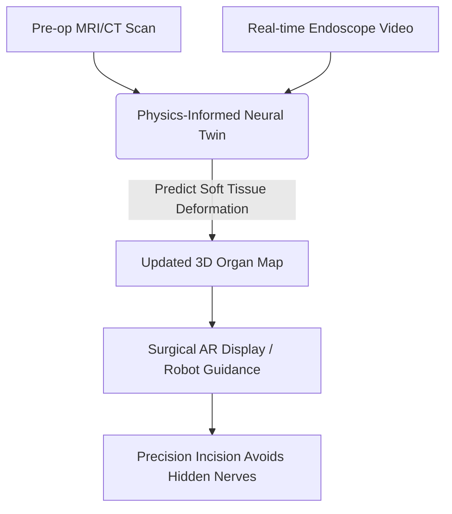
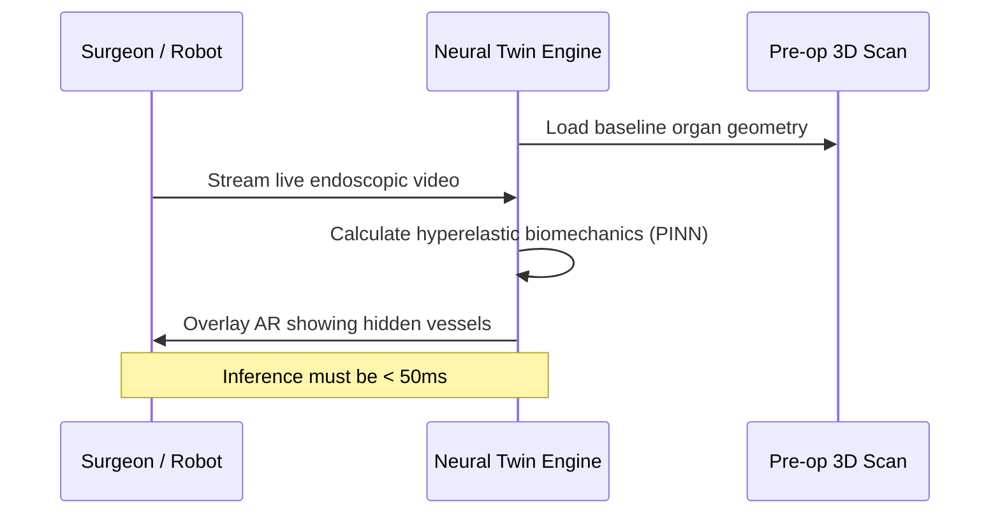

<!-- markdownlint-disable MD009 MD010 MD013 MD022 MD028 MD032 MD033 MD034 MD036 MD037 MD039 MD041 MD058 MD060 -->
[ 🇫🇷 Version Française ](./README.fr.md)

# Surgical Neural Twin

> **Executive Summary:** A real-time biomechanical digital twin powered by Physics-Informed Neural Networks that recalculates soft tissue deformation instantly during surgery to guide surgical robots via ultra-precise augmented reality.

---

## 1. Visual Overview & Wow Effect

## 2. Contrarian Thesis (Peter Thiel Style)

**Popular Belief:** Better surgical outcomes rely on higher resolution pre-operative MRI scans and better optical cameras on surgical robots.

**Hidden Truth:** Pre-op scans become completely obsolete the second a surgeon makes the first cut, because soft tissues deform, sag, and bleed. True precision requires real-time physics simulation during the surgery, calculating how the flesh actually behaves, not just how it looked yesterday.

## 3. Problem & Target Market

**Business Model:** B2B (Hospital Licensing / Robotics OEM)

**Target Audience:** Surgical robot manufacturers (Intuitive Surgical, Medtronic), elite surgeons, national healthcare systems.

**Urgent Pain Point:** During complex surgeries (e.g., neurosurgery, hepatic), surgeons navigate "blind" relative to the pre-op imagery because the organs shift. This risks hitting critical blood vessels or nerves that are no longer where the 3D map says they are, leading to fatal errors.

## 4. Technical Architecture & Infrastructure

## 5. Business Model & Financial Viability

| Metric | Value |
|---|---|
| Pricing Structure | Per-robot OS Integration License + Per-surgery fee |
| 12-Month Target | 2 OEM partnerships or 5 pilot hospital installations |
| Revenue Formula | 5 hospitals × €20,000/year = €100,000 ARR |
| Estimated Gross Margin | 85% (Software License) |

## 6. Distribution Engine & Moat

**Acquisition Strategy:** B2B integration partnerships with major surgical robotics companies, embedding the Neural Twin as a premium add-on feature in their existing hardware consoles.

**Moat (Defensibility):** Standard biomechanical simulation (Finite Element Analysis) takes hours to compute. Achieving millisecond inference requires a Physics-Informed Neural Network architecture trained on exceptional multimodal medical data. FDA/CE Class III software certification creates an enormous, multi-year barrier to entry.

## 7. Detailed Evaluation Grid

| Criterion | VC Score (/100) | Market Score (/100) |
|---|---|---|
| Thesis & Monopoly / Urgency | -- / 25 | -- / 25 |
| Moat / LLM Immunity | -- / 25 | -- / 25 |
| Scalability / UX Friction | -- / 25 | -- / 25 |
| Unit Economics / ROI | -- / 25 | -- / 25 |
| **TOTAL** | **-- / 100** | **-- / 100** |

> **VC Verdict:** Pending evaluation.

> **Market Verdict:** Pending evaluation.
