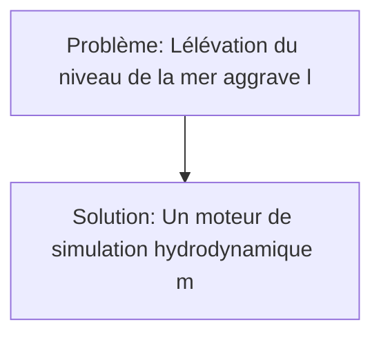
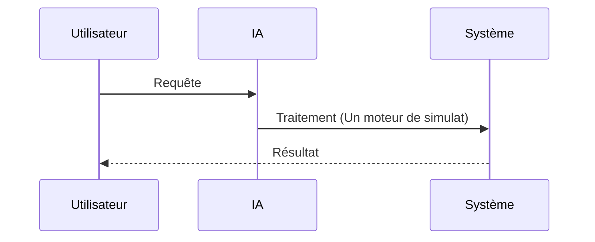

<!-- markdownlint-disable MD013 MD033 MD041 -->

[🇬🇧 English Version](./README.md)

# Tsunami Coastal Simulator

> **Résumé exécutif :** Une solution B2G / B2B ciblant Gouvernements côtiers, planificateurs urbains, assureurs immobiliers (réassurance), développeurs d'infrastructures offshore pour résoudre le problème suivant : L'élévation du niveau de la mer aggrave l'impact destructeur des tsunamis et des ondes de tempête. Les modèles d'inondation actuels sont macroscopiques et statiques ; ils ne prennent pas en compte l'interaction dynamique entre la vague et la géométrie urbaine 3D (comment l'eau s'engouffre dans les rues spécifiques, détruisant certains bâtiments et pas d'autres). L'approche repose sur : Un moteur de simulation hydrodynamique massivement parallèle (multi-GPU) intégrant les jumeaux numériques urbains (BIM/GIS 3D). Le système résout les équations d'eau peu profonde (Shallow Water Equations) à l'échelle du mètre, modélisant les effets de goulet d'étranglement urbain et de débris flottants.

---

## 1. Aperçu visuel & Effet Wahou

## 2. La thèse contrariante (Peter Thiel Style)

- **La croyance populaire :** Une approche générique SaaS classique est suffisante.
- **La vérité cachée :** Les cartes d'inondation 2D standard sont de simples extrusions basées sur l'altitude. Elles ignorent la physique des fluides complexe (réflexion, diffraction, transport de sédiments/débris) qui détermine la force d'impact réelle sur les structures.

## 3. Le problème & La cible

- **Modèle économique :** B2G / B2B
- **Cible précise :** Gouvernements côtiers, planificateurs urbains, assureurs immobiliers (réassurance), développeurs d'infrastructures offshore
- **La douleur urgente :** L'élévation du niveau de la mer aggrave l'impact destructeur des tsunamis et des ondes de tempête. Les modèles d'inondation actuels sont macroscopiques et statiques ; ils ne prennent pas en compte l'interaction dynamique entre la vague et la géométrie urbaine 3D (comment l'eau s'engouffre dans les rues spécifiques, détruisant certains bâtiments et pas d'autres).

## 4. Architecture technique & Plomberie

Un moteur de simulation hydrodynamique massivement parallèle (multi-GPU) intégrant les jumeaux numériques urbains (BIM/GIS 3D). Le système résout les équations d'eau peu profonde (Shallow Water Equations) à l'échelle du mètre, modélisant les effets de goulet d'étranglement urbain et de débris flottants.

## 5. Modèle économique & Viabilité financière

| Métrique                    | Valeur                             |
| --------------------------- | ---------------------------------- |
| Structure de prix           | Abonnement / Licence B2G / B2B     |
| Objectif 12 mois            | 100 clients (ou volume équivalent) |
| Calcul du CA (Target 100k€) | 100 \* 1000€ = 100k€               |
| Marge brute estimée         | 80%                                |

## 6. Moteur de distribution & Fossé défensif (Moat)

- **Stratégie d'acquisition :** Ventes directes et partenariats dans le domaine : World Models & Simulation physique
- **Moat (Barrière à l'entrée) :** Les cartes d'inondation 2D standard sont de simples extrusions basées sur l'altitude. Elles ignorent la physique des fluides complexe (réflexion, diffraction, transport de sédiments/débris) qui détermine la force d'impact réelle sur les structures. Les risques incluent : Besoin de données bathymétriques et topographiques lidar très haute résolution souvent incomplètes ou payantes. Le modèle d'affaires B2G est notoire pour ses cycles de vente extrêmement longs (plusieurs années) et sa dépendance aux budgets publics imprévisibles.

## 7. Grille d'évaluation détaillée

| Critère                           | Score VC (/100) | Score Terrain (/100) |
| --------------------------------- | --------------- | -------------------- |
| Thèse & Monopole / Urgence        | -- / 25         | -- / 25              |
| Moat / Résistance aux LLM natifs  | -- / 25         | -- / 25              |
| Scalabilité / Friction d'adoption | -- / 25         | -- / 25              |
| Unit Economics / ROI direct       | -- / 25         | -- / 25              |
| **TOTAL**                         | -- / 100        | -- / 100             |

> **Verdict VC :** En attente d'évaluation.
> **Verdict Terrain :** En attente d'évaluation.
