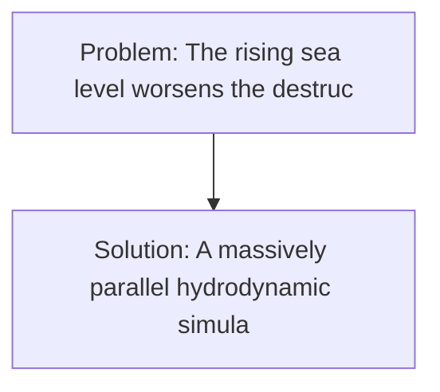
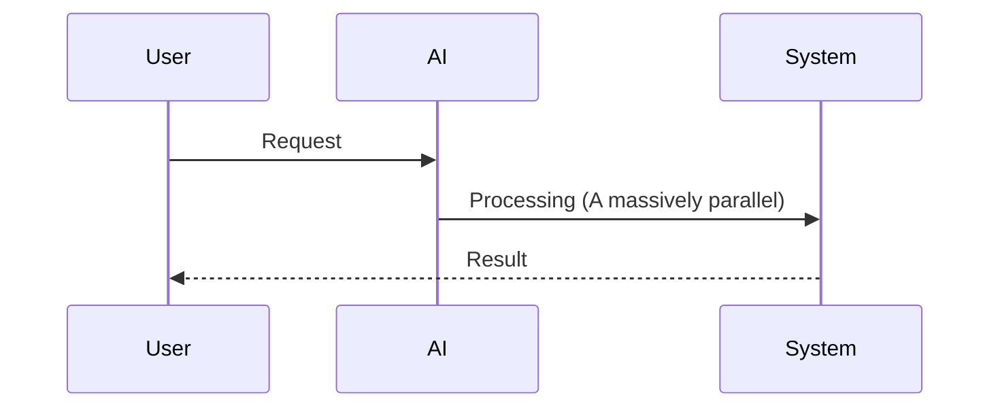

<!-- markdownlint-disable MD013 MD033 MD041 -->

[🇫🇷 Version Française](./README.fr.md)

# Tsunami Coastal Simulator

> **Executive Summary:** A B2G / B2B solution targeting Coastal governments, urban planners, real estate insurers (reinsurance), offshore infrastructure developers to solve the following problem: The rising sea level worsens the destructive impact of tsunamis and storm surges. Current flood patterns are macroscopic and static; They do not take into account the dynamic interaction between the wave and 3D urban geometry (how the water rushes into specific streets, destroying some buildings and not others). The approach relies on: A massively parallel hydrodynamic simulation engine (multi-GPU) integrating urban digital twins (BIM/GIS 3D). The system solves the shallow water equations (Shallow Water Equations) on a meter scale, modeling the effects of urban bottlenecks and floating debris.

---

## 1. Visual Overview & Wow Effect

## 2. Contrarian Thesis (Peter Thiel Style)

- **Popular Belief:** A generic SaaS approach is sufficient.
- **Hidden Truth:** Standard 2D flood maps are simple altitude-based extrusions. They ignore the physics of complex fluids (reflection, diffraction, sediment transport/debris) that determines the actual impact force on structures.

## 3. Problem & Target Market

- **Business Model:** B2G / B2B
- **Target Audience:** Coastal governments, urban planners, real estate insurers (reinsurance), offshore infrastructure developers
- **Urgent Pain Point:** The rising sea level worsens the destructive impact of tsunamis and storm surges. Current flood patterns are macroscopic and static; They do not take into account the dynamic interaction between the wave and 3D urban geometry (how the water rushes into specific streets, destroying some buildings and not others).

## 4. Technical Architecture & Infrastructure

A massively parallel hydrodynamic simulation engine (multi-GPU) integrating urban digital twins (BIM/GIS 3D). The system solves the shallow water equations (Shallow Water Equations) on a meter scale, modeling the effects of urban bottlenecks and floating debris.

## 5. Business Model & Financial Viability

| Metric                 | Value                              |
| ---------------------- | ---------------------------------- |
| Pricing Structure      | B2G / B2B Subscription / License   |
| 12-Month Target        | 100 clients (or equivalent volume) |
| Revenue Formula        | 100 \* 1000€ = 100k€               |
| Estimated Gross Margin | 80%                                |

## 6. Distribution Engine & Moat

- **Acquisition Strategy:** Direct sales and partnerships in the domain: World Models & Physical Simulation
- **Moat (Defensibility):** Standard 2D flood maps are simple altitude-based extrusions. They ignore the physics of complex fluids (reflection, diffraction, sediment transport/debris) that determines the actual impact force on structures. Risks include: Need very high resolution bathymetric and topographical data Lidar often incomplete or pay. The B2G business model is known for its extremely long sales cycles (several years) and its dependence on unpredictable public budgets.

## 7. Detailed Evaluation Grid

| Criterion                   | VC Score (/100) | Market Score (/100) |
| --------------------------- | --------------- | ------------------- |
| Thesis & Monopoly / Urgency | -- / 25         | -- / 25             |
| Moat / LLM Immunity         | -- / 25         | -- / 25             |
| Scalability / UX Friction   | -- / 25         | -- / 25             |
| Unit Economics / ROI        | -- / 25         | -- / 25             |
| **TOTAL**                   | -- / 100        | -- / 100            |

> **VC Verdict:** Pending evaluation.
> **Market Verdict:** Pending evaluation.
