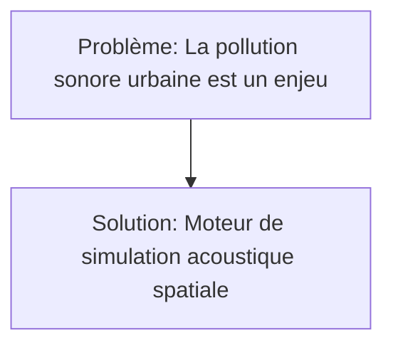
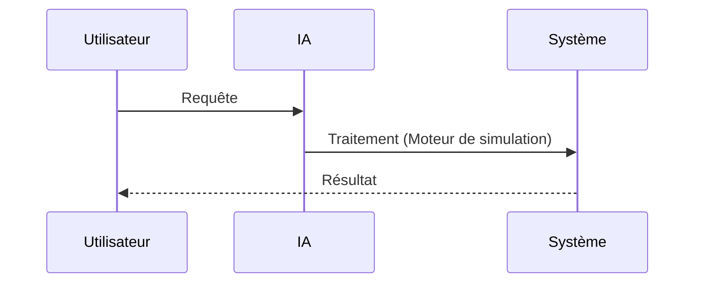

<!-- markdownlint-disable MD013 MD033 MD041 -->

[🇬🇧 English Version](./README.md)

# Urban Acoustic Neural Twin

> **Résumé exécutif :** Une solution B2G / B2B ciblant Municipalités, urbanistes, constructeurs de transports (métros, tramways), et promoteurs immobiliers. pour résoudre le problème suivant : La pollution sonore urbaine est un enjeu majeur de santé publique, réduisant l'espérance de vie et causant des maladies cardiovasculaires. Les simulations acoustiques actuelles (Ray Tracing audio) prennent des jours de calcul, sont limitées à de petites zones et échouent à modéliser la réflexion sonore complexe des nouveaux matériaux de construction. L'approche repose sur : Moteur de simulation acoustique spatiale à l'échelle d'une ville (Neural Twin) utilisant des réseaux de neurones informés par la physique (PINNs) pour résoudre l'équation des ondes en temps réel. Il intègre la géométrie urbaine 3D, les propriétés des matériaux et le trafic dynamique pour simuler la propagation du bruit de manière interactive.

---

## 1. Aperçu visuel & Effet Wahou

## 2. La thèse contrariante (Peter Thiel Style)

- **La croyance populaire :** Une approche générique SaaS classique est suffisante.
- **La vérité cachée :** Les méthodes numériques traditionnelles (Boundary Element Method) ne scalent pas à la taille d'une métropole. Un LLM ou un SaaS standard n'a aucune compréhension des équations différentielles partielles régissant la physique ondulatoire et la diffraction dans des géométries urbaines complexes.

## 3. Le problème & La cible

- **Modèle économique :** B2G / B2B
- **Cible précise :** Municipalités, urbanistes, constructeurs de transports (métros, tramways), et promoteurs immobiliers.
- **La douleur urgente :** La pollution sonore urbaine est un enjeu majeur de santé publique, réduisant l'espérance de vie et causant des maladies cardiovasculaires. Les simulations acoustiques actuelles (Ray Tracing audio) prennent des jours de calcul, sont limitées à de petites zones et échouent à modéliser la réflexion sonore complexe des nouveaux matériaux de construction.

## 4. Architecture technique & Plomberie

Moteur de simulation acoustique spatiale à l'échelle d'une ville (Neural Twin) utilisant des réseaux de neurones informés par la physique (PINNs) pour résoudre l'équation des ondes en temps réel. Il intègre la géométrie urbaine 3D, les propriétés des matériaux et le trafic dynamique pour simuler la propagation du bruit de manière interactive.

## 5. Modèle économique & Viabilité financière

| Métrique                    | Valeur                             |
| --------------------------- | ---------------------------------- |
| Structure de prix           | Abonnement / Licence B2G / B2B     |
| Objectif 12 mois            | 100 clients (ou volume équivalent) |
| Calcul du CA (Target 100k€) | 100 \* 1000€ = 100k€               |
| Marge brute estimée         | 80%                                |

## 6. Moteur de distribution & Fossé défensif (Moat)

- **Stratégie d'acquisition :** Ventes directes et partenariats dans le domaine : World Models & Simulation physique
- **Moat (Barrière à l'entrée) :** Les méthodes numériques traditionnelles (Boundary Element Method) ne scalent pas à la taille d'une métropole. Un LLM ou un SaaS standard n'a aucune compréhension des équations différentielles partielles régissant la physique ondulatoire et la diffraction dans des géométries urbaines complexes. Les risques incluent : Besoin massif de données pour calibrer le modèle (capteurs IoT acoustiques dispersés dans la ville), difficulté à modéliser la variabilité atmosphérique (vent, température) qui affecte la propagation du son, longue durée des cycles de vente (B2G).

## 7. Grille d'évaluation détaillée

| Critère                           | Score VC (/100) | Score Terrain (/100) |
| --------------------------------- | --------------- | -------------------- |
| Thèse & Monopole / Urgence        | -- / 25         | -- / 25              |
| Moat / Résistance aux LLM natifs  | -- / 25         | -- / 25              |
| Scalabilité / Friction d'adoption | -- / 25         | -- / 25              |
| Unit Economics / ROI direct       | -- / 25         | -- / 25              |
| **TOTAL**                         | -- / 100        | -- / 100             |

> **Verdict VC :** En attente d'évaluation.
> **Verdict Terrain :** En attente d'évaluation.
