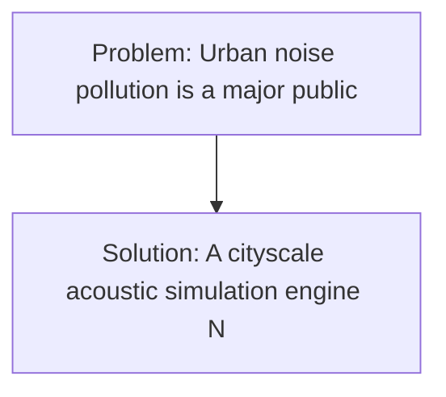
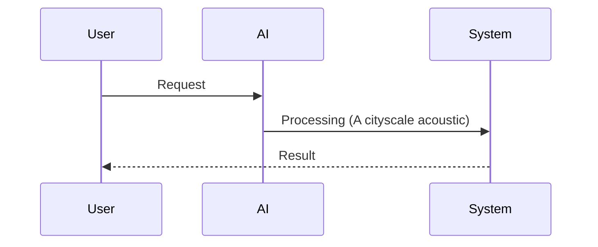

<!-- markdownlint-disable MD013 MD033 MD041 -->

[🇫🇷 Version Française](./README.fr.md)

# Urban Acoustic Neural Twin

> **Executive Summary:** A B2G / B2B solution targeting Municipalities, urban planners, transport manufacturers (metros, trams), and real estate developers. to solve the following problem: Urban noise pollution is a major public health issue, reducing life expectancy and causing cardiovascular disease. Current acoustic simulations (Ray Tracing audio) take days of calculation, are limited to small areas and fail to model the complex sound reflection of new building materials. The approach relies on: A city-scale acoustic simulation engine (Neural Twin) using physics-informed neuron networks (PINNs) to solve the real-time wave equation. It integrates 3D urban geometry, material properties and dynamic traffic to simulate noise propagation in an interactive way.

---

## 1. Visual Overview & Wow Effect

## 2. Contrarian Thesis (Peter Thiel Style)

- **Popular Belief:** A generic SaaS approach is sufficient.
- **Hidden Truth:** The Boundary Element Method does not scalate to the size of a metropolis. A standard LLM or SaaS has no understanding of the partial differential equations governing wave physics and diffraction in complex urban geometries.

## 3. Problem & Target Market

- **Business Model:** B2G / B2B
- **Target Audience:** Municipalities, urban planners, transport manufacturers (metros, trams), and real estate developers.
- **Urgent Pain Point:** Urban noise pollution is a major public health issue, reducing life expectancy and causing cardiovascular disease. Current acoustic simulations (Ray Tracing audio) take days of calculation, are limited to small areas and fail to model the complex sound reflection of new building materials.

## 4. Technical Architecture & Infrastructure

A city-scale acoustic simulation engine (Neural Twin) using physics-informed neuron networks (PINNs) to solve the real-time wave equation. It integrates 3D urban geometry, material properties and dynamic traffic to simulate noise propagation in an interactive way.

## 5. Business Model & Financial Viability

| Metric                 | Value                              |
| ---------------------- | ---------------------------------- |
| Pricing Structure      | B2G / B2B Subscription / License   |
| 12-Month Target        | 100 clients (or equivalent volume) |
| Revenue Formula        | 100 \* 1000€ = 100k€               |
| Estimated Gross Margin | 80%                                |

## 6. Distribution Engine & Moat

- **Acquisition Strategy:** Direct sales and partnerships in the domain: World Models & Physical Simulation
- **Moat (Defensibility):** The Boundary Element Method does not scalate to the size of a metropolis. A standard LLM or SaaS has no understanding of the partial differential equations governing wave physics and diffraction in complex urban geometries. Risks include: Massive data need to calibrate the model (acoustic IoT sensors scattered throughout the city), difficulty in modeling atmospheric variability (wind, temperature) that affects the propagation of sound, long sales cycles (B2G).

## 7. Detailed Evaluation Grid

| Criterion                   | VC Score (/100) | Market Score (/100) |
| --------------------------- | --------------- | ------------------- |
| Thesis & Monopoly / Urgency | -- / 25         | -- / 25             |
| Moat / LLM Immunity         | -- / 25         | -- / 25             |
| Scalability / UX Friction   | -- / 25         | -- / 25             |
| Unit Economics / ROI        | -- / 25         | -- / 25             |
| **TOTAL**                   | -- / 100        | -- / 100            |

> **VC Verdict:** Pending evaluation.
> **Market Verdict:** Pending evaluation.
