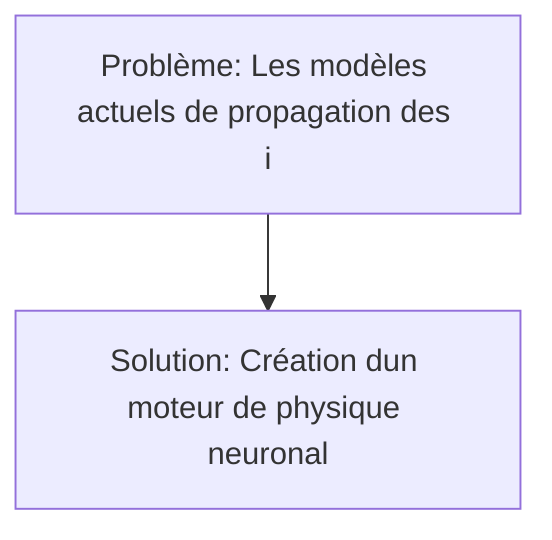
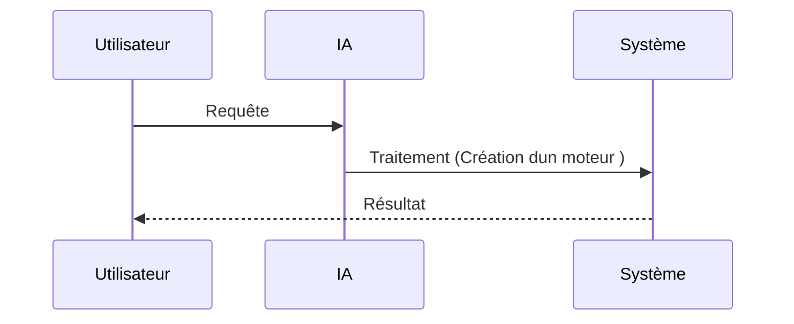

<!-- markdownlint-disable MD013 MD033 MD041 -->

[🇬🇧 English Version](./README.md)

# Wildfire Neural Twin

> **Résumé exécutif :** Une solution B2B / B2G ciblant Agences gouvernementales de gestion des forêts, opérateurs de réseaux électriques (utilities), et compagnies d'assurance spécialisées dans les risques climatiques. pour résoudre le problème suivant : Les modèles actuels de propagation des incendies de forêt sont lents, s'appuient sur des données statiques et peinent à modéliser les dynamiques de feu extrêmes induites par le micro-climat. Cela entraîne des évacuations tardives, des pertes d'infrastructures massives et des primes d'assurance incalculables. L'approche repose sur : Création d'un moteur de physique neuronale (Neural Physics Engine) ingérant en temps réel les données de télémétrie LIDAR, l'imagerie satellite infrarouge et les données de vent IoT pour simuler la thermodynamique de combustion et la dynamique des fluides à une résolution submétrique, des milliers de fois plus vite que les modèles CFD (Computational Fluid Dynamics) traditionnels.

---

## 1. Aperçu visuel & Effet Wahou

## 2. La thèse contrariante (Peter Thiel Style)

- **La croyance populaire :** Une approche générique SaaS classique est suffisante.
- **La vérité cachée :** Un SaaS ou un simple modèle prédictif statistique ne peut pas capturer les non-linéarités de la mécanique des fluides et de la thermodynamique en temps réel. Il faut un modèle de monde (World Model) physique capable d'extrapoler les états futurs basés sur des lois physiques encodées dans les réseaux de neurones.

## 3. Le problème & La cible

- **Modèle économique :** B2B / B2G
- **Cible précise :** Agences gouvernementales de gestion des forêts, opérateurs de réseaux électriques (utilities), et compagnies d'assurance spécialisées dans les risques climatiques.
- **La douleur urgente :** Les modèles actuels de propagation des incendies de forêt sont lents, s'appuient sur des données statiques et peinent à modéliser les dynamiques de feu extrêmes induites par le micro-climat. Cela entraîne des évacuations tardives, des pertes d'infrastructures massives et des primes d'assurance incalculables.

## 4. Architecture technique & Plomberie

Création d'un moteur de physique neuronale (Neural Physics Engine) ingérant en temps réel les données de télémétrie LIDAR, l'imagerie satellite infrarouge et les données de vent IoT pour simuler la thermodynamique de combustion et la dynamique des fluides à une résolution submétrique, des milliers de fois plus vite que les modèles CFD (Computational Fluid Dynamics) traditionnels.

## 5. Modèle économique & Viabilité financière

| Métrique                    | Valeur                             |
| --------------------------- | ---------------------------------- |
| Structure de prix           | Abonnement / Licence B2B / B2G     |
| Objectif 12 mois            | 100 clients (ou volume équivalent) |
| Calcul du CA (Target 100k€) | 100 \* 1000€ = 100k€               |
| Marge brute estimée         | 80%                                |

## 6. Moteur de distribution & Fossé défensif (Moat)

- **Stratégie d'acquisition :** Ventes directes et partenariats dans le domaine : World Models & Simulation physique
- **Moat (Barrière à l'entrée) :** Un SaaS ou un simple modèle prédictif statistique ne peut pas capturer les non-linéarités de la mécanique des fluides et de la thermodynamique en temps réel. Il faut un modèle de monde (World Model) physique capable d'extrapoler les états futurs basés sur des lois physiques encodées dans les réseaux de neurones. Les risques incluent : Besoin massif en puissance de calcul (GPU) pour l'entraînement initial du modèle de base, accès critique et coûteux aux données satellites/LIDAR en temps réel, difficulté de validation sur le terrain lors d'événements extrêmes.

## 7. Grille d'évaluation détaillée

| Critère                           | Score VC (/100) | Score Terrain (/100) |
| --------------------------------- | --------------- | -------------------- |
| Thèse & Monopole / Urgence        | -- / 25         | -- / 25              |
| Moat / Résistance aux LLM natifs  | -- / 25         | -- / 25              |
| Scalabilité / Friction d'adoption | -- / 25         | -- / 25              |
| Unit Economics / ROI direct       | -- / 25         | -- / 25              |
| **TOTAL**                         | -- / 100        | -- / 100             |

> **Verdict VC :** En attente d'évaluation.
> **Verdict Terrain :** En attente d'évaluation.
