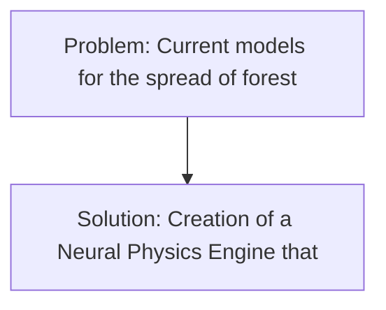
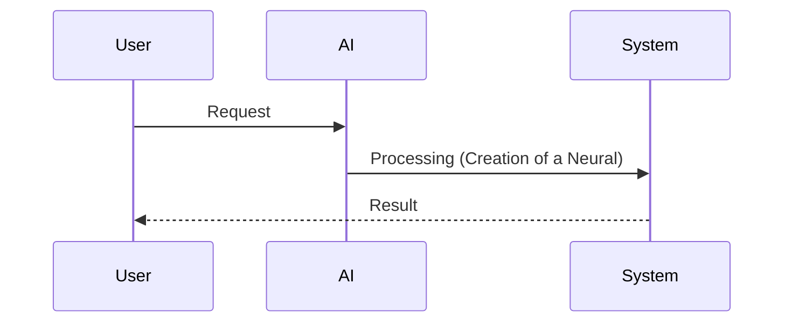

<!-- markdownlint-disable MD013 MD033 MD041 -->

[🇫🇷 Version Française](./README.fr.md)

# Wildfire Neural Twin

> **Executive Summary:** A B2B / B2G solution targeting Government forest management agencies, utilities, and insurance companies specializing in climate risk. to solve the following problem: Current models for the spread of forest fires are slow, based on static data and difficult to model the extreme fire dynamics induced by microclimate. This leads to late evacuations, massive infrastructure losses and incalculable insurance premiums. The approach relies on: Creation of a Neural Physics Engine that ingest LIDAR telemetry data, infrared satellite imagery and IoT wind data in real time to simulate combustion thermodynamics and fluid dynamics at submetric resolution, thousands of times faster than traditional CFD (Computational Fluid Dynamics) models.

---

## 1. Visual Overview & Wow Effect

## 2. Contrarian Thesis (Peter Thiel Style)

- **Popular Belief:** A generic SaaS approach is sufficient.
- **Hidden Truth:** A SaaS or a simple statistical predictive model cannot capture the nonlinearities of fluid mechanics and thermodynamics in real time. We need a world model (World Model) that can extrapolate future states based on physical laws encoded in neuron networks.

## 3. Problem & Target Market

- **Business Model:** B2B / B2G
- **Target Audience:** Government forest management agencies, utilities, and insurance companies specializing in climate risk.
- **Urgent Pain Point:** Current models for the spread of forest fires are slow, based on static data and difficult to model the extreme fire dynamics induced by microclimate. This leads to late evacuations, massive infrastructure losses and incalculable insurance premiums.

## 4. Technical Architecture & Infrastructure

Creation of a Neural Physics Engine that ingest LIDAR telemetry data, infrared satellite imagery and IoT wind data in real time to simulate combustion thermodynamics and fluid dynamics at submetric resolution, thousands of times faster than traditional CFD (Computational Fluid Dynamics) models.

## 5. Business Model & Financial Viability

| Metric                 | Value                              |
| ---------------------- | ---------------------------------- |
| Pricing Structure      | B2B / B2G Subscription / License   |
| 12-Month Target        | 100 clients (or equivalent volume) |
| Revenue Formula        | 100 \* 1000€ = 100k€               |
| Estimated Gross Margin | 80%                                |

## 6. Distribution Engine & Moat

- **Acquisition Strategy:** Direct sales and partnerships in the domain: World Models & Physical Simulation
- **Moat (Defensibility):** A SaaS or a simple statistical predictive model cannot capture the nonlinearities of fluid mechanics and thermodynamics in real time. We need a world model (World Model) that can extrapolate future states based on physical laws encoded in neuron networks. Risks include: Massive need for computing power (GPU) for initial training of the base model, critical and expensive access to real-time satellite/LIDAR data, difficulty of validation in the field during extreme events.

## 7. Detailed Evaluation Grid

| Criterion                   | VC Score (/100) | Market Score (/100) |
| --------------------------- | --------------- | ------------------- |
| Thesis & Monopoly / Urgency | -- / 25         | -- / 25             |
| Moat / LLM Immunity         | -- / 25         | -- / 25             |
| Scalability / UX Friction   | -- / 25         | -- / 25             |
| Unit Economics / ROI        | -- / 25         | -- / 25             |
| **TOTAL**                   | -- / 100        | -- / 100            |

> **VC Verdict:** Pending evaluation.
> **Market Verdict:** Pending evaluation.
