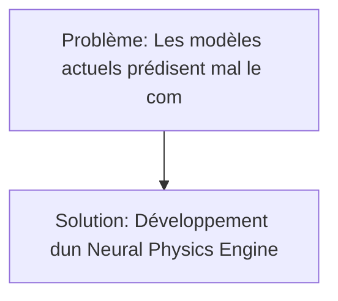
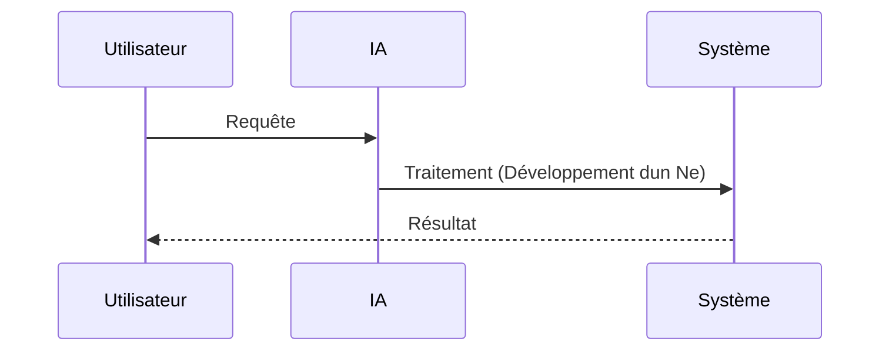

<!-- markdownlint-disable MD013 MD033 MD041 -->

[🇬🇧 English Version](./README.md)

# Wildfire Pyroconvection Twin

> **Résumé exécutif :** Une solution B2B / B2G ciblant Agences forestières, sécurité civile, opérateurs de réseaux électriques, compagnies d'assurance (réassurance) pour résoudre le problème suivant : Les modèles actuels prédisent mal le comportement des mégafeux (incendies de 6ème génération) car ils ignorent le micro-climat créé par le feu lui-même (pyroconvection). Cela entraîne des pertes matérielles et humaines imprévisibles, et les assurances refusent de couvrir ces risques sans modélisation précise. L'approche repose sur : Développement d'un Neural Physics Engine intégrant la dynamique des fluides computationnelle (CFD) en temps réel avec des réseaux de neurones informés par la physique (PINNs). Le système modélise l'interaction complexe entre la topographie, les carburants forestiers et les panaches thermiques générant leur propre météo.

---

## 1. Aperçu visuel & Effet Wahou

## 2. La thèse contrariante (Peter Thiel Style)

- **La croyance populaire :** Une approche générique SaaS classique est suffisante.
- **La vérité cachée :** Un LLM ne comprend pas les équations de Navier-Stokes. Les outils SaaS SIG (Systèmes d'Information Géographique) sont statiques et ne peuvent pas simuler les boucles de rétroaction thermodynamiques non linéaires en temps réel (il faut calculer la physique, pas faire des requêtes en base de données).

## 3. Le problème & La cible

- **Modèle économique :** B2B / B2G
- **Cible précise :** Agences forestières, sécurité civile, opérateurs de réseaux électriques, compagnies d'assurance (réassurance)
- **La douleur urgente :** Les modèles actuels prédisent mal le comportement des mégafeux (incendies de 6ème génération) car ils ignorent le micro-climat créé par le feu lui-même (pyroconvection). Cela entraîne des pertes matérielles et humaines imprévisibles, et les assurances refusent de couvrir ces risques sans modélisation précise.

## 4. Architecture technique & Plomberie

Développement d'un Neural Physics Engine intégrant la dynamique des fluides computationnelle (CFD) en temps réel avec des réseaux de neurones informés par la physique (PINNs). Le système modélise l'interaction complexe entre la topographie, les carburants forestiers et les panaches thermiques générant leur propre météo.

## 5. Modèle économique & Viabilité financière

| Métrique                    | Valeur                             |
| --------------------------- | ---------------------------------- |
| Structure de prix           | Abonnement / Licence B2B / B2G     |
| Objectif 12 mois            | 100 clients (ou volume équivalent) |
| Calcul du CA (Target 100k€) | 100 \* 1000€ = 100k€               |
| Marge brute estimée         | 80%                                |

## 6. Moteur de distribution & Fossé défensif (Moat)

- **Stratégie d'acquisition :** Ventes directes et partenariats dans le domaine : World Models / Simulation physique
- **Moat (Barrière à l'entrée) :** Un LLM ne comprend pas les équations de Navier-Stokes. Les outils SaaS SIG (Systèmes d'Information Géographique) sont statiques et ne peuvent pas simuler les boucles de rétroaction thermodynamiques non linéaires en temps réel (il faut calculer la physique, pas faire des requêtes en base de données). Les risques incluent : Besoin massif en compute (GPU clusters) pour l'entraînement initial, accès aux données satellitaires IR et lidar haute résolution pour calibrer les modèles, temps de validation scientifique (peer-review nécessaire pour rassurer les réassureurs).

## 7. Grille d'évaluation détaillée

| Critère                           | Score VC (/100) | Score Terrain (/100) |
| --------------------------------- | --------------- | -------------------- |
| Thèse & Monopole / Urgence        | -- / 25         | -- / 25              |
| Moat / Résistance aux LLM natifs  | -- / 25         | -- / 25              |
| Scalabilité / Friction d'adoption | -- / 25         | -- / 25              |
| Unit Economics / ROI direct       | -- / 25         | -- / 25              |
| **TOTAL**                         | -- / 100        | -- / 100             |

> **Verdict VC :** En attente d'évaluation.
> **Verdict Terrain :** En attente d'évaluation.
