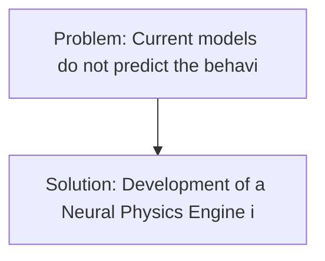
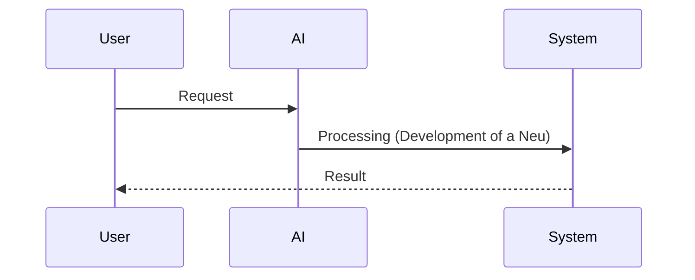

<!-- markdownlint-disable MD013 MD033 MD041 -->

[🇫🇷 Version Française](./README.fr.md)

# Wildfire Pyroconvection Twin

> **Executive Summary:** A B2B / B2G solution targeting Forestry agencies, civil security, electricity operators, insurance companies (reinsurance) to solve the following problem: Current models do not predict the behaviour of megafires (sixth generation fires) because they ignore the microclimate created by the fire itself (pyroconvection). This results in unpredictable material and human losses, and insurance refuses to cover these risks without precise modelling. The approach relies on: Development of a Neural Physics Engine integrating computational fluid dynamics (CFD) in real time with physics-informed neuron networks (PINNs). The system modeled the complex interaction between topography, forest fuels and thermal plumes generating their own weather.

---

## 1. Visual Overview & Wow Effect

## 2. Contrarian Thesis (Peter Thiel Style)

- **Popular Belief:** A generic SaaS approach is sufficient.
- **Hidden Truth:** A LLM does not include the Navier-Stokes equations. SaaS GIS (Geographical Information Systems) tools are static and cannot simulate non-linear thermodynamic feedback loops in real time (you need to calculate physics, not make database queries).

## 3. Problem & Target Market

- **Business Model:** B2B / B2G
- **Target Audience:** Forestry agencies, civil security, electricity operators, insurance companies (reinsurance)
- **Urgent Pain Point:** Current models do not predict the behaviour of megafires (sixth generation fires) because they ignore the microclimate created by the fire itself (pyroconvection). This results in unpredictable material and human losses, and insurance refuses to cover these risks without precise modelling.

## 4. Technical Architecture & Infrastructure

Development of a Neural Physics Engine integrating computational fluid dynamics (CFD) in real time with physics-informed neuron networks (PINNs). The system modeled the complex interaction between topography, forest fuels and thermal plumes generating their own weather.

## 5. Business Model & Financial Viability

| Metric                 | Value                              |
| ---------------------- | ---------------------------------- |
| Pricing Structure      | B2B / B2G Subscription / License   |
| 12-Month Target        | 100 clients (or equivalent volume) |
| Revenue Formula        | 100 \* 1000€ = 100k€               |
| Estimated Gross Margin | 80%                                |

## 6. Distribution Engine & Moat

- **Acquisition Strategy:** Direct sales and partnerships in the domain: World Models / Physical Simulation
- **Moat (Defensibility):** A LLM does not include the Navier-Stokes equations. SaaS GIS (Geographical Information Systems) tools are static and cannot simulate non-linear thermodynamic feedback loops in real time (you need to calculate physics, not make database queries). Risks include: Massive Compute Requirement (GPU clusters) for initial training, access to IR satellite data and high resolution lidar to calibrate models, scientific validation time (peer-review needed to reassure reinsurers).

## 7. Detailed Evaluation Grid

| Criterion                   | VC Score (/100) | Market Score (/100) |
| --------------------------- | --------------- | ------------------- |
| Thesis & Monopoly / Urgency | -- / 25         | -- / 25             |
| Moat / LLM Immunity         | -- / 25         | -- / 25             |
| Scalability / UX Friction   | -- / 25         | -- / 25             |
| Unit Economics / ROI        | -- / 25         | -- / 25             |
| **TOTAL**                   | -- / 100        | -- / 100            |

> **VC Verdict:** Pending evaluation.
> **Market Verdict:** Pending evaluation.
