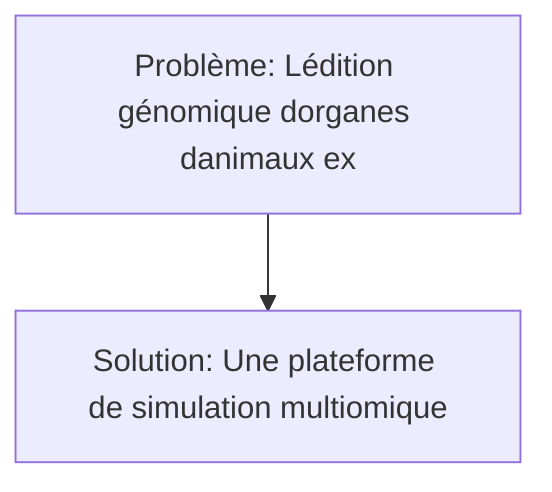
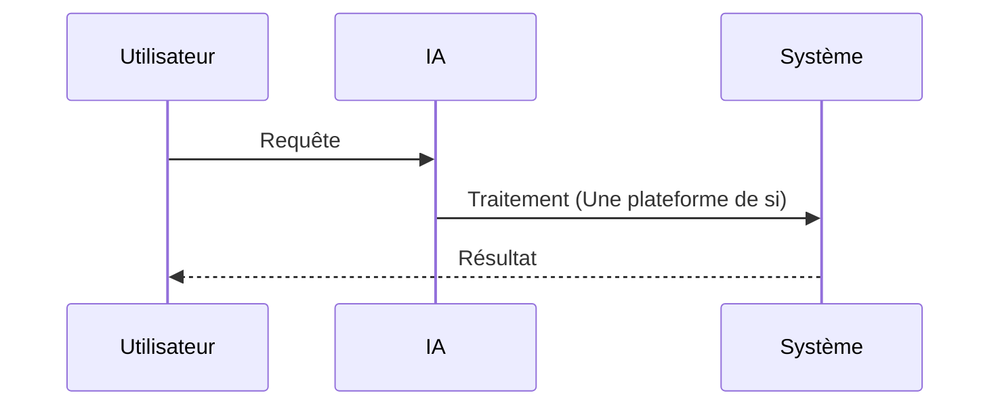

<!-- markdownlint-disable MD013 MD033 MD041 -->

[🇬🇧 English Version](./README.md)

# Xenotransplantation Immune Sim

> **Résumé exécutif :** Une solution B2B ciblant Entreprises de xénotransplantation, instituts de recherche en édition génomique (CRISPR), hôpitaux de recherche pour résoudre le problème suivant : L'édition génomique d'organes d'animaux (ex: cœur de porc) pour la transplantation humaine fait face à la barrière mortelle du rejet hyperaigu et des virus endogènes. Les tests in-vivo sont lents, chers, éthiquement complexes et ne permettent pas de tester des milliers de combinaisons d'éditions génétiques. L'approche repose sur : Une plateforme de simulation multi-omique et d'immunologie in-silico. Elle modélise la cascade du complément humain et l'interaction des antigènes porcins (PERVs, Alpha-gal) avec le système immunitaire humain au niveau moléculaire en utilisant des réseaux de neurones graphiques (GNN) et de la dynamique moléculaire.

---

## 1. Aperçu visuel & Effet Wahou

## 2. La thèse contrariante (Peter Thiel Style)

- **La croyance populaire :** Une approche générique SaaS classique est suffisante.
- **La vérité cachée :** Un LLM ne peut pas modéliser le repliement des protéines ni les réactions en cascade de l'immunologie complexe multi-espèces. Il faut un moteur de physique bio-moléculaire et des données d'entraînement omiques hautement propriétaires.

## 3. Le problème & La cible

- **Modèle économique :** B2B
- **Cible précise :** Entreprises de xénotransplantation, instituts de recherche en édition génomique (CRISPR), hôpitaux de recherche
- **La douleur urgente :** L'édition génomique d'organes d'animaux (ex: cœur de porc) pour la transplantation humaine fait face à la barrière mortelle du rejet hyperaigu et des virus endogènes. Les tests in-vivo sont lents, chers, éthiquement complexes et ne permettent pas de tester des milliers de combinaisons d'éditions génétiques.

## 4. Architecture technique & Plomberie

Une plateforme de simulation multi-omique et d'immunologie in-silico. Elle modélise la cascade du complément humain et l'interaction des antigènes porcins (PERVs, Alpha-gal) avec le système immunitaire humain au niveau moléculaire en utilisant des réseaux de neurones graphiques (GNN) et de la dynamique moléculaire.

## 5. Modèle économique & Viabilité financière

| Métrique                    | Valeur                             |
| --------------------------- | ---------------------------------- |
| Structure de prix           | Abonnement / Licence B2B           |
| Objectif 12 mois            | 100 clients (ou volume équivalent) |
| Calcul du CA (Target 100k€) | 100 \* 1000€ = 100k€               |
| Marge brute estimée         | 80%                                |

## 6. Moteur de distribution & Fossé défensif (Moat)

- **Stratégie d'acquisition :** Ventes directes et partenariats dans le domaine : Biotech & Bio-informatique
- **Moat (Barrière à l'entrée) :** Un LLM ne peut pas modéliser le repliement des protéines ni les réactions en cascade de l'immunologie complexe multi-espèces. Il faut un moteur de physique bio-moléculaire et des données d'entraînement omiques hautement propriétaires. Les risques incluent : Besoin critique de données cliniques de haute qualité (souvent secrètes ou inexistantes), complexité computationnelle extrême de la simulation du système immunitaire humain entier, barrières réglementaires FDA massives.

## 7. Grille d'évaluation détaillée

| Critère                           | Score VC (/100) | Score Terrain (/100) |
| --------------------------------- | --------------- | -------------------- |
| Thèse & Monopole / Urgence        | -- / 25         | -- / 25              |
| Moat / Résistance aux LLM natifs  | -- / 25         | -- / 25              |
| Scalabilité / Friction d'adoption | -- / 25         | -- / 25              |
| Unit Economics / ROI direct       | -- / 25         | -- / 25              |
| **TOTAL**                         | -- / 100        | -- / 100             |

> **Verdict VC :** En attente d'évaluation.
> **Verdict Terrain :** En attente d'évaluation.
