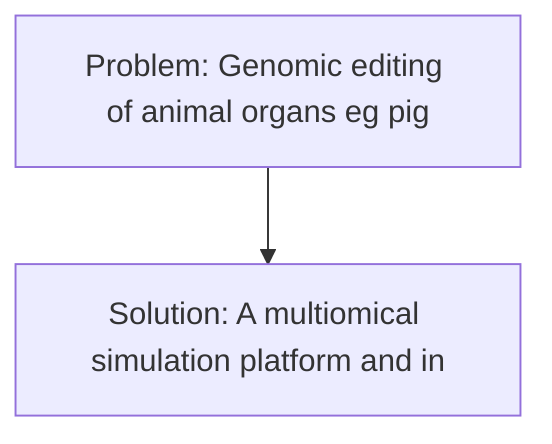
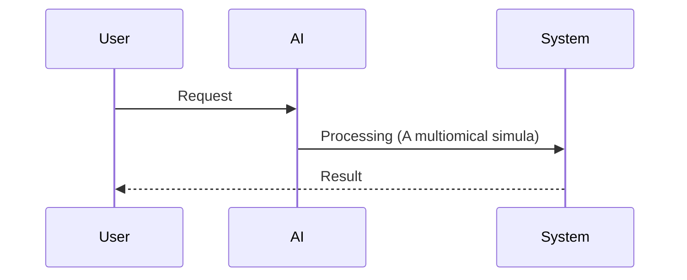

<!-- markdownlint-disable MD013 MD033 MD041 -->

[🇫🇷 Version Française](./README.fr.md)

# Xenotransplantation Immune Sim

> **Executive Summary:** A B2B solution targeting Xenotransplantation companies, genomic publishing research institutes (CRISPR), research hospitals to solve the following problem: Genomic editing of animal organs (e.g. pig heart) for human transplantation faces the deadly barrier of hyperacute rejection and endogenous viruses. In-vivo tests are slow, expensive, ethically complex and do not allow thousands of combinations of genetic editing to be tested. The approach relies on: A multi-omical simulation platform and in-silico immunology. It models the cascade of human complement and the interaction of porcine antigens (PERVs, Alpha-gal) with the human immune system at the molecular level using graphical neuron (GNN) networks and molecular dynamics.

---

## 1. Visual Overview & Wow Effect

## 2. Contrarian Thesis (Peter Thiel Style)

- **Popular Belief:** A generic SaaS approach is sufficient.
- **Hidden Truth:** LLM cannot model protein folding or cascade reactions of complex multi-species immunology. It requires a biomolecular physics motor and highly proprietary omic drive data.

## 3. Problem & Target Market

- **Business Model:** B2B
- **Target Audience:** Xenotransplantation companies, genomic publishing research institutes (CRISPR), research hospitals
- **Urgent Pain Point:** Genomic editing of animal organs (e.g. pig heart) for human transplantation faces the deadly barrier of hyperacute rejection and endogenous viruses. In-vivo tests are slow, expensive, ethically complex and do not allow thousands of combinations of genetic editing to be tested.

## 4. Technical Architecture & Infrastructure

A multi-omical simulation platform and in-silico immunology. It models the cascade of human complement and the interaction of porcine antigens (PERVs, Alpha-gal) with the human immune system at the molecular level using graphical neuron (GNN) networks and molecular dynamics.

## 5. Business Model & Financial Viability

| Metric                 | Value                              |
| ---------------------- | ---------------------------------- |
| Pricing Structure      | B2B Subscription / License         |
| 12-Month Target        | 100 clients (or equivalent volume) |
| Revenue Formula        | 100 \* 1000€ = 100k€               |
| Estimated Gross Margin | 80%                                |

## 6. Distribution Engine & Moat

- **Acquisition Strategy:** Direct sales and partnerships in the domain: Biotech & Bioinformatics
- **Moat (Defensibility):** LLM cannot model protein folding or cascade reactions of complex multi-species immunology. It requires a biomolecular physics motor and highly proprietary omic drive data. Risks include: Critical need for high quality clinical data (often secret or non-existent), extreme computational complexity of simulation of the entire human immune system, massive FDA regulatory barriers.

## 7. Detailed Evaluation Grid

| Criterion                   | VC Score (/100) | Market Score (/100) |
| --------------------------- | --------------- | ------------------- |
| Thesis & Monopoly / Urgency | -- / 25         | -- / 25             |
| Moat / LLM Immunity         | -- / 25         | -- / 25             |
| Scalability / UX Friction   | -- / 25         | -- / 25             |
| Unit Economics / ROI        | -- / 25         | -- / 25             |
| **TOTAL**                   | -- / 100        | -- / 100            |

> **VC Verdict:** Pending evaluation.
> **Market Verdict:** Pending evaluation.
