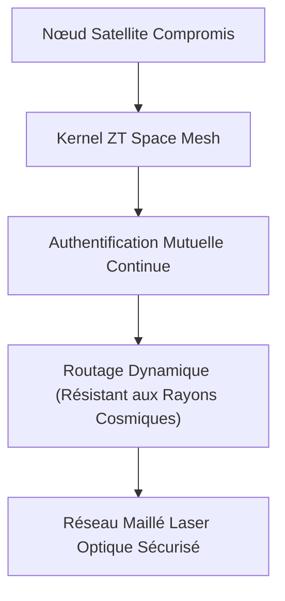
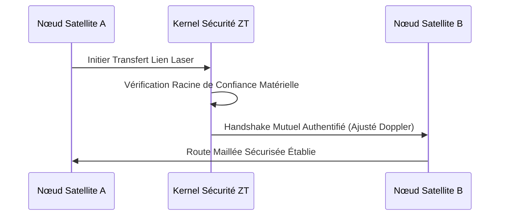

<!-- markdownlint-disable MD009 MD010 MD013 MD022 MD028 MD032 MD033 MD034 MD036 MD037 MD039 MD041 MD058 MD060 -->

[🇬🇧 English Version](./README.md)

# Space Mesh ZT

> **Résumé exécutif :** Une infrastructure de sécurité Zero-Trust ultra-légère pour les systèmes d'exploitation temps réel (RTOS) des constellations de satellites en orbite basse (LEO).

---

## 1. Aperçu visuel & Effet Wahou

## 2. La thèse contrariante (Peter Thiel Style)

La croyance populaire : Les réseaux spatiaux peuvent utiliser les mêmes architectures de sécurité Zero-Trust cloud que les réseaux d'entreprise terrestres.
La vérité cachée : L'espace impose des contraintes SWaP (Taille, Poids, Puissance) extrêmes et des retards Doppler. Les solutions ZT terrestres (ex: Zscaler) ne fonctionnent tout simplement pas en orbite.

## 3. Le problème & La cible

Modèle économique : B2B
Cible précise : Opérateurs de constellations LEO, Agences spatiales, Télécoms (CISO, Space Systems Engineers).
La douleur urgente : Les réseaux spatiaux (LEO) communiquant par laser optique sont vulnérables à l'usurpation et la prise de contrôle de nœuds, menaçant l'intégrité du réseau mondial.

## 4. Architecture technique & Plomberie

## 5. Modèle économique & Viabilité financière

| Métrique                    | Valeur                                         |
| --------------------------- | ---------------------------------------------- |
| Structure de prix           | Licence logicielle par satellite + maintenance |
| Objectif 12 mois            | 2 constellations sécurisées (200 nœuds)        |
| Calcul du CA (Target 100k€) | 200 nœuds \* 5k€/nœud                          |
| Marge brute estimée         | 90%                                            |

## 6. Moteur de distribution & Fossé défensif (Moat)

Stratégie d'acquisition : Intégration avec les fabricants de bus satellitaires et ventes directes aux opérateurs.
Moat (Barrière à l'entrée) : Développer un kernel de sécurité pour des RTOS spatiaux contraints, tenant compte de la physique orbitale (retards Doppler, bit flips par rayons cosmiques), constitue une immense barrière à l'entrée.

## 7. Grille d'évaluation détaillée

| Critère                           | Score VC (/100) | Score Terrain (/100) |
| --------------------------------- | --------------- | -------------------- |
| Thèse & Monopole / Urgence        | -- / 25         | 22 / 25              |
| Moat / Résistance aux LLM natifs  | -- / 25         | 23 / 25              |
| Scalabilité / Friction d'adoption | -- / 25         | 14 / 25              |
| Unit Economics / ROI direct       | -- / 25         | 18 / 25              |
| **TOTAL**                         | **-- / 100**    | **77 / 100**         |

> **Verdict VC :** En attente d'évaluation.
> **Verdict Terrain :** La sécurisation des communications satellitaires est cruciale face à la militarisation de l'espace. L'architecture réseau en orbite est intouchable par les IA terrestres. Néanmoins, l'adoption se heurte à des barrières massives (lancements spatiaux, hardware spécifique), limitant les clients potentiels et rendant la monétisation complexe.
